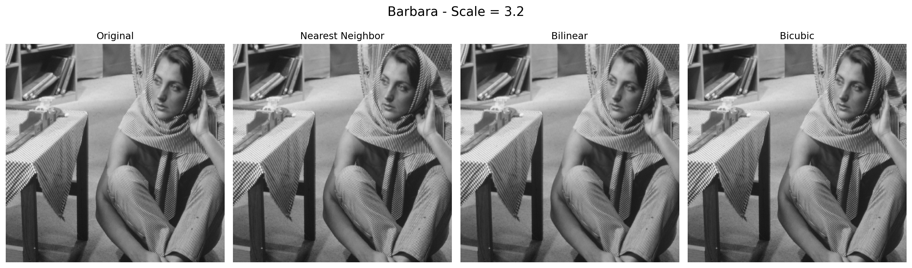
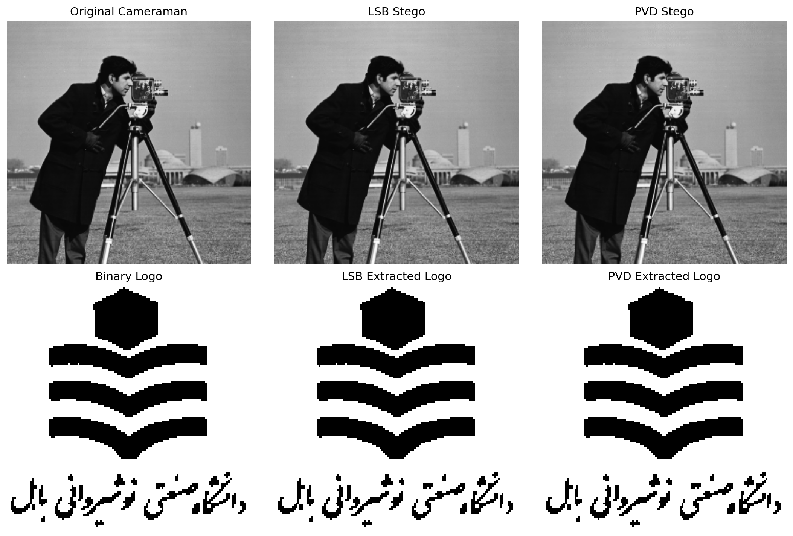
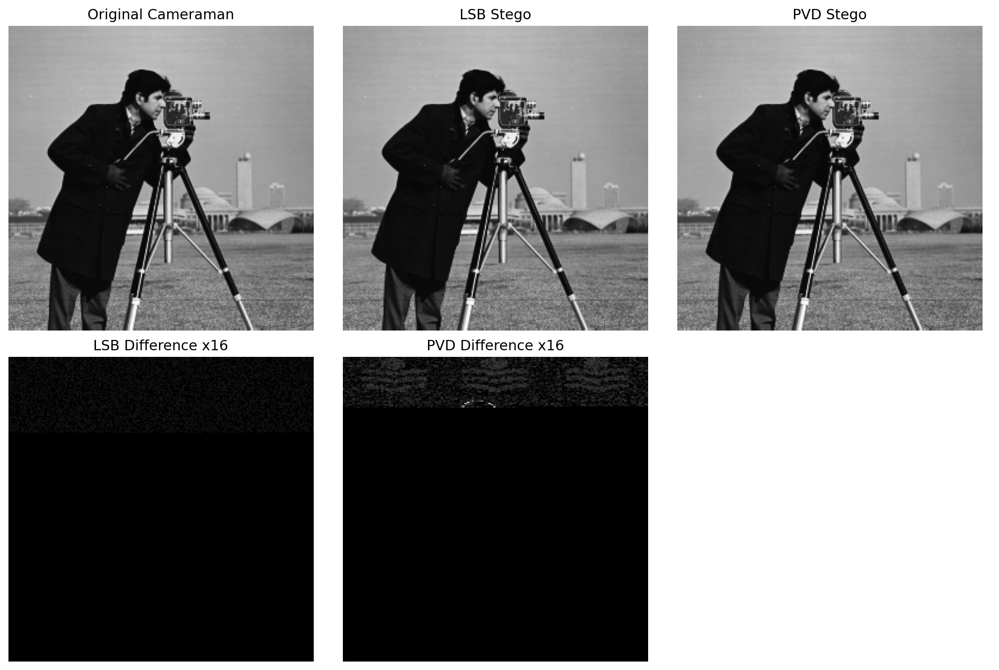
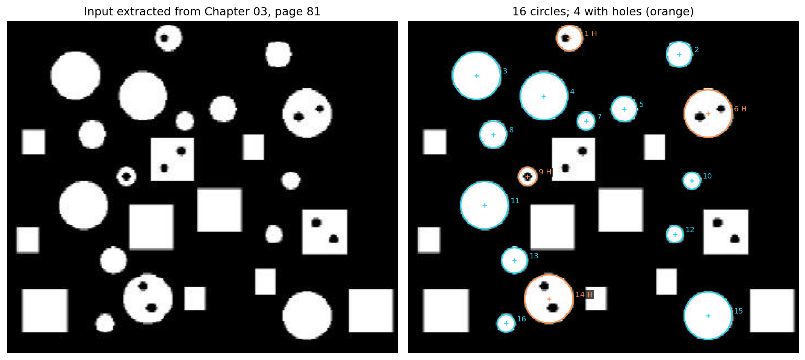
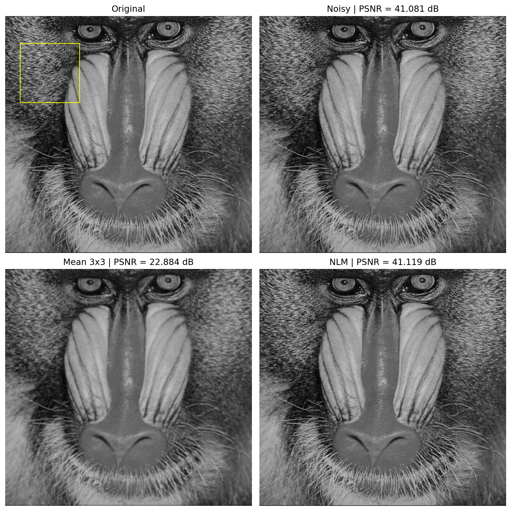
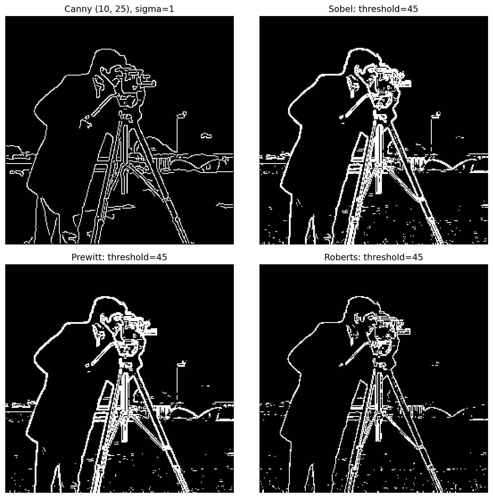
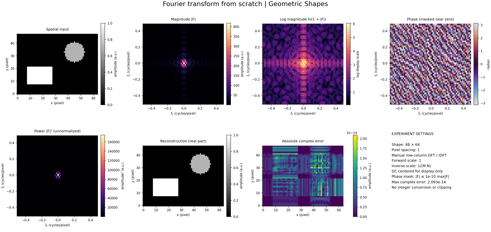

# Computer Vision Fundamentals Lab

A growing portfolio of **digital image processing and computer vision algorithms implemented primarily from scratch with NumPy**. The repository is organized by assignment and independent chapter lab so new experiments can be added without turning the project into a collection of unrelated `Q1/Q2/...` folders.

The core algorithms are implemented directly; Pillow is used for image I/O, Matplotlib for visualization, and `scikit-image` and NumPy FFT provide independent numerical references in selected tests and experiments.

## Highlights

| Topic | What is implemented | Representative result |
| --- | --- | --- |
| Image interpolation | Nearest Neighbor, Bilinear, Bicubic resizing with inverse mapping | Bicubic gives smoother enlargement at a higher runtime cost |
| Image steganography | LSB and Pixel Value Differencing (PVD) embedding/extraction | Clean extraction is exact for both methods |
| Image quality | MSE, PSNR, difference maps | LSB: MSE `0.1248`, PSNR `57.17 dB`; PVD: MSE `0.5148`, PSNR `51.01 dB` |
| Noise robustness | Gaussian-noise attack and BER analysis | PVD preserves more hidden bits than LSB at variance `1` and `10` |
| Circular Hough | Circle detection, radius/area estimation, hole classification | `16` circular parts detected; `4` classified as having holes |
| Image denoising | Gaussian noise, 3x3 mean filter, Non-Local Means | NLM preserves texture and slightly improves PSNR on the tested Baboon image |
| Fourier transform | Manual 1D/2D DFT and inverse, row-column separability, analytical pytest checks | Six synthetic experiments with reconstruction, spectra, and runtime comparisons |
| Edge detection | Canny, Sobel, Prewitt, Roberts | Canny parameter sweep plus stage-by-stage implementation |

## Selected results

### Interpolation



### Steganography and quality evaluation





### Circular Hough detection



### Denoising



### Edge detection



### Fourier transform from scratch

[Chapter 04 · Lab 01](chapter-labs/chapter-04-frequency-domain/01-fourier-transform/README.md) adds direct and separable Fourier transforms with complex-input support, NumPy reference comparisons, and reproducible synthetic experiments.



## Repository structure

```text
computer-vision-fundamentals-lab/
├── assignments/
│   ├── assignment-01/
│   │   ├── 01-interpolation-algorithms/
│   │   ├── 02-resize-experiments/
│   │   ├── 03-image-steganography/
│   │   ├── 04-quality-metrics/
│   │   └── 05-noise-robustness/
│   └── assignment-02/
│       ├── 01-circular-hough/
│       ├── 02-nlm-denoising/
│       └── 03-edge-detection/
├── chapter-labs/
│   └── chapter-04-frequency-domain/
│       └── 01-fourier-transform/
├── docs/
├── scripts/
├── .github/workflows/
└── requirements.txt
```

Each experiment remains self-contained with its own code, input images, generated outputs, and tests. This keeps the original coursework logic easy to inspect while the repository itself stays readable and extensible.

## Setup

Tested with Python 3.12.

```bash
python -m venv .venv
# Linux/macOS
source .venv/bin/activate
# Windows PowerShell
# .\.venv\Scripts\Activate.ps1

python -m pip install --upgrade pip
python -m pip install -r requirements.txt
```

For Windows PowerShell, use this activation command instead of `source`:

```powershell
.\.venv\Scripts\Activate.ps1
```

Run this from the repository root after creating `.venv`. If PowerShell execution policy blocks activation, use `.\.venv\Scripts\python.exe` in place of `python` for the commands below; activation is optional.

## Validate the whole repository

```bash
python scripts/validate_repository.py
```

By default this runs every assignment test suite against the committed outputs and the Fourier lab pytest suite. To regenerate all experiment outputs first, use `python scripts/validate_repository.py --regenerate`.

## Run an experiment directly

For example:

```bash
cd assignments/assignment-02/03-edge-detection
python edge_comparison.py
python test.py
```

See the assignment-level READMEs for the purpose, algorithms, and main findings of each series.

## Assignments

- **[Assignment 01](assignments/assignment-01/README.md)** - interpolation, resizing, steganography, MSE/PSNR, and Gaussian-noise robustness.
- **[Assignment 02](assignments/assignment-02/README.md)** - Circular Hough Transform, NLM denoising, and edge detection.

## Independent chapter labs

- **[Chapter 04 · Lab 01: Fourier Transform From Scratch](chapter-labs/chapter-04-frequency-domain/01-fourier-transform/README.md)** — manual forward/inverse transforms, mathematical validation, centered spectra, reconstruction, and performance measurements. See its README for regeneration commands and measured results.

## Adding future assignments

The repository is intentionally designed to grow. Add a new folder such as `assignments/assignment-03/`, give its questions descriptive names, add a short assignment README, and register its demos/tests in `scripts/validate_repository.py`.

A concrete template is available in **[docs/ADDING_ASSIGNMENTS.md](docs/ADDING_ASSIGNMENTS.md)**.

## Notes on coursework assets

This portfolio copy intentionally excludes the original university submission reports because they contain personal/course-submission information. Some input images are standard benchmark or course-provided assets and may have separate redistribution terms; see **[docs/ASSET_NOTICE.md](docs/ASSET_NOTICE.md)**.
