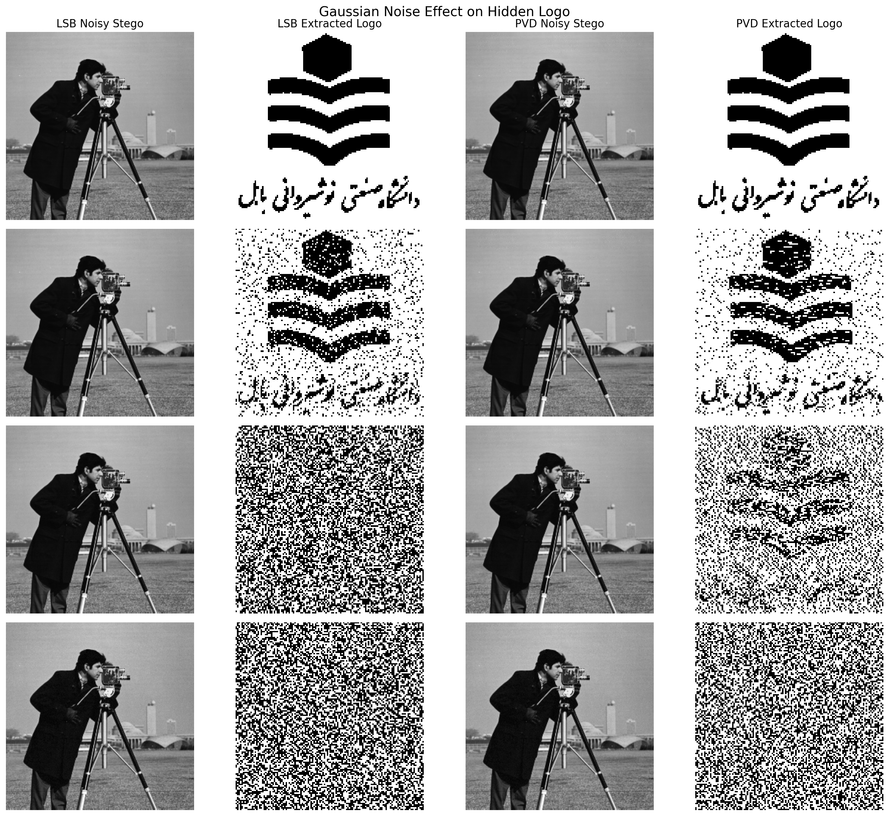

# Assignment 01 - Interpolation, Steganography, and Robustness

This assignment covers the foundations of digital-image representation and evaluation: interpolation, resizing, information hiding, image-quality metrics, and robustness to Gaussian noise.

## Experiments

### 1. Interpolation algorithms

`01-interpolation-algorithms/`

Implements **Nearest Neighbor**, **Bilinear**, and **Bicubic** interpolation directly with NumPy. The implementation uses inverse mapping from output pixels to continuous source coordinates and includes explicit border handling and dtype restoration.

### 2. Resize experiments

`02-resize-experiments/`

Applies all three interpolation methods to Barbara and Pepper at scale factors `3.2x` and `0.2x`, saves side-by-side visual comparisons, and records runtime measurements.

The observed speed ordering is consistently:

`Nearest Neighbor < Bilinear < Bicubic`

Nearest Neighbor is fastest but visibly blockier; Bilinear is smoother; Bicubic is the most computationally expensive and generally produces smoother enlargement.

### 3. Image steganography

`03-image-steganography/`

Implements two embedding/extraction methods:

- **LSB (Least Significant Bit)**
- **PVD (Pixel Value Differencing)**

For the clean stego images, the hidden binary logo is recovered exactly by both methods.

### 4. MSE and PSNR

`04-quality-metrics/`

MSE and PSNR are implemented directly and cross-checked against `scikit-image` in the test suite.

| Method | MSE | PSNR | Max pixel change |
| --- | ---: | ---: | ---: |
| LSB | 0.124756 | 57.170 dB | 1 |
| PVD | 0.514832 | 51.014 dB | 15 |

For this experiment, LSB creates less distortion in the host image.

### 5. Gaussian-noise robustness

`05-noise-robustness/`

The stego images are attacked with zero-mean Gaussian noise at variances `0.01`, `0.1`, `1`, and `10`. The extracted logo is evaluated with MSE, PSNR, wrong-bit count, and BER.

A useful result is that **imperceptibility and robustness are not the same objective**: LSB has better clean-image fidelity, while PVD preserves more hidden bits at the stronger tested noise levels.

## Key figure



## Testing

Every question includes a standalone `test.py`. From the repository root, run all assignments with:

```bash
python scripts/validate_repository.py
```
