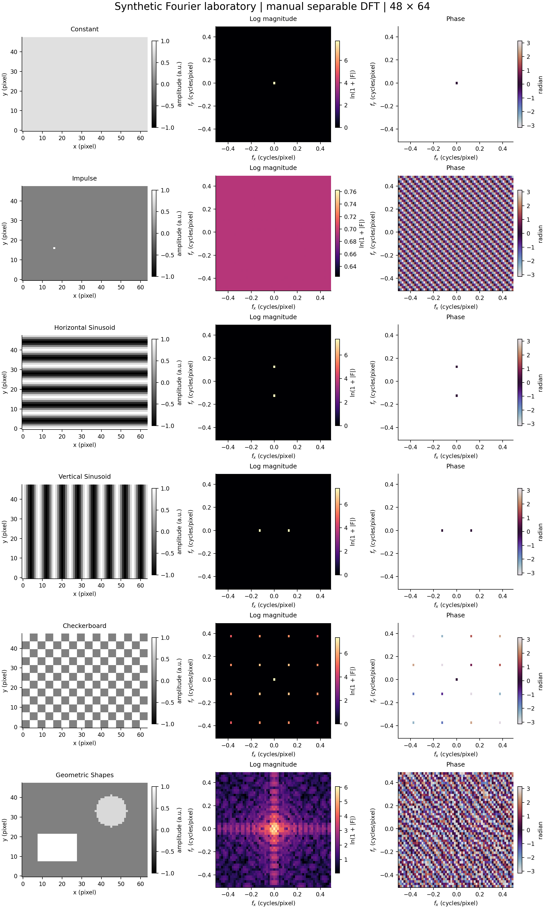
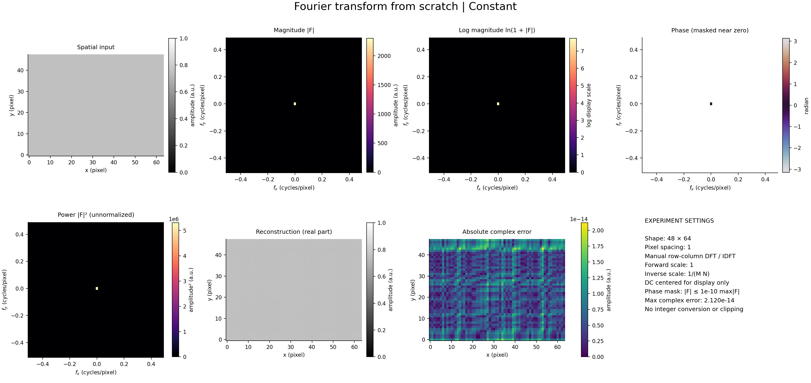
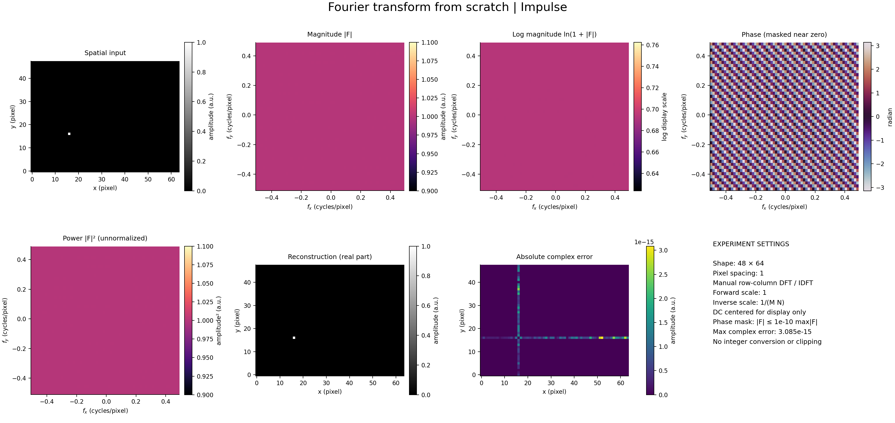
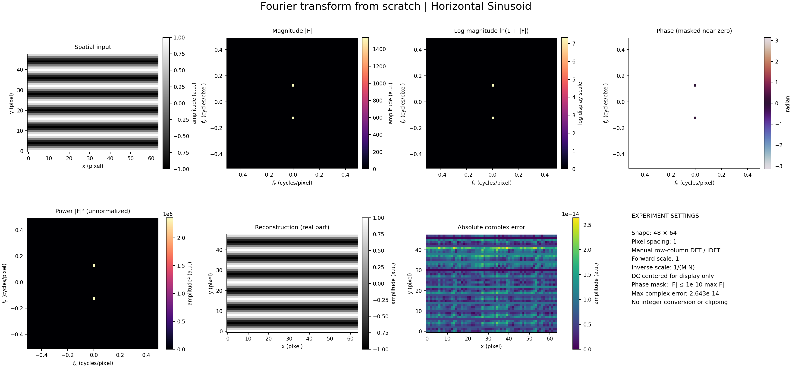
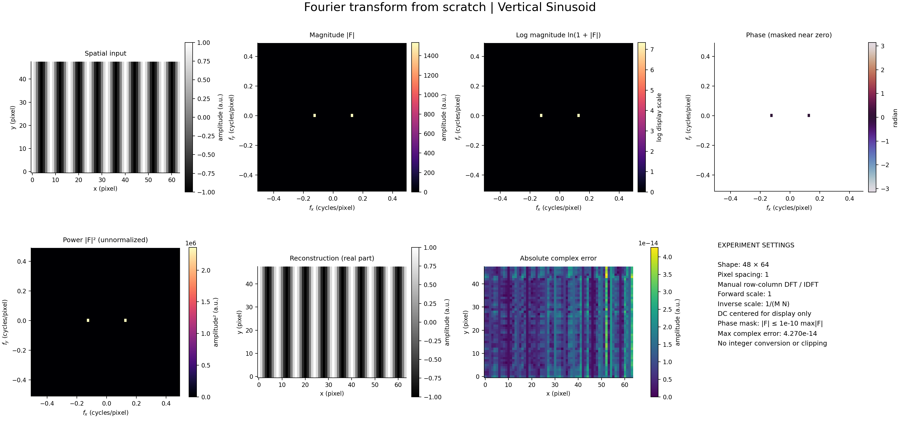
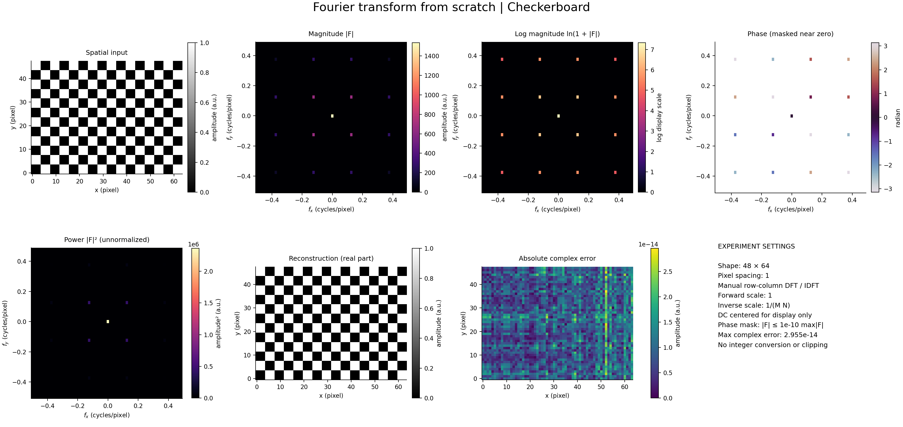
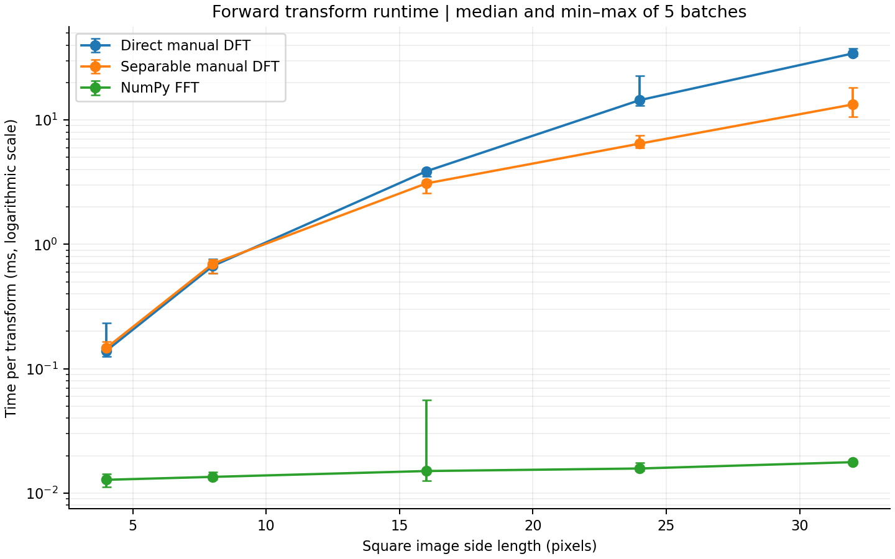

# Chapter 04 · Lab 01 — Fourier Transform From Scratch

This independent laboratory implements and validates the discrete Fourier transform (DFT) directly from its finite-sum definitions. It connects spatial structures to magnitude, phase, and energy, verifies reconstruction, and measures the cost of direct evaluation versus row-column separability and NumPy FFT. Only Lab 01 is implemented.

## Mathematical background and convention

For a length-$N$ signal, with $j^2=-1$:

$$
F[k] = \sum_{n=0}^{N-1} f[n] e^{-j2\pi kn/N},\qquad k=0,\ldots,N-1,
$$

$$
f[n] = \frac{1}{N}\sum_{k=0}^{N-1} F[k] e^{+j2\pi kn/N}.
$$

For an $M\times N$ image, $m$ indexes rows and $n$ indexes columns:

$$
F[u,v] = \sum_{m=0}^{M-1}\sum_{n=0}^{N-1} f[m,n]
 e^{-j2\pi(um/M+vn/N)},
$$

$$
f[m,n] = \frac{1}{MN}\sum_{u=0}^{M-1}\sum_{v=0}^{N-1} F[u,v]
 e^{+j2\pi(um/M+vn/N)}.
$$

All functions use NumPy's default **backward normalization**: no forward scale and inverse scale $1/N$ or $1/(MN)$. The supplied Chapter 04 slides show several conventions: page 2 includes forward-normalized and unitary 1D pairs; page 5 presents a unitary 2D pair alongside a forward-normalized DC formula; pages 36–38 use forward-normalized property tables. Consequently, their scale factors cannot be mixed. Here $F[0,0]=\sum f$, and the mean is $F[0,0]/(MN)$. The slides are a conceptual source and are not redistributed.

Separability factors the exponential into row and column terms:

$$
G[m,v]=\sum_{n=0}^{N-1}f[m,n]e^{-j2\pi vn/N},\qquad
F[u,v]=\sum_{m=0}^{M-1}G[m,v]e^{-j2\pi um/M}.
$$

The inverse uses positive exponents and divides the final result by $MN$. This is a separable **DFT**, with no FFT butterfly decomposition.

Useful properties under this convention are:

$$
\sum_{m,n}|f[m,n]|^2=\frac{1}{MN}\sum_{u,v}|F[u,v]|^2,
\qquad F[(-u)\bmod M,(-v)\bmod N]=\overline{F[u,v]}\quad\text{for real }f.
$$

Linearity holds for complex coefficients. An origin impulse transforms to ones; a displaced impulse has unit magnitude and a phase ramp. A bin-aligned complex exponential concentrates at its signed frequency bin, while a real cosine has two conjugate peaks.

## Implementation and API

[Implementation](fourier.py) is independent of the [experiment runner](experiment.py). The manual module uses only NumPy array operations, complex exponentials, and explicit defining sums. It contains no FFT-library calls. Each direct 2D output bin sums over the complete input without factoring its kernel; the separable version computes each row's manual 1D transform and then each column's transform.

| Function | Input | Output | Normalization |
| --- | --- | --- | --- |
| `dft_1d` | Numeric array-like, shape `(N,)` | `complex128`, shape `(N,)` | None |
| `idft_1d` | Complex or real spectrum, shape `(N,)` | `complex128`, shape `(N,)` | $1/N$ |
| `dft_2d` | Numeric array-like, shape `(M,N)` | `complex128`, same shape | None |
| `idft_2d` | Complex or real spectrum, shape `(M,N)` | `complex128`, same shape | $1/(MN)$ |
| `dft_2d_separable` | Numeric array-like, shape `(M,N)` | `complex128`, same shape | None |
| `idft_2d_separable` | Complex or real spectrum, shape `(M,N)` | `complex128`, same shape | $1/(MN)$ |

Boolean, integer, floating, and complex inputs are promoted to `complex128`. Inputs are not mutated. Results keep their complex part, including small numerical residue. DC is returned at index zero. Odd/even sizes, singleton axes, non-contiguous arrays, and rectangular images are supported; no power-of-two requirement exists.

Empty, scalar, ragged, wrong-rank, or nonfinite inputs raise `ValueError`. Strings and object arrays raise `TypeError`. No implicit grayscale conversion, resizing, padding, or truncation occurs.

## Installation and execution

From the repository root, using Python 3.12:

```bash
python -m venv .venv
source .venv/bin/activate
python -m pip install -r requirements.txt

# New lab tests only
python -m pytest -q chapter-labs/chapter-04-frequency-domain/01-fourier-transform/tests

# Recreate all Lab 01 figures, raw arrays, CSV tables, and JSON metadata
python chapter-labs/chapter-04-frequency-domain/01-fourier-transform/experiment.py

# Existing assignment suites plus new lab tests, using saved outputs
python scripts/validate_repository.py

# Reproduce the full CI regeneration flow (also rewrites existing assignment outputs)
python scripts/validate_repository.py --regenerate
```

On Windows PowerShell, activate with:

```powershell
.\.venv\Scripts\Activate.ps1
```

Run this from the repository root after creating `.venv`. If PowerShell execution policy blocks activation, use `.\.venv\Scripts\python.exe` in place of `python` for the commands above; activation is optional.

Optional runner arguments are `--output-dir PATH` and `--repeats 5`; the latter controls runtime measurement batches and must be positive. NumPy and Matplotlib are the only dependencies used by the runner; pytest is the only added repository dependency. NumPy FFT is used solely for verification and benchmarking; `fftshift`, `ifftshift`, and `fftfreq` are display/indexing helpers.

For interactive Python use, add this lab directory to the module search path, then:

```python
import numpy as np
from fourier import dft_1d, idft_1d

signal = np.array([1, 2, 3, 4], dtype=np.float64)
spectrum = dft_1d(signal)
reconstructed = idft_1d(spectrum)
np.testing.assert_allclose(reconstructed, signal, rtol=1e-10, atol=1e-10)
```

## Numerical validation

The [pytest suite](tests/test_fourier.py) uses fixed seed `404` for reference tests, `405` for property tests, and `406` for separability. It tests real and complex data, odd/even lengths, both rectangular orientations, singleton axes, dtype promotion, and invalid inputs. Forward transforms are compared to `np.fft.fftn`; inverse transforms are compared to `np.fft.ifftn` using arbitrary frequency data. Analytical expectations are constructed independently for constants, impulses, sine/cosine signals, and complex exponentials. Further checks cover both round-trip directions, linearity of forward and inverse transforms, Parseval normalization, conjugate symmetry, direct/separable equivalence, and centering/uncentering on odd and even shapes.

Every numerical comparison uses `rtol=1e-10, atol=1e-10`; no tolerance was relaxed. Absolute error is especially informative for theoretically zero bins. `complex128` reduces rounding but does not make evaluating complex exponentials exact.

Actual standalone test output (Python 3.12.14, NumPy 2.3.5, pytest 8.4.2):

```text
119 passed in 0.20s
```

Six visual experiments were additionally checked against NumPy using the same tolerance. The table below is a snapshot of the reviewed run; errors include complex residue and are absolute maxima unless stated otherwise.

| Input | Direct vs NumPy | Separable vs NumPy | Direct reconstruction | Separable reconstruction | Parseval relative error |
| --- | ---: | ---: | ---: | ---: | ---: |
| constant | 6.374e-12 | 6.973e-12 | 5.285e-14 | 2.120e-14 | 0.000e+00 |
| impulse | 3.472e-14 | 3.332e-14 | 6.967e-15 | 3.085e-15 | 0.000e+00 |
| horizontal_sinusoid | 6.729e-12 | 1.175e-11 | 3.061e-14 | 2.643e-14 | 2.961e-15 |
| vertical_sinusoid | 9.358e-12 | 7.949e-12 | 5.444e-14 | 4.270e-14 | 1.480e-16 |
| checkerboard | 6.635e-12 | 6.878e-12 | 4.827e-14 | 2.955e-14 | 1.332e-15 |
| geometric_shapes | 3.688e-12 | 2.839e-12 | 2.757e-14 | 2.093e-14 | 0.000e+00 |

Full values, MSE, energies, and imaginary residue are saved in [numerical_results.csv](output/numerical_results.csv) and [metrics.json](output/metrics.json).

## Visual experiments

The deterministic inputs are 48 rows × 64 columns with unit pixel spacing and arbitrary amplitude units:

| Input | Definition / interpretation |
| --- | --- |
| Constant | Value 0.75; only DC, expected coefficient 2304 |
| Impulse | Value 1 at row 16, column 16; flat magnitude with a phase ramp |
| Horizontal sinusoid | Horizontal stripes, cosine varying over rows, 6 cycles/image; peaks at $f_y=\pm0.125$ cycles/pixel |
| Vertical sinusoid | Vertical stripes, cosine varying over columns, 8 cycles/image; peaks at $f_x=\pm0.125$ cycles/pixel |
| Checkerboard | Alternating 4×4 blocks valued 0/1; DC and repeated harmonics |
| Geometric shapes | Rectangle at rows 8–21, columns 8–27, value 1; disk of radius 8 at row 33, column 45, value 0.7 |



Each detailed figure contains input, magnitude, natural-log magnitude `ln(1+|F|)`, phase in radians, unnormalized power `|F|²`, real reconstruction, and absolute **complex** error. Reconstruction and input share a display range. Spectra are centered only for display using `fftshift`; `ifftshift` explicitly restores the original ordering before inverse evaluation. Horizontal frequency is the column frequency; vertical frequency is the row frequency. Spatial plots use the same lower-left origin as the frequency plots.

Phase is undefined where magnitude is zero. White phase pixels mask bins at or below `1e-10 * max(|F|)`, solely for display. Neither the stored spectra nor reconstruction is thresholded. Raw magnitude/power retain rounding residue; log scaling exposes weaker components. Error maps use per-case scales, so compare their labeled colorbars rather than color alone. Unnormalized power is not a power spectral density; dividing its sum by $MN$ gives spatial energy.








## Performance and computational complexity

Each benchmark includes input validation, output allocation, and kernel evaluation. Each function is warmed up once per size, then timed over five batches with `time.perf_counter`. Manual methods run once per batch; NumPy runs 100 times per batch and elapsed time is divided by 100 to reduce timer overhead. Reported medians and min–max ranges are descriptive observations on a shared x86_64 host. No timing is a CI pass/fail criterion and no measured timing is extrapolated to larger images.

| Image shape | Direct DFT (ms) | Separable DFT (ms) | NumPy FFT (ms) |
| --- | ---: | ---: | ---: |
| 4 × 4 | 0.1390 | 0.1466 | 0.0128 |
| 8 × 8 | 0.6706 | 0.6994 | 0.0135 |
| 16 × 16 | 3.8680 | 3.0889 | 0.0151 |
| 24 × 24 | 14.4345 | 6.4545 | 0.0158 |
| 32 × 32 | 34.2943 | 13.3428 | 0.0177 |

At 32 × 32, the direct implementation was 2.57 times slower than separability and 1933 times slower than NumPy FFT in this run. See [runtime.csv](output/runtime.csv) for all measured ranges.



| Method | Time for $M\times N$ | Square $L\times L$ | Auxiliary memory, excluding input/output |
| --- | --- | --- | --- |
| Manual 1D DFT / IDFT | $O(N^2)$ for length $N$ | — | $O(N)$ |
| Direct 2D DFT / IDFT | $O(M^2N^2)$ | $O(L^4)$ | $O(MN)$ |
| Separable 2D DFT / IDFT | $O(MN(M+N))$ | $O(L^3)$ | $O(MN)$ |
| FFT, typical efficient lengths | $O(MN(\log M+\log N))$ | $O(L^2\log L)$ | Implementation dependent |

The direct definition evaluates $MN$ input terms for each of $MN$ output bins. Doubling both dimensions multiplies that term count by 16; separability reduces it to row and column sums, whose count grows by 8 for square inputs. Large images remain impractical with either manual algorithm. NumPy's optimized FFT is appropriate for production-size images. Python-loop overhead and vectorized inner sums influence the small-size crossover; measured times alone do not estimate asymptotic exponents or isolate language overhead from algorithmic gains.

## Output files and reproducibility

| Path | Contents |
| --- | --- |
| [fourier.py](fourier.py) | Importable manual transforms and input validation |
| [experiment.py](experiment.py) | Synthetic generation, numerical comparison, figures, benchmarking |
| [tests/](tests/) | pytest import setup and mathematical tests |
| [output/metrics.json](output/metrics.json) | Numerical results, timing samples summarized by min/median/max, software and host metadata |
| [output/numerical_results.csv](output/numerical_results.csv) | Six input comparisons, reconstruction error/MSE, imaginary residue, Parseval energy |
| [output/runtime.csv](output/runtime.csv) | Five image sizes, median/min/max seconds for three methods |
| [output/arrays.npz](output/arrays.npz) | Full precision inputs, unshifted manual spectra, complex reconstructions |
| [output/](output/) | Eight 180-DPI PNG figures and the numerical artifacts above |

Inspect raw arrays using `np.load("output/arrays.npz")`. Synthetic data and seeds reproduce mathematical inputs; timings vary with hardware and load, and last-bit results may vary by platform. README tables record the reviewed run; rerunning the experiment updates the machine-readable results and figures, not the README snapshot.

## Edge cases and limitations

The API operates on finite 1D or 2D numeric arrays only. It does not accept image channels, arbitrary transform axes, alternate normalization modes, or arbitrary precision. Very large finite amplitudes can overflow products or sums; the implementation does not promise overflow-free arithmetic. Promoting large integers to double precision can lose exact integer representation. Direct phase evaluation accumulates rounding error as size grows, so the stated tolerance is validated for the documented small cases, not promised for every size and dynamic range.

The DFT assumes periodic extension. Bin-aligned sinusoids avoid leakage here; arbitrary frequencies or discontinuous boundaries generally spread energy between bins. No windowing, padding, filtering, convolution, or later chapter lab is implemented. All added images are project-generated synthetic inputs. No coursework PDF or third-party image is added.

## References

1. Supplied *Chapter 04: Image Enhancement in the Frequency Domain* slides: pages 2–5 (DFT, inverse, polar representation, centering) and 36–39 (properties, separability, inverse computation, transform pairs). Consulted locally; not redistributed. Normalization differences are reconciled above.
2. NumPy, [Discrete Fourier Transform: definitions, normalization, spectrum, and phase](https://numpy.org/doc/2.3/reference/routines.fft.html). Used as an independent computational reference, not as the manual algorithm.
3. NumPy, [fftshift](https://numpy.org/doc/2.3/reference/generated/numpy.fft.fftshift.html) and [ifftshift](https://numpy.org/doc/2.3/reference/generated/numpy.fft.ifftshift.html), for display ordering and its inverse.
