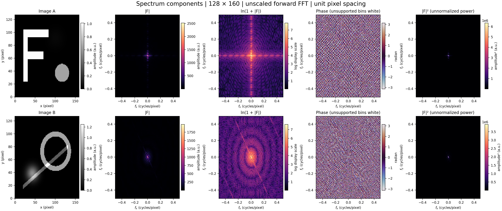
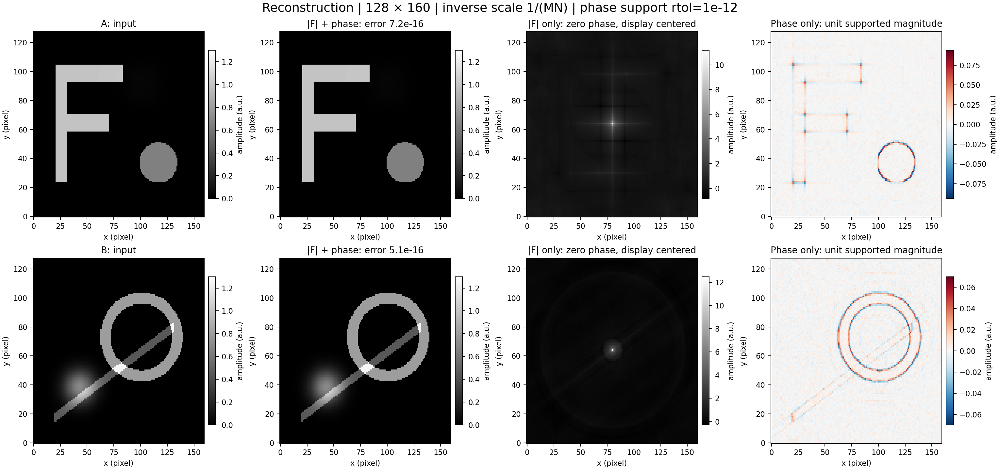
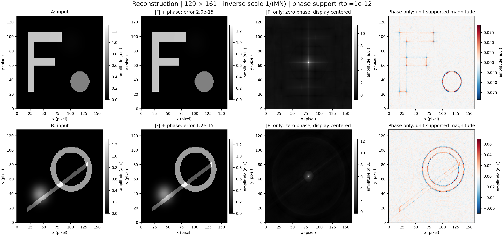
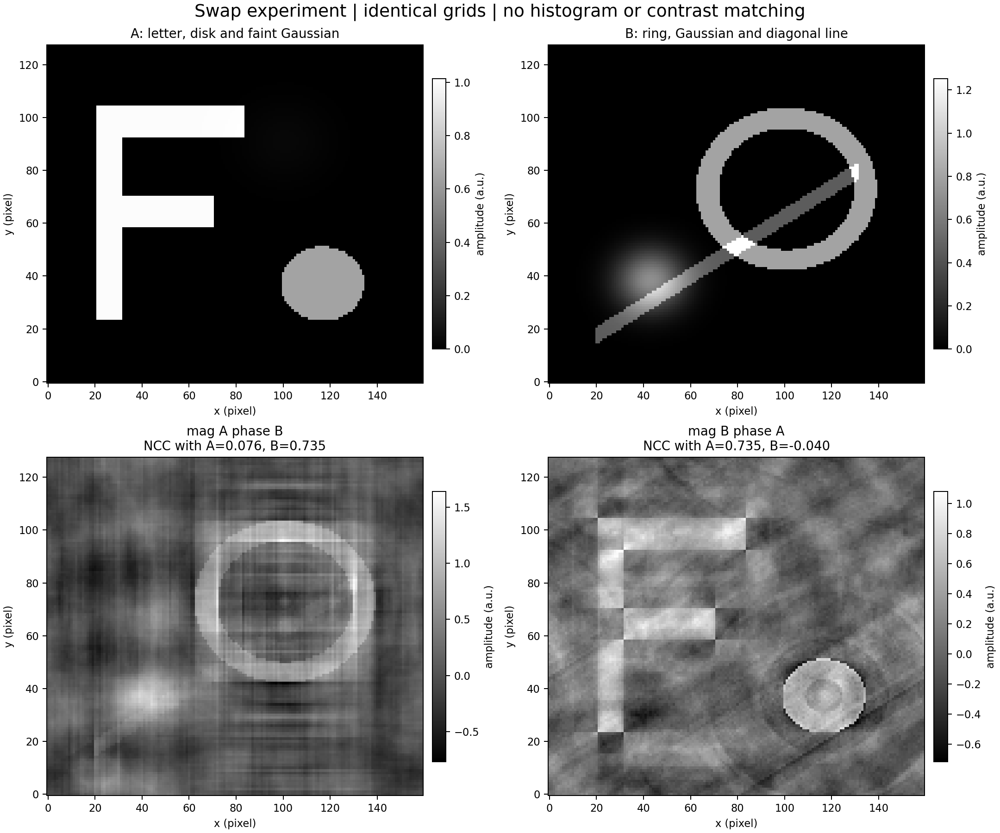
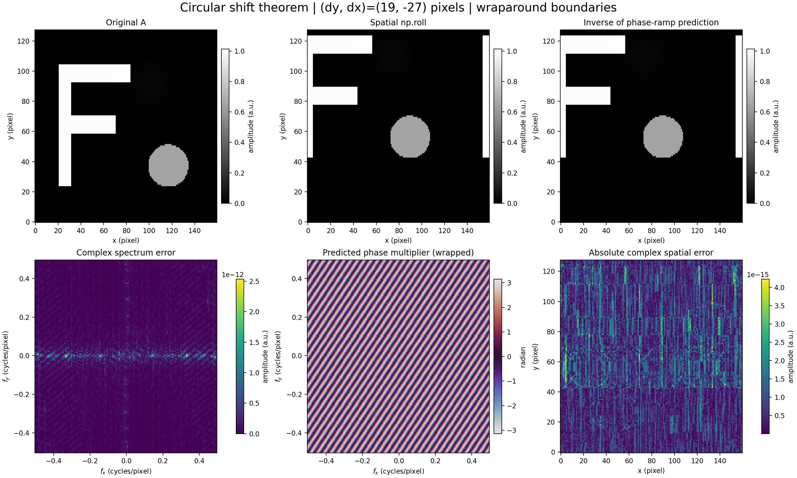
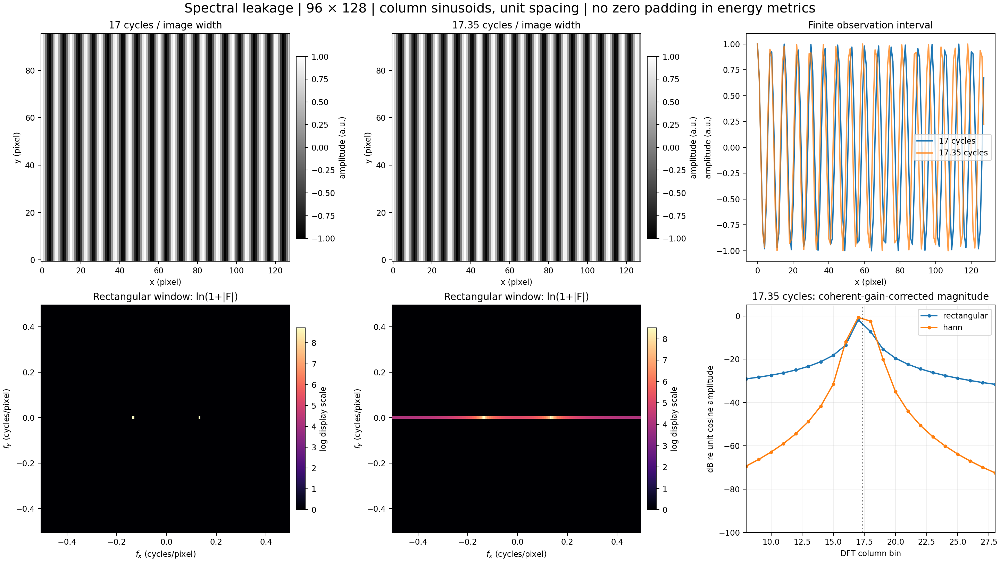
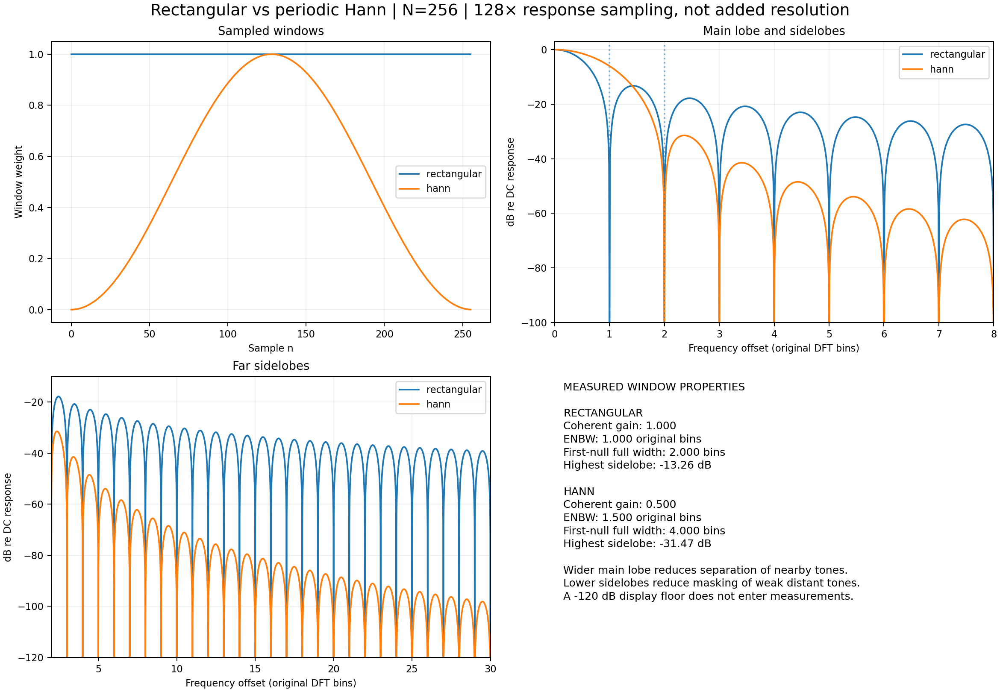
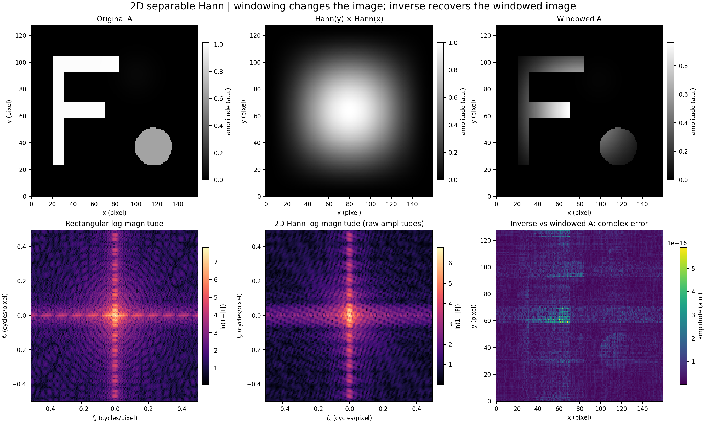

# Chapter 04 · Lab 02 — Fourier Spectrum Explorer

This independent laboratory studies what Fourier magnitude and phase retain, how circular translation changes phase, and why a finite observation interval causes spectral leakage. Eight reproducible figures and quantitative measurements accompany automated mathematical tests. Images are synthetic; no external image, coursework PDF, or personal information is distributed.

**Scope:** only Lab 02. NumPy FFT is the practical transform engine. [Lab 01](../01-fourier-transform/README.md) supplies the existing manual DFT/IDFT for small verification cases; its implementation is imported without duplication or modification.

## Run the lab

From the repository root, using Python 3.12:

```bash
python -m pip install -r requirements.txt

# New tests only
python -m pytest -q chapter-labs/chapter-04-frequency-domain/02-fourier-spectrum-explorer/tests

# All figures, full-precision arrays, JSON metadata, and CSV measurements
python chapter-labs/chapter-04-frequency-domain/02-fourier-spectrum-explorer/experiment.py

# Existing assignment suites and both chapter labs
python scripts/validate_repository.py

# The full GitHub Actions regeneration flow
python scripts/validate_repository.py --regenerate
```

The runner accepts `--output-dir PATH`; its default is this lab's `output/`, independent of the calling directory. Regeneration of the whole repository also rewrites previous experiment outputs; use a disposable checkout if those outputs must remain untouched. This lab's runner writes only its output directory.

No dependencies are added. The runner needs NumPy and Matplotlib. Tests additionally use existing pytest and SciPy; SciPy's periodic Hann window is an independent reference, not the experiment implementation. See the root README for environment activation, including Windows PowerShell.

## Mathematical conventions

An image has shape $(M,N)$, with row coordinate $m$ and column coordinate $n$. Unit pixel spacing is assumed. The unscaled forward transform and normalized inverse are:

$$
F[u,v]=\sum_{m=0}^{M-1}\sum_{n=0}^{N-1} f[m,n]
 e^{-j2\pi(um/M+vn/N)},
$$

$$
f[m,n]=\frac{1}{MN}\sum_{u=0}^{M-1}\sum_{v=0}^{N-1} F[u,v]
 e^{+j2\pi(um/M+vn/N)}.
$$

This is NumPy's default `backward` normalization. DC is at `[0,0]` in all stored spectra; its coefficient is the image sum. Spectrum components are:

$$
A=|F|,\qquad \phi=\operatorname{atan2}(\operatorname{Im}F,\operatorname{Re}F),
\qquad P=|F|^2,\qquad L=\ln(1+|F|).
$$

$P$ is unnormalized power, **not** a power spectral density. Parseval's relation is $\sum |f|^2=\sum P/(MN)$. Phase is wrapped to $[-\pi,\pi]$ and has no meaning at zero magnitude.

Only figures center frequency bins with `fftshift`. Frequency labels come from `fftfreq`: horizontal $f_x$ is column frequency and vertical $f_y$ is row frequency, in cycles/pixel. All inversions use original unshifted spectra. A centered spectrum supplied externally must first pass through `ifftshift`, especially on odd dimensions, where two applications of `fftshift` do not undo one another.

## Inputs and experimental settings

Two different real images are constructed from normalized coordinates $x=n/N$, $y=m/M$ by [synthetic_pair](spectrum_tools.py). Their analytical parameters are fixed, so the experiment runner uses no random generator.

| Image | Synthetic content |
| --- | --- |
| A | Letter F built from three rectangles; a disk centered at $(x,y)=(0.73,0.29)$ with radius 0.11 and amplitude 0.65; a faint Gaussian centered at $(0.63,0.71)$ |
| B | Ring centered at $(0.63,0.57)$ with radii 0.18/0.24; Gaussian centered at $(0.27,0.30)$; a narrow diagonal line |
| Leakage images | 96×128 column cosines, constant over rows, with 17 and 17.35 cycles across the image width |
| Window responses | Length 256; rectangular and **periodic** Hann; 128× zero padding to sample the DTFT response |

Reconstruction, swapping, and translation are measured on both **128×160** and **129×161** arrays. Shapes use normalized coordinates for reproducible interpretation; disk/ring masks are circular in this normalized coordinate system and can appear elliptical in pixel coordinates on rectangular grids. Plot axes display actual pixels.

## 1. Magnitude, phase, log magnitude, and power



Magnitude describes the strength of each sinusoidal component; phase aligns the components spatially. Linear magnitude and power emphasize strong low-frequency content. Natural-log magnitude makes weaker frequency components visible. White phase pixels indicate unsupported phase, using the support convention below. The detailed JSON records support counts. In the four main source images, every bin exceeds the chosen threshold; exact zero and sparse support are tested separately.

## 2–3. Full, magnitude-only, and phase-only reconstruction

Define a supported unit-phase spectrum by

$$
S_\tau[u,v]=\begin{cases}
F[u,v]/|F[u,v]|,& |F[u,v]|>\tau\max |F|,\\
0,&\text{otherwise}.
\end{cases}
$$

For an all-zero spectrum the support is empty and $S_\tau=0$. The default $\tau=10^{-12}$ treats numerical near-zero coefficients as undefined phase, using a threshold relative to the spectral maximum. Division uses an explicit mask, so there is no divide-by-zero warning or arbitrary assignment of phase to a missing coefficient. The result is **not** `exp(1j*angle(F))` at every bin: that expression incorrectly assigns unit amplitude to zero coefficients.

The three reconstructions are

$$
f_{\rm full}=\mathcal F^{-1}\{|F|S_0\},\qquad
f_{\rm mag}=\mathcal F^{-1}\{|F|\},\qquad
f_{\rm phase}=\mathcal F^{-1}\{S_\tau\}.
$$

Full reconstruction deliberately uses $\tau=0$ to retain every strictly nonzero coefficient. Magnitude-only reconstruction sets each existing coefficient's phase to zero; zero coefficients remain zero. Phase-only reconstruction sets supported magnitudes to one and leaves the rest zero. Its energy is $\|f_{\rm phase}\|_2^2=\#\mathrm{support}/(MN)$, so its amplitude is not comparable to the original image's amplitude.




The full reconstruction recovers the source within floating-point precision. Magnitude-only images lose spatial alignment and are centrosymmetric for real sources; they retain frequency strength, not the original arrangement. The magnitude-only spatial result is shifted **for display only** to place its zero-lag feature in the center. This is a spatial reordering, not a centered spectrum passed to the inverse. Phase-only images emphasize positions and contours while losing the original intensity distribution. Only these phase-only panels use signed symmetric color limits; no absolute-value operation is applied to hide negative values. Each magnitude-only/phase-only panel has its own labeled range; input/full panels share a fixed range of 0–1.3.

| Grid | Image | Max complex reconstruction error | MSE | Supported / total bins |
| --- | --- | ---: | ---: | ---: |
| 128×160 | A | 6.855e-16 | 1.722e-32 | 20480 / 20480 |
| 128×160 | B | 4.550e-16 | 9.610e-33 | 20480 / 20480 |
| 129×161 | A | 1.787e-15 | 2.627e-32 | 20769 / 20769 |
| 129×161 | B | 1.058e-15 | 1.544e-32 | 20769 / 20769 |


Constant and impulse tests provide useful edge cases. A positive constant has DC-only phase support, giving a phase-only image of $1/(MN)$ everywhere. A displaced unit impulse has unit spectral magnitude, so phase-only inversion returns that displaced impulse while zero-phase inversion returns an origin impulse. An all-zero input returns zeros for every reconstruction variant.

## 4. Swap magnitude and phase

For equal-sized, aligned image grids, construct

$$
H_{A,B}=|F_A|S_\tau(F_B),\qquad
h_{A,B}=\mathcal F^{-1}\{H_{A,B}\}.
$$

Where B lacks supported phase, the hybrid coefficient is set to zero; this deliberately discards A's magnitude at that bin. Magnitude retention is therefore conditional on the phase support. The removed magnitude-energy fraction is recorded, rather than silently inventing missing phase. The source pair has full phase support at the stated threshold, so no donor energy is removed in these experiments.



The hybrids resemble the **phase donor's geometry and placement**, with the **magnitude donor's spectral strengths and texture/contrast weighting**. These are observations for the two chosen images, not a theorem that phase alone determines perception for every image. Centered signed normalized correlation (NCC) quantifies spatial resemblance without histogram matching or fitting:

$$
\mathrm{NCC}(a,b)=\frac{\sum (a-\bar a)(b-\bar b)}{\|a-\bar a\|_2\|b-\bar b\|_2}.
$$

| Grid | Hybrid | NCC with A | NCC with B | Relative magnitude error |
| --- | --- | ---: | ---: | ---: |
| 128×160 | magnitude A, phase B | 0.0758 | 0.7352 | 1.098e-16 |
| 128×160 | magnitude B, phase A | 0.7352 | -0.0402 | 9.629e-17 |
| 129×161 | magnitude A, phase B | 0.0664 | 0.7358 | 1.178e-16 |
| 129×161 | magnitude B, phase A | 0.7358 | 0.0055 | 9.077e-17 |


On shared supported bins, power is preserved from the magnitude donor. Consequently, its circular autocorrelation $\mathcal F^{-1}\{|F|^2\}$ is preserved, even though its spatial arrangement changes. The maximum measured relative autocorrelation error is recorded in `metrics.json`. Magnitude-only inversion $\mathcal F^{-1}\{|F|\}$ must not be confused with this inverse-power autocorrelation.

## 5. Circular translation and the Fourier shift theorem

For an integer translation $(\Delta y,\Delta x)$:

$$
g[m,n]=f[(m-\Delta y)\bmod M,(n-\Delta x)\bmod N],
$$

$$
G[u,v]=F[u,v]\exp\left[-j2\pi\left(\frac{u\Delta y}{M}+\frac{v\Delta x}{N}\right)\right].
$$

The experiment compares `fft2(np.roll(f, (19,-27), axis=(0,1)))` to this phase-ramp prediction and compares its inverse to the rolled image. Magnitude remains unchanged because the multiplier has unit modulus. Signed FFT frequencies are equivalent for these integer shifts; shifts are reduced modulo the array dimensions before evaluating the exponential.



| Grid | Max complex spectrum error | Relative spectrum error | Max complex reconstruction error |
| --- | ---: | ---: | ---: |
| 128×160 | 2.549e-12 | 2.871e-15 | 4.172e-15 |
| 129×161 | 6.411e-12 | 6.465e-15 | 1.710e-14 |


This is circular wraparound translation, not zero-padded translation or a crop. Fractional shifts and interpolation are intentionally excluded. Tests cover positive, negative, zero, and larger-than-image shifts, even/odd dimensions, complex inputs, and real DC/Nyquist cases.

## 6. Spectral leakage

A finite sampled record is implicitly repeated by the DFT. A sinusoid with an integer number of cycles fits that period, concentrating its energy at its signed frequency bins. A noninteger cycle count generally has a boundary discontinuity under periodic extension, spreading energy over the DFT bins.

For a complex sinusoid $x[n]=e^{j2\pi qn/N}$ and integer bin $k$, its DFT magnitude is the Dirichlet-kernel expression

$$
|X[k]|=\left|\frac{\sin(\pi(q-k))}{\sin(\pi(q-k)/N)}\right|,
$$

with limiting value $N$ at the matching bin. Analytical tests use complex tones to avoid interaction of the positive and negative components of real cosines; the plotted image experiments use real cosines.



Two **unpadded DFT-energy** fractions are reported: energy outside the nearest bin pair $(+17,-17)$, and energy outside the same two fixed five-bin bands (15–19 and -19–-15). The second metric exposes far leakage without confusing main-lobe broadening with sidelobe suppression. The column window is broadcast over rows here; the 2D FFT remains on the $f_y=0$ row, so its energy fraction equals the 1D fraction. The gain-corrected slice uses $2|X|/\sum w$ for a real cosine; fractional-bin scalloping and opposite-frequency interference still apply.

| Cycles | Window | Outside nearest pair | Outside fixed five-bin bands |
| ---: | --- | ---: | ---: |
| 17 | rectangular | 9.065383e-30 | 8.276041e-30 |
| 17 | hann | 3.333333e-01 | 6.822329e-30 |
| 17.35 | rectangular | 3.411385e-01 | 6.364280e-02 |
| 17.35 | hann | 4.314821e-01 | 3.043971e-04 |


Hann lowers the distant leakage in this example while increasing energy outside just the nearest bin pair. Even the perfectly aligned Hann-windowed cosine has one-third of its energy outside that pair because the periodic Hann deliberately spreads each peak into neighboring bins. Windowing does not make all off-bin energy disappear.

## 7. Rectangular versus periodic Hann windows

The definitions used in [spectrum_tools.py](spectrum_tools.py) are

$$
w_R[n]=1,\qquad w_H[n]=\tfrac12-\tfrac12\cos(2\pi n/N),\qquad 0\le n<N.
$$

This **periodic** Hann is appropriate for spectral analysis; it differs from the symmetric $N-1$ denominator often used for filter design. For $N>1$, the periodic window starts at zero and its last retained sample is generally nonzero. A length-one window is explicitly `[1]`.

Coherent gain and equivalent noise bandwidth (ENBW, in original DFT bins) are

$$
G_c=\frac1N\sum_nw[n],\qquad
\mathrm{ENBW}=N\frac{\sum_nw[n]^2}{(\sum_nw[n])^2}.
$$

We sample each window's continuous-frequency response through a 128× zero-padded FFT and normalize by its DC response. The first positive local minimum measures the first-null offset. The full main-lobe width is twice that offset, and the highest sampled sidelobe is the maximum response beyond that first null. Measurements require $N\ge8$ and an oversampling factor of at least 8. Zero padding refines this response sampling; it adds no information or resolving power.



| Window | Coherent gain | ENBW (bins) | First-null full width (bins) | Highest sampled sidelobe (dB) |
| --- | ---: | ---: | ---: | ---: |
| rectangular | 1.000 | 1.000 | 2.000 | -13.261 |
| hann | 0.500 | 1.500 | 4.000 | -31.468 |


The Hann main lobe is twice as wide by this first-null criterion, while the highest sidelobe is lower. This reduces masking by distant strong components but makes nearby components harder to separate. ENBW also increases: reduced sidelobes do not imply unchanged resolution or noise bandwidth. First-null width is a comparative resolution descriptor; actual two-tone resolvability also depends on amplitude, phase, noise, and separation. Sidelobe maxima are sampled approximations, not exact continuous extrema.

For a 2D taper, $w[m,n]=w_H^{(M)}[m]w_H^{(N)}[n]$. This separable window has coherent gain 0.25 when both dimensions exceed one. It suppresses boundary contributions **and changes the image**. Its inverse reconstructs the windowed image, not the untapered input; dividing by the window cannot recover samples at its zeros. The displayed log magnitudes below use raw amplitudes without gain correction, so changes reflect both tapering and attenuation.



## Implementation/API and edge cases

[spectrum_tools.py](spectrum_tools.py) contains importable numerical functions; [experiment.py](experiment.py) handles input generation, figure layout, measurements, and artifact writing.

| Function | Behavior |
| --- | --- |
| `phase_unit(F, relative_tolerance=1e-12)` | Supported unit phase; zero spectrum returns zero |
| `compose_spectrum(magnitude, phase_source, relative_tolerance=1e-12)` | Equal-shaped nonnegative real magnitudes with supported donor phase |
| `reconstruct_variants(image)` | Unshifted FFT and three complex128 reconstruction arrays |
| `hermitian_error(F)` | Maximum absolute violation of conjugate symmetry |
| `translated_spectrum(F, (dy,dx))` | Phase-ramp prediction for integer circular translation |
| `periodic_window(N, kind)` / `window_2d(shape, kind)` | Float64 rectangular/periodic Hann weights |
| `outside_bin_energy(signal, bins)` | Unpadded 1D DFT-energy fraction outside selected signed bins; zero energy returns zero |
| `window_response` / `window_metrics` | Gain-normalized padded response and measured widths, sidelobes, ENBW |
| `synthetic_pair(shape)` | Two deterministic float64 source images |

Finite numeric inputs are promoted to complex128, with float64 window weights. Empty/ragged/wrong-rank/nonfinite inputs are rejected. Magnitudes must be finite, real, nonnegative, and the same shape as the phase source. Shape dimensions and window lengths must be positive integers. Inputs are not modified. No power-of-two or square-array restriction exists, and singleton dimensions are tested. There is no image-file input or automatic resizing, channel reduction, intensity clipping, or uint8 conversion.

For real source images, conjugate symmetry is $F[-u\bmod M,-v\bmod N]=\overline{F[u,v]}$. Symmetric magnitude and phase-support masks preserve a real inverse up to roundoff. The API also accepts complex data and arbitrary spectra, so it does **not** promise a real result for non-Hermitian input or force one by discarding its imaginary component. Very small coefficient phases are ill-conditioned; a support threshold trades negligible-amplitude information for stability. Near-threshold conjugate coefficients can differ by rounding; residuals are retained and measured rather than hidden by a symmetry projection.

All calculations retain floating-point/complex precision. `.real` is used only in spatial figure panels for real-source experiments; imaginary residuals are measured separately. There is no clipping in numerical results. Displayed dB values alone use a -120 dB floor to avoid logarithm singularities. Color scales are per panel unless stated otherwise, so compare colorbars as well as patterns.

## Validation and measured output

Tests use deterministic small arrays with seeds 402–405. Comparisons to the manual Lab 01 implementation and analytical expectations use `rtol=atol=1e-10`; tolerances were not weakened. Physical window-property bounds allow finite-length and response-sampling differences; they are not relaxed reconstruction tolerances.

The suite covers full reconstruction of real/complex data, exact zero and near-zero support, constants, displaced impulses, missing-phase swaps, Hermitian symmetry, autocorrelation/power retention, Parseval phase-only energy, circular shifts, DC/Nyquist bins, odd/even/singleton/rectangular dimensions, analytical Dirichlet leakage, far-leakage suppression, main-lobe widths, ENBW, periodic Hann against SciPy, 2D window inversion, input immutability, and invalid arguments.

Actual new-suite output:

```text
97 passed in 1.82s
```

Combined chapter-lab pytest output: `216 passed in 2.16s` (119 Lab 01 + 97 Lab 02). Existing assignment suites and both chapter labs also passed through `scripts/validate_repository.py`; detailed logs are retained in the separate review package.

The repository validator registers both chapter labs. The existing GitHub Actions job already compiles `chapter-labs` and runs `validate_repository.py --regenerate`; updating the validator integrates Lab 02 without an unnecessary workflow edit. No dependency, previous assignment, or Lab 01 file is changed. Full CI-style regeneration was attempted twice in an isolated copy so previous outputs remained unchanged in the feature worktree. **Both attempts stopped in the unchanged Assignment 01 resize experiment because regenerated PNG files were truncated**, before either Fourier lab ran. The failure logs and PNG diagnostics are retained in the separate review package. The normal repository validator passes against the committed previous outputs. Lab 02 regeneration was run separately in the isolated copy and its 47 arrays and full metrics were compared to the reviewed output; see the review record for the result. The existing whole-repository regeneration issue remains unresolved; no successful GitHub-hosted Actions run is claimed.

## Reproducible artifacts

| Path | Contents |
| --- | --- |
| [output/metrics.json](output/metrics.json) | Software/platform metadata, settings, support counts, reconstruction/swap/shift/window measurements |
| [output/leakage.csv](output/leakage.csv) | Four cycle-count/window combinations, two leakage fractions and coherent gain |
| [output/windows.csv](output/windows.csv) | Measured window gain, ENBW, first-null width, highest sidelobe |
| [output/arrays.npz](output/arrays.npz) | 47 named full-precision input/spectrum/reconstruction/window/response arrays |
| [output/](output/) | Eight annotated PNG figures at 180 DPI, plus numerical artifacts |
| [tests/](tests/) | Mathematical pytest cases and import setup |

Load raw evidence with `np.load("output/arrays.npz")`; fields prefixed `even_` or `odd_` identify the grid. Stored spectra are unshifted. Regeneration reproduces deterministic inputs and metrics to platform-dependent floating-point precision. README tables are the reviewed-run snapshot; the runner updates artifacts, not this README. Metadata records the exact software versions used.

## Limitations

The examples are selected synthetic structures, not a perceptual study or a benchmark on natural images. Image sampling, relative amplitudes, and phase relationships affect hybrid appearance. All transformations assume periodic extension. No fractional translation, phase unwrapping, denoising, filtering, deconvolution, interactive GUI, or later lab is included. Thresholds are tunable through the helper API but fixed and documented in the runner. Double precision can overflow for extreme finite amplitudes, and a vanishingly small nonzero signal can underflow in energy calculations. Window-response plots require finite sampling; zero padding does not improve the underlying resolution. The FFT is roughly $O(MN(\log M+\log N))$ time and $O(MN)$ storage; manual transforms remain confined to small verification cases.

## References

1. [Chapter 04 · Lab 01 mathematical background and validated manual transforms](../01-fourier-transform/README.md), including the chapter's polar representation, normalization, translation and separability conventions. The previously supplied slides were consulted in Lab 01; they are not redistributed here.
2. NumPy 2.3, [Discrete Fourier Transform definitions, ordering and normalization](https://numpy.org/doc/2.3/reference/routines.fft.html).
3. SciPy 1.17, [Hann window: periodic versus symmetric construction](https://docs.scipy.org/doc/scipy-1.17.0/reference/generated/scipy.signal.windows.hann.html). Tests compare to `hann(N, sym=False)`; experiment weights use the explicit formula above.
