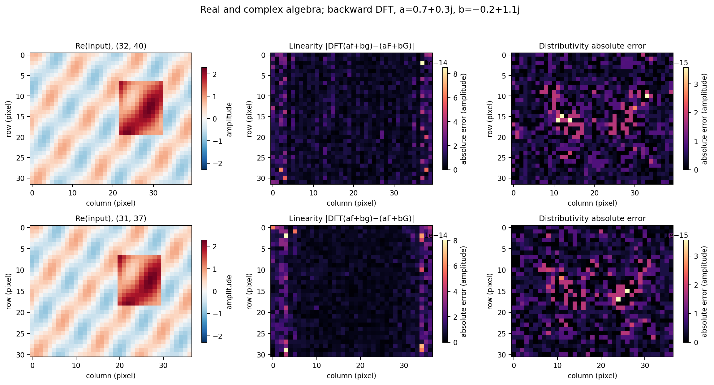
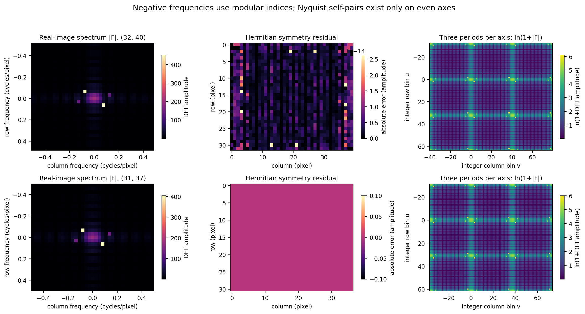
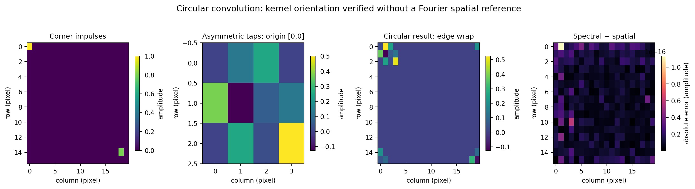
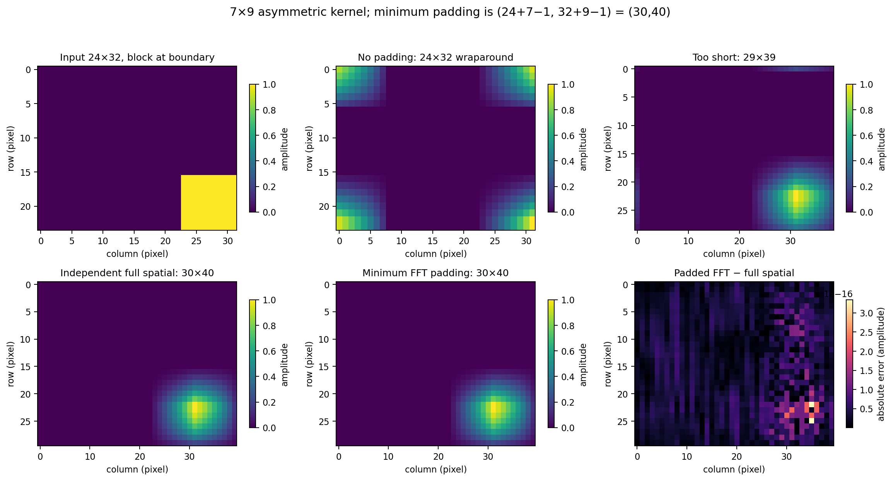
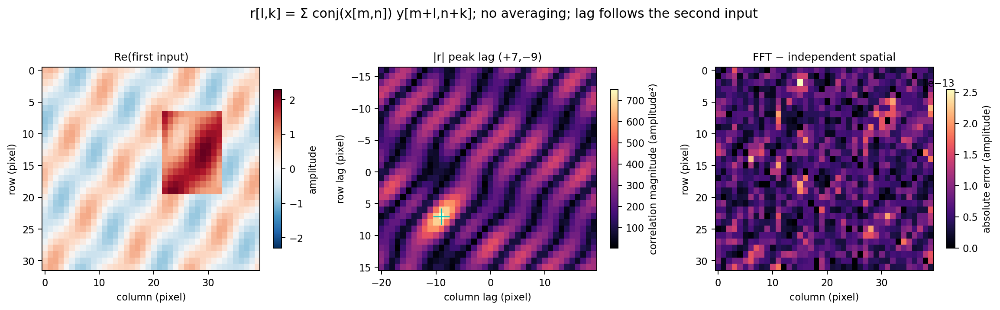
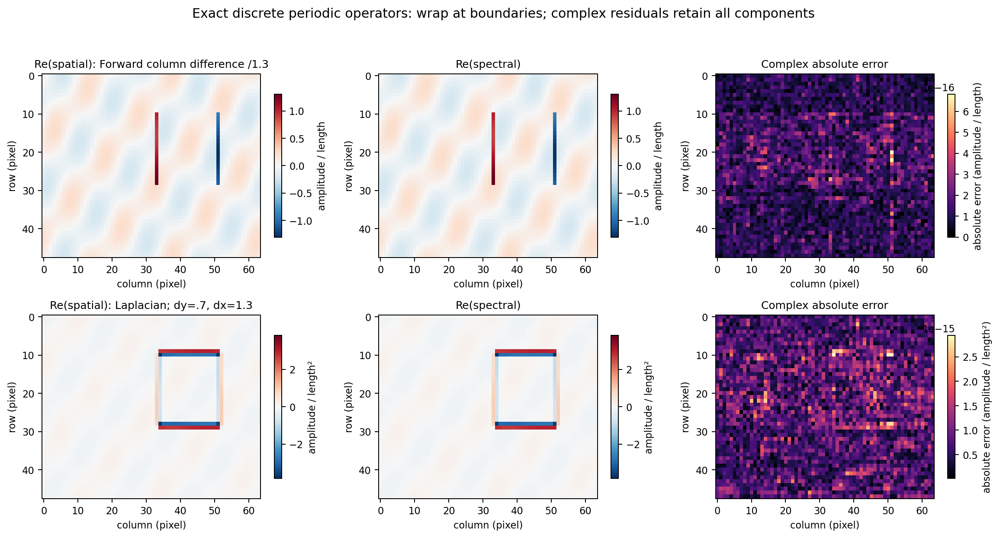
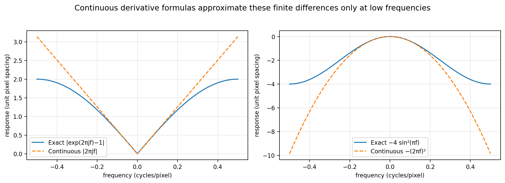
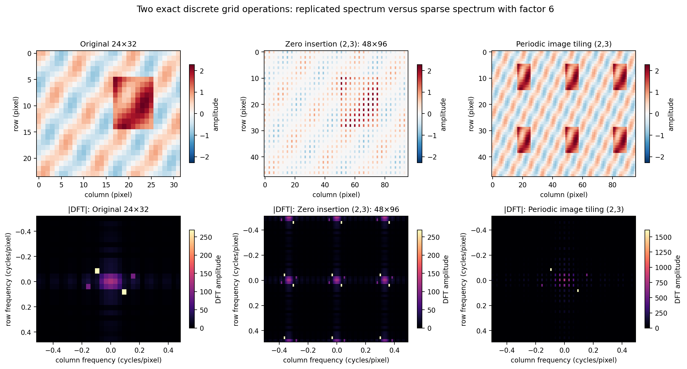
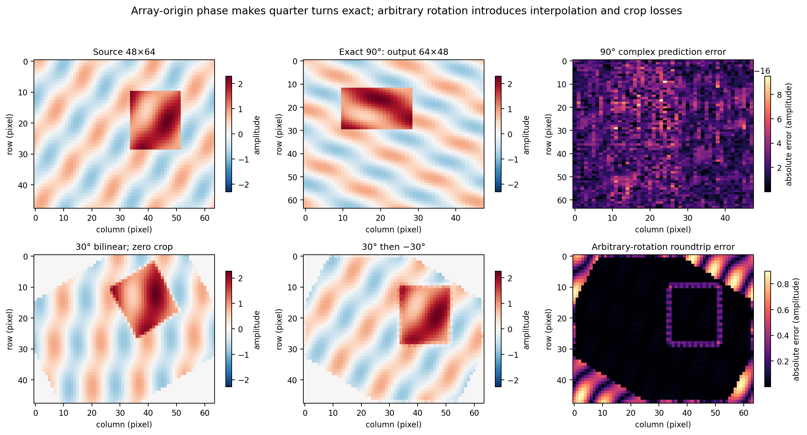

# Chapter 04 · Lab 03 — Fourier Transform Properties

This laboratory verifies discrete Fourier identities against independently computed spatial operators. It studies algebra, modular frequency indices, convolution, correlation, periodic differences, and precisely defined discrete scaling and rotation. All inputs are synthetic. Nine original figures, full numerical tables and 18 reference arrays are included; internal validation logs are retained in the separate review package.

Only Lab 03 is implemented. [Lab 01](../01-fourier-transform/README.md) supplies its existing manual DFT/IDFT for a small verification case; [Lab 02](../02-fourier-spectrum-explorer/README.md) supplies its Hermitian-symmetry diagnostic. Neither is copied or modified. NumPy FFT is used for the frequency-domain calculations. Independent spatial sums never call an FFT.

This package is a fresh reconstruction from base `ac9b96871f5bd8d9c9fb2c4ff03f9b2555e2792a`, after the earlier temporary package became unavailable. It reproduces the scientific scope and artifacts; it is not claimed to be byte-identical to the lost package. Test counts and measurements below refer to this execution. The original Chapter 04 PDF is unavailable in this environment, so its property tables cannot be freshly inspected. The derivations are stated explicitly here and tested under the established repository convention; no course PDF or third-party image is redistributed.

## Reproduce

From the repository root, with Python 3.12 and the existing dependencies:

```bash
python -m venv .venv
source .venv/bin/activate
python -m pip install -r requirements.txt
python -m pytest -q chapter-labs/chapter-04-frequency-domain/03-fourier-properties/tests
python chapter-labs/chapter-04-frequency-domain/03-fourier-properties/experiment.py
python chapter-labs/chapter-04-frequency-domain/03-fourier-properties/verify_artifacts.py
python scripts/validate_repository.py
```

Windows PowerShell activation, from the repository root:

```powershell
.\.venv\Scripts\Activate.ps1
```

If local execution policy blocks activation, use `.\.venv\Scripts\python.exe` instead of `python`; activation is optional. The runner accepts `--output-dir PATH`. Its default output path is relative to the script, independent of the current directory. No dependency or workflow change is required. Existing Actions invokes the repository validator, whose new entry includes this suite.

To investigate complete regeneration without rewriting tracked earlier outputs in the working tree, create a disposable snapshot (no commit required):

```bash
mkdir ../lab03-regeneration
git archive HEAD | tar -x -C ../lab03-regeneration
cd ../lab03-regeneration
python scripts/validate_repository.py --regenerate
```

On platforms without `tar`, extract an archive of the current repository revision into a separate folder. Use the same Python dependencies there; no new Git commit or push is needed to run this laboratory.

## DFT and coordinates

Rows $m=0,\ldots,M-1$ increase downwards; columns $n=0,\ldots,N-1$ increase rightwards. The default **backward** normalization is

$$
F[u,v]=\sum_{m=0}^{M-1}\sum_{n=0}^{N-1}f[m,n]
e^{-2\pi j(um/M+vn/N)},
$$

$$
f[m,n]=\frac1{MN}\sum_{u=0}^{M-1}\sum_{v=0}^{N-1}F[u,v]
e^{+2\pi j(um/M+vn/N)}.
$$

There is no extra factor in either convolution theorem below. Course tables using a normalized forward transform require corresponding changes to their convolution factors. Stored spectra are **unshifted**, DC at `[0,0]`. The plotting code uses `fftshift` only for centered spectral displays, with matching `fftfreq` axes in cycles/pixel. All inverses consume the original unshifted arrays. Externally centered spectra would require `ifftshift` before inversion; two `fftshift` calls are not an inverse pair on odd axes.

All numerical inputs are promoted to double precision (`complex128`); measured errors include imaginary parts. Real parts, absolute values and plot color limits are applied only for visualization. No calculation converts to `uint8` or clips reconstruction values.

## 1. Linearity and distributivity

For real or complex scalars and arrays,

$$
\mathcal F\{af+bg\}=aF+bG,
\qquad (f+g)*_c h=f*_c h+g*_c h.
$$

The second identity is checked spatially, while the independent convolution theorem checks its frequency representation. Experiments use $a=0.7+0.3j$, $b=-0.2+1.1j$ on both real and complex images with shapes $32\times40$ and $31\times37$.



Residual panels show absolute complex errors, not differences between independently normalized pictures. Display scales adapt to each residual so roundoff is visible; these small colored patterns are not physical features.

## 2. Conjugate symmetry and periodicity

The defining exponential is unchanged by adding an integer number of periods:

$$
F[u+aM,v+bN]=F[u,v],\qquad a,b\in\mathbb Z.
$$

Taking a complex conjugate of the defining sum gives

$$
\mathcal F\{\overline f\}[u,v]
=\overline{F[(-u)\bmod M,(-v)\bmod N]}.
$$

Only for real $f$ does this reduce to Hermitian symmetry $F[-u,-v]=\overline{F[u,v]}$. Negative frequency is a modular index, not a simple reversal: `F[::-1,::-1]` would incorrectly move DC. Self-conjugate bins have coordinates 0, or dimension/2 on an even axis. Those bins are real up to roundoff; an odd axis has no Nyquist self-pair.



The logarithmic panel repeats three periods in each direction and labels integer bins. Periodicity extends a fixed DFT grid; it does not create additional independent frequency measurements. Complex inputs deliberately violate the real-image symmetry; the general conjugation identity still holds.

## 3. Circular convolution and orientation

For image $f$ and taps $h$ of arbitrary finite size $P\times Q$,

$$
(f*_c h)[m,n]=\sum_{a=0}^{P-1}\sum_{b=0}^{Q-1}
h[a,b]f[(m-a)\bmod M,(n-b)\bmod N].
$$

Kernel origin is **`h[0,0]`**. There is no conjugation, display centering, or additional tap reversal. A positive tap offset shifts an origin impulse toward increasing row/column indices. This definition is convolution, even though the code implements it by rolling the input rather than explicitly flipping the kernel.

When a kernel exceeds the image dimensions, first periodize it by **adding** taps whose indices collide modulo $(M,N)$. Truncating it with `fft2(kernel, s=image.shape)` loses taps and is incorrect. The independent spatial function handles all taps directly. Its FFT counterpart uses the folded $h_c$:

$$
\mathcal F\{f*_c h\}=F H_c.
$$

Substitution into the forward sum and the change of variable $t=m-a$ yields the product of the two defining sums, proving the identity with this normalization.



The asymmetric $3\times4$ kernel and two corner impulses expose orientation and boundary behavior that symmetric blur kernels could hide.

## 4. Linear convolution and minimum padding

Under zero extension, full linear convolution has support

$$
0\le m\le M+P-2,\qquad0\le n\le N+Q-2.
$$

Thus the FFT grid must satisfy

$$
L\ge M+P-1,\qquad K\ge N+Q-1.
$$

These bounds are sufficient because no nonzero support wraps to the start of either axis. They are necessary in the worst case: impulses at both inputs' last samples yield a nonzero value at the final support index. A grid one sample shorter aliases that sample into index zero. Sparse particular inputs may need less support, but the API guarantees correctness for arbitrary inputs of the specified shapes and rejects insufficient padding.

`linear_convolution` scatters every product into an independent zero-initialized full output. `spectral_linear_convolution` pads both inputs, multiplies their transforms and crops any extra padding to full support. This is **full**, not `same` or `valid`, convolution.



The $24\times32$ boundary block and normalized asymmetric $7\times9$ kernel require $30\times40$. The experiment also checks $35\times45$ and deliberately undersized $29\times39$. Both unpadded and undersized results equal the independently folded full convolution, demonstrating the cause of wraparound. Padding changes the assumed boundary extension, rather than repairing a circular result after the fact.

## 5. Cross-correlation convention

For equal-size arrays, define the **unnormalized** circular cross-correlation

$$
r_{xy}[\ell,k]=\sum_{m,n}\overline{x[m,n]}
y[(m+\ell)\bmod M,(n+k)\bmod N].
$$

The conjugate acts on the **first** input. Inserting the inverse expansion of $y$ and recognizing the conjugated forward sum of $x$ gives

$$
r_{xy}=\mathcal F^{-1}\{\overline X Y\}.
$$

Consequently $r_{yx}[-\ell,-k]=\overline{r_{xy}[\ell,k]}$ and $r_{xx}[0,0]=\sum|x|^2$. For $y=c\,\operatorname{roll}(x,(d_y,d_x))$, the matching lag is **$(d_y,d_x)$**, and its value is $c\sum|x|^2$. The opposite convention commonly used by other APIs reverses this lag sign or conjugates the other operand; comparisons must adapt conventions first.



The complex experiment uses $c=e^{0.6j}$, shift $(7,-9)$ on $32\times40$. The unshifted peak index is $(7,31)$, reported as signed lag $(7,-9)$. Only the lag visualization is centered. The complete correlation map remains complex and unshifted in the NPZ. Repetitive or constant images can have ambiguous peaks; no universal uniqueness claim is made.

## 6. Exact periodic differences and Laplacian

For positive spacing $h_x$, the forward column difference is

$$
D_xf[m,n]=\frac{f[m,(n+1)\bmod N]-f[m,n]}{h_x}.
$$

A forward-index change contributes a **positive** exponential to the forward DFT, so

$$
H_{D_x}[u,v]=\frac{e^{+2\pi j v/N}-1}{h_x}.
$$

The row version replaces $v/N$ by $u/M$. The centered five-point Laplacian is

$$
\Delta_h f=\frac{f[m+1,n]-2f[m,n]+f[m-1,n]}{h_y^2}
+\frac{f[m,n+1]-2f[m,n]+f[m,n-1]}{h_x^2},
$$

with all indices periodic. Using $e^{j\theta}+e^{-j\theta}-2=-4\sin^2(\theta/2)$ gives

$$
H_{\Delta_h}[u,v]=-4\left[\frac{\sin^2(\pi u/M)}{h_y^2}
+\frac{\sin^2(\pi v/N)}{h_x^2}\right].
$$



This exact response is real, nonpositive and zero at DC. Constants vanish, including singleton axes. The experiments use complex $48\times64$ data and physical sample spacings $(h_y,h_x)=(0.7,1.3)$ length units. Array plot axes retain pixel indices; operator units are amplitude/length or amplitude/length².



The continuous responses $2\pi j\nu_x$ and $-4\pi^2(\nu_x^2+\nu_y^2)$ describe differentiation of a continuous periodic interpolant, not these finite stencils. The Taylor expansion $e^{j\theta}-1\approx j\theta$ agrees only at low frequencies. The CSV includes complex forward response components and the exact/continuous one-axis Laplacian slices at 257 frequencies, with unit sample spacing. Boundary edges may be real periodic differences across the image seam; zero or reflected boundaries require other operators.

## 7. Discrete scaling and rotation

### Integer zero insertion versus periodic tiling

Two precisely specified grid changes avoid treating a continuous scaling theorem as an exact arbitrary image resize.

For integer factors $(r,s)$, define a larger array $z$ by $z[rm,sn]=f[m,n]$ and zero elsewhere. Substitution in its $rM\times sN$ DFT gives

$$
Z[u,v]=F[u\bmod M,v\bmod N].
$$

There is no $rs$ factor. This is zero insertion without an interpolation filter; it is not smooth enlargement. Conversely, repeating the original image into $r\times s$ periods produces

$$
T[u,v]=\begin{cases}rs\,F[u/r,v/s],&u\equiv0\pmod r,\ v\equiv0\pmod s,\\0,&\text{otherwise}.\end{cases}
$$

The factor comes from summing geometric series over repeated periods. Both identities change the array dimensions; frequency labels must refer to the respective sampling grid. Generic downsampling can alias and generic interpolation changes the transfer function. The continuous relation $g(x,y)=f(ax,by)\Rightarrow G(\nu_x,\nu_y)=F(\nu_x/a,\nu_y/b)/|ab|$ is not applied blindly to finite sampled images.



The example uses a $24\times32$ source and $(r,s)=(2,3)$. It verifies the repeated versus sparse spectra including the amplitude factor six.

### Quarter turns and the array origin

For NumPy's counterclockwise `rot90` on an $M\times N$ array,

$$
g[a,b]=f[b,N-1-a],\qquad g\text{ has shape }N\times M.
$$

Inserting $m=b$, $n=N-1-a$ into the forward sum yields

$$
G[p,q]=e^{+2\pi j p/N}\,F[q,(-p)\bmod N].
$$

The phase factor follows from the last-index reflection about the array origin, and cannot be dropped. Composing this formula handles any integer number of quarter turns. It is exact for odd/even, rectangular and complex arrays, without interpolation. A display rotation in Cartesian coordinates must also account for image rows increasing downwards.



The $30^\circ$ example is explicitly approximate: SciPy `ndimage.rotate`, bilinear order 1, `reshape=False`, zero boundary, `prefilter=False`. Its rotate/back-rotate losses combine interpolation and cropping, and do not disprove the continuous rotation theorem. No equality assertion or tolerance relaxation is applied to that example. The separate naive quarter-turn experiment intentionally omits the origin phase and measures its failure.

## Implementation and interface

| File | Responsibility |
| --- | --- |
| [properties.py](properties.py) | Importable spatial references, spectral counterparts, grid and response helpers |
| [experiment.py](experiment.py) | Analytical inputs, independent comparisons, numerical exports and nine figures |
| [figure_io.py](figure_io.py) | Memory encoding, PNG verification and atomic publication for this lab only |
| [verify_artifacts.py](verify_artifacts.py) | PNG, CSV/JSON, dtype and independent saved-array checks |
| [tests/test_properties.py](tests/test_properties.py) | Mathematical, convention, boundary and input checks |
| [tests/test_figure_io.py](tests/test_figure_io.py) | Valid publication, invalid encoding and truncated-file rejection |

Algorithms accept finite, nonempty 2D numeric real or complex arrays, including singleton axes and noncontiguous views. Outputs are new arrays, predominantly complex128. Inputs are not mutated. Empty, wrong-rank, nonnumeric and nonfinite arrays are rejected. Shape/factor arguments require two positive integers (booleans rejected), axes are 0 or 1, spacings are finite positive real values. Correlation requires matching shapes. `periodic_samples` accepts broadcastable integer row/column indices; oversized kernels are summed by `periodize`. Spectral response arrays have the specified image shape. No automatic kernel centering or undocumented boundary conversion occurs.

Spatial convolution costs $O(MNPQ)$ and $O(MN)$ result storage for circular mode, or $O((M+P-1)(N+Q-1))$ storage for full mode. Independent spatial correlation examines $MN$ samples at each of $MN$ lags, costing $O((MN)^2)$. FFT convolution/correlation costs $O(LK\log(LK))$ on the relevant grid, with $O(LK)$ storage. Finite stencils, periodization, zero insertion and fixed quarter turns have linear cost in their input/output sizes; FFT verification adds transform cost. This lab makes no fragile runtime assertions or speed claims from unmeasured timings.

## Numerical validation and results

Expected results come from independent spatial loops, SciPy full convolution, analytical impulses/eigenmodes, NumPy FFT, and the unchanged Lab 01 small manual transform. Fixed-seed tests use seeds 403–405, real/complex data, shapes `(1,1)`, `(1,5)`, `(4,1)`, `(3,5)`, `(4,6)`, `(5,4)`, and kernels including oversized `(6,7)`. Tests explicitly cover asymmetric tap orientation, complex conjugation, signed correlation lag, minimum and excess padding, one-sample-short axes, periodic boundaries, integer scaling, rotations and invalid inputs.

Exact comparisons use `rtol=atol=1e-10` with double precision. Maximum absolute complex error and relative L2 error are exported for every experiment. Zero expected norm uses the absolute error as its finite relative-error fallback; zeros are not divided by zero. No tolerances are weakened to admit interpolation artifacts. Small roundoff differences across FFT/library versions are expected; binary figure hashes are artifact checks, not mathematical acceptance criteria.

| Experiment | Maximum absolute complex error |
| --- | ---: |
| `manual_dft_3x5` | 4.684036072284e-15 |
| `manual_inverse_3x5` | 1.483560831394e-15 |
| `circular_convolution` | 1.133376873706e-16 |
| `linear_minimum_padding` | 3.344480423404e-16 |
| `circular_correlation` | 2.542114972925e-13 |
| `forward_difference` | 6.822581642601e-16 |
| `periodic_laplacian` | 2.942745555080e-15 |
| `rotation_31x37_k1` | 1.530555893832e-13 |
| `rotation_spatial_reconstruction` | 9.508356269297e-16 |

All 40 exact comparisons passed. The largest maximum absolute error was **3.985229945527e-13**.

Counterexamples are measured, not passed as equalities: unpadded versus linear crop **0.935064935065**; insufficient 29×39 versus linear crop **0.220779220779**; naive 90° formula without origin phase **316.885935298** maximum spectral error. The 30° bilinear roundtrip has relative L2 error **0.336246181594** and retained energy ratio **0.8366487137**. These are intended limitations, not numerical transform failures.

Fresh execution: **266 new tests passed**; **482 combined chapter tests passed**; all eight existing assignment suites plus all three chapter suites passed the normal repository validator. A separate complete `--regenerate` execution passed. All **111 actual assignment/chapter PNGs** then passed both checksum verification and full decoding. All 18 new arrays and all numerical records matched between the two experiment runs exactly. This one successful regeneration does not settle the historical intermittent truncation.


Detailed validation logs, including the complete-regeneration and artifact audits, are retained in the separate review package. Earlier lost logs are not recreated as if they were new observations. The rebuilt pytest suite is independently rerun and need not have the same case count as the lost suite.

## Artifact inventory and regeneration

| Artifact | Content |
| --- | --- |
| [metrics.json](output/metrics.json) | 40 exact comparisons, counterexample measurements, versions and settings |
| [measurements.csv](output/measurements.csv) | The same 40 numerical records in tabular form |
| [operator_responses.csv](output/operator_responses.csv) | 257 frequency-response samples |
| [reference_cases.npz](output/reference_cases.npz) | 18 arrays, preserving complex128 and float64 |
| Nine `output/*.png` | All figures shown above, rendered at 180 DPI |

The 18 NPZ keys are `convolution_input`, `convolution_kernel`, `circular_spatial`, `padding_input`, `padding_kernel`, `linear_spatial`, `insufficient_padding`, `correlation_x`, `correlation_y`, `correlation_spatial`, `operator_input`, `forward_difference_spatial`, `laplacian_spatial`, `scaling_input`, `zero_inserted`, `rotation_input`, `rotated_30`, `rotated_back`. `np.load(path, allow_pickle=False)` reads them. All scientific outputs fit in the lightweight package; none are omitted.

## Limitations and PNG investigation

The independent spatial references are designed for small scientific examples. The routines are 2D only, use periodic boundaries unless full zero-extended convolution is explicitly selected, and do not implement arbitrary kernel-center conventions, normalized correlation, deconvolution or interpolated image-resize identities.

The repository has previously reported intermittent truncated PNG outputs in existing assignments. A fresh complete `--regenerate` run is investigated separately in this reconstruction; its actual result is documented in the separate review package. A successful execution is not evidence that an intermittent issue is permanently fixed. The prior lost failure logs and truncated files are unavailable and cannot be forensically reconstructed.

The new lab encodes figures in memory, verifies checksums and full pixel decoding, checks write length, flushes and fsyncs a temporary file, verifies bytes, atomically replaces the target, and verifies again. It never automatically retries or hides failure. This makes incomplete publication less likely, but does not establish the cause of a previous truncation or prevent an unrelated later writer or storage failure. Existing assignment algorithms, save paths, Labs 01–02, requirements and workflows remain unchanged.

## References

- Gonzalez and Woods, *Digital Image Processing*, frequency-domain filtering and the DFT property tables. The originally attached course Chapter 04 PDF is unavailable for fresh inspection in this reconstruction.
- [NumPy FFT conventions](https://numpy.org/doc/2.3/reference/routines.fft.html): backward normalization and frequency ordering.
- [NumPy rot90](https://numpy.org/doc/2.3/reference/generated/numpy.rot90.html): discrete array rotation axes and direction.
- [SciPy convolve2d](https://docs.scipy.org/doc/scipy-1.17.0/reference/generated/scipy.signal.convolve2d.html): independent full convolution in tests.
- [SciPy ndimage.rotate](https://docs.scipy.org/doc/scipy-1.17.0/reference/generated/scipy.ndimage.rotate.html): interpolation and output-shape settings in the approximate example.
