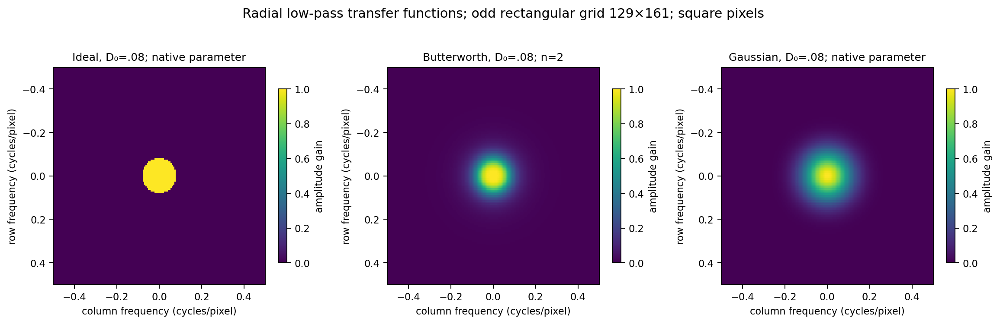
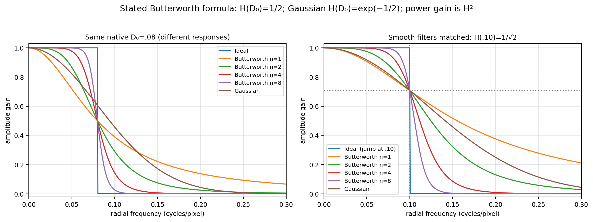
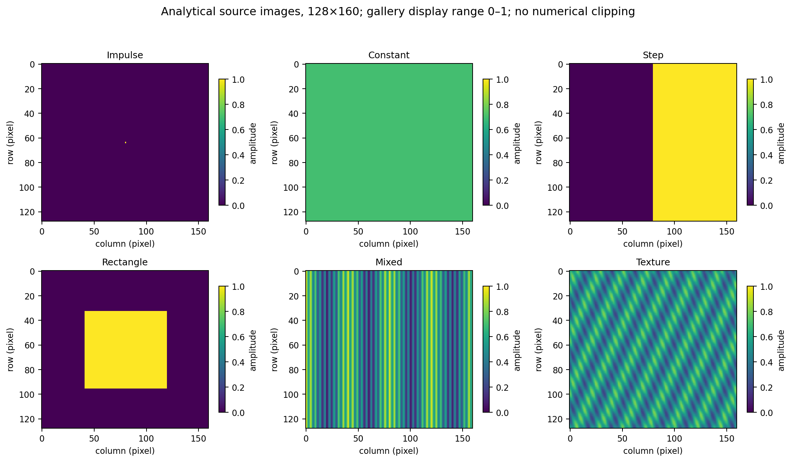
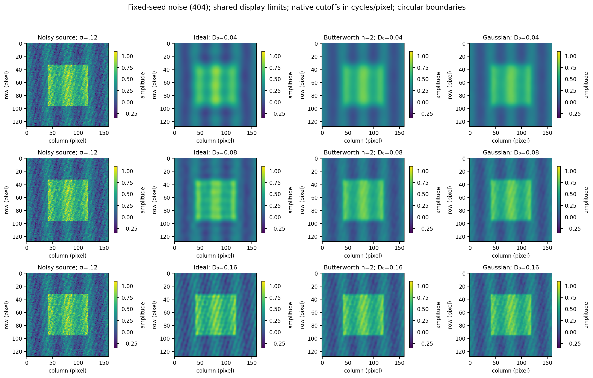
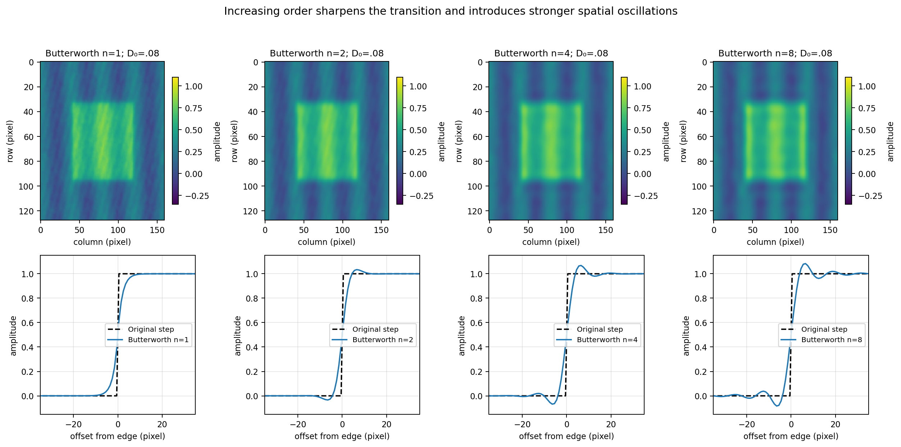
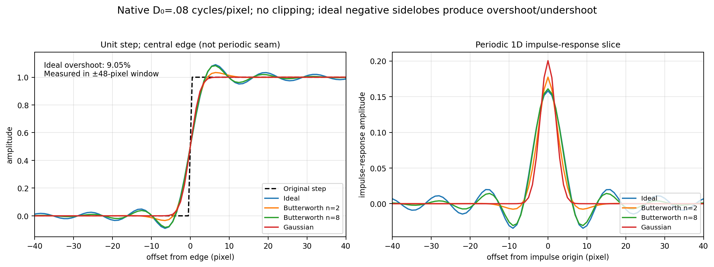
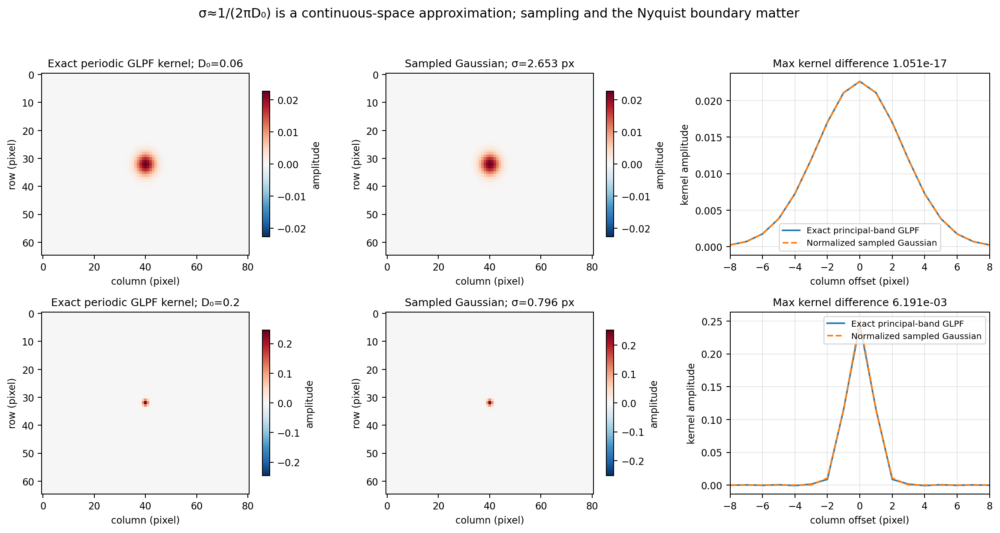
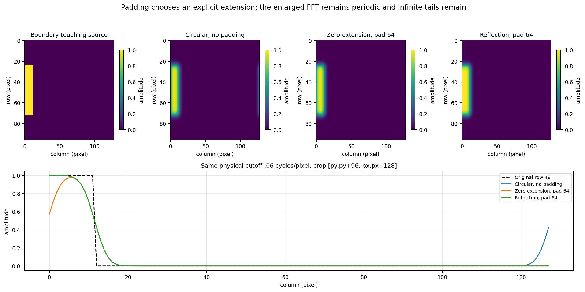
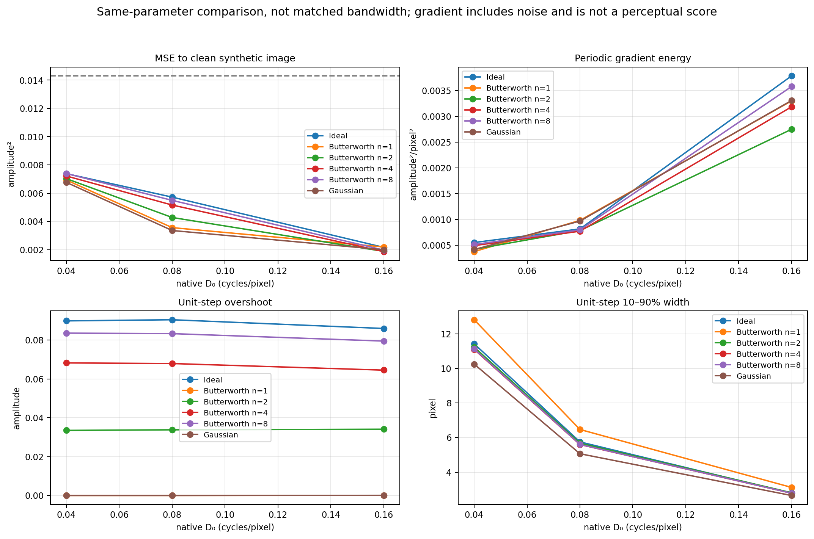
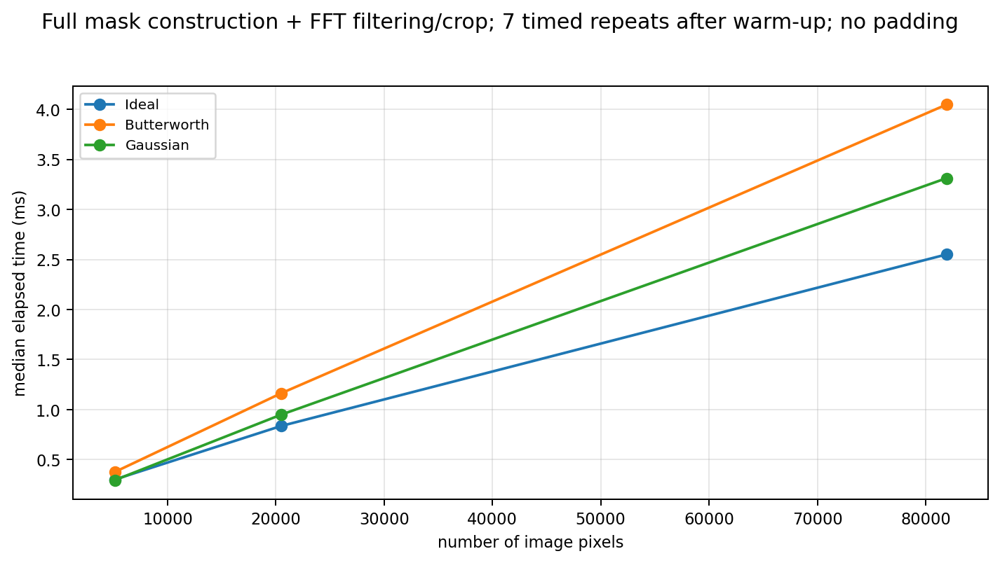

# Chapter 04 · Lab 04 — Frequency-Domain Low-Pass Filters

This laboratory compares ideal, Butterworth and Gaussian frequency-domain low-pass filters using synthetic images, exact discrete conventions and independently tested numerical references. Ten scientific figures, 18 filter/cutoff cases, 28 full-precision reference arrays and measured timing results accompany the code.

The existing [Lab 01](../01-fourier-transform/README.md) supplies a small manual-DFT verification; [Lab 03](../03-fourier-properties/README.md) supplies independent spatial convolution and its verified atomic PNG publisher. Their files are imported without copying or modification. This lab does not repeat the earlier Fourier implementation, spectrum exploration or convolution experiments. No external image is required.

**Source limitation:** the original Chapter 04 course PDF is unavailable in this environment. Its low-pass section was not freshly inspected and no page references are claimed. The task's filter formulas, explicit derivations below, and the official NumPy/SciPy documentation define this experiment's conventions. No course PDF, personal information or third-party image is distributed.

## Reproduce

Use Python 3.12 and the repository's existing pinned dependencies. From the repository root:

```bash
python -m venv .venv
source .venv/bin/activate
python -m pip install -r requirements.txt
python -m pytest -q chapter-labs/chapter-04-frequency-domain/04-low-pass-filters/tests
python chapter-labs/chapter-04-frequency-domain/04-low-pass-filters/experiment.py
python chapter-labs/chapter-04-frequency-domain/04-low-pass-filters/verify_artifacts.py
python scripts/validate_repository.py
```

Windows PowerShell activation:

```powershell
.\.venv\Scripts\Activate.ps1
```

If activation is blocked by local policy, use `.\.venv\Scripts\python.exe` in place of `python`; activation is optional. The runner accepts `--output-dir PATH` and `--benchmark-repeats 7`. Its default output directory is relative to the script, independent of the current directory.

Whole-repository regeneration rewrites previous outputs. Run it **only in a disposable snapshot**. For a published revision, export that revision into a separate directory with `git archive HEAD | tar -x -C /path/to/disposable`, then run `python scripts/validate_repository.py --regenerate` there. For uncommitted review changes, export the exact base `c75feb9` and apply the complete binary review patch to that snapshot first. Ordinary validation does not regenerate earlier outputs. No commit, branch creation or publication is needed to test this lab.

## Frequency coordinates and normalization

An image has $M$ rows and $N$ columns; rows increase downward. The established backward DFT convention is

$$
F[u,v]=\sum_{m,n}f[m,n]e^{-2\pi j(um/M+vn/N)},\qquad
f[m,n]=\frac1{MN}\sum_{u,v}F[u,v]e^{+2\pi j(um/M+vn/N)}.
$$

For an axis of length $L$, the signed integer bins are $k=0,1,\ldots,\lfloor(L-1)/2\rfloor$ followed by the negative bins. The even-length Nyquist bin is $-L/2$. With unit pixel spacing, frequency in cycles/pixel is $k/L$. Define

$$
\nu_y[u]=k_y[u]/M,\qquad \nu_x[v]=k_x[v]/N,\qquad
D[u,v]=\sqrt{\nu_y[u]^2+\nu_x[v]^2}.
$$

All cutoff parameters **use cycles/pixel**, not bins. `frequency_axes` optionally returns signed bins for interpretation, but filters never accept a bin-radius cutoff. For example, row bin 4 in 128 rows is .03125 cycles/pixel, while column bin 4 in 160 columns is .025. A circle in physical frequency therefore satisfies $(k_y/M)^2+(k_x/N)^2\le D_0^2$ and is generally an ellipse in rectangular bin coordinates. Equal physical pixel spacing is assumed; anisotropic sampling would require separate axis spacings and is outside this API.

The largest radial frequency can approach $\sqrt{.5}$ at a corner, exceeding the one-axis Nyquist .5. A cutoff above every sampled radius makes the ideal filter exactly all-pass. Smooth filters approach the identity as $D_0\to\infty$ and approach a DC-only projection as $D_0\to0^+$. Zero/infinite cutoffs are rejected; finite extreme cutoffs are evaluated stably, with representable underflow allowed to produce zero gain.

Stored masks are unshifted, DC at `[0,0]`. Centered masks are `fftshift(H)`. `apply_transfer(..., centered=True)` explicitly uses **`ifftshift`** to return a supplied centered mask to FFT order. These operations differ on odd dimensions. The image itself is never spatially shifted to perform filtering.

## Filter formulas and cutoff matching

The three real amplitude responses are

$$
H_I(D)=\begin{cases}1,&D\le D_0,\\0,&D>D_0,\end{cases}
\qquad H_B(D)=\frac1{1+(D/D_0)^{2n}},\qquad
H_G(D)=e^{-D^2/(2D_0^2)}.
$$

The ideal boundary is inclusive. Butterworth $n$ is a positive integer; experiments use 1, 2, 4 and 8. Every filter has **exact DC gain one**. The radial distance is even under modular frequency negation, so the masks satisfy $H[-u,-v]=H[u,v]=\overline{H[u,v]}$. Multiplying a real image's Hermitian spectrum by such a mask preserves Hermitian symmetry and yields a real inverse up to roundoff.



The stated Butterworth formula has $H_B(D_0)=1/2$: this is **half amplitude**, with power gain $1/4$ and attenuation $-6.0206$ dB. It is not the half-power point. The square-root Butterworth magnitude formula sometimes used in other contexts is a different formula. Gaussian $D_0$ is its frequency standard deviation, with $H_G(D_0)=e^{-1/2}\approx.60653$ and power gain $e^{-1}$. Equal nominal $D_0$ therefore does not mean equal half-power radius, bandwidth, MSE or edge width.

For a chosen amplitude $0<a<1$ at physical radius $r$, solve the formulas for native cutoffs:

$$
D_{0,G}=\frac r{\sqrt{-2\ln a}},\qquad
D_{0,B}=\frac r{(a^{-1}-1)^{1/(2n)}}.
$$

`cutoff_for_amplitude` implements these conversions. At the true half-power point $a=1/\sqrt2$, $D_{0,G}=r/\sqrt{\ln2}$ and $D_{0,B}=r/(\sqrt2-1)^{1/(2n)}$. An ideal discontinuity cannot attain an intermediate amplitude; its jump radius is labeled separately and is not falsely presented as matched.



The left panel compares native $D_0=.08$; the right matches all smooth filters to $H(.10)=1/\sqrt2$. The 6006-row CSV retains the full radial curves, including each matched native cutoff. Matching a single response point still does not match integrated bandwidth or the full transition shape.

## Filtering implementation and interface

Filtering is

$$
g=\mathcal F^{-1}\{HF\}.
$$

No extra scale factor is needed because the inverse already divides by $MN$. [low_pass.py](low_pass.py) contains the independently importable implementation. `ideal_low_pass`, `butterworth_low_pass`, `gaussian_low_pass` and `transfer_function` return float64 masks. `radial_response` evaluates analytical profiles. `filter_image` returns a `FilterResult` with complex128 `values`, the full inverse's `imaginary_residual` for real inputs, `padded_shape`, and `crop_start`. For complex inputs the imaginary component is meaningful and `imaginary_residual` is `None`. All numerical arrays retain complex values until display; no clipping, `abs` reconstruction or uint8 conversion conceals errors.

Inputs must be finite, nonempty 2D numeric arrays; integer, float, boolean and complex data are promoted to complex128 without mutation. Rectangular, odd/even, singleton-axis and noncontiguous arrays are supported. Shapes require two positive integers; padding requires two nonnegative integers; boolean dimensions and noninteger orders are rejected. Cutoffs, spatial sigma and reference truncation are finite positive real scalars. Butterworth orders are limited to 1–1024 to keep arithmetic practical. `centered` must be boolean. Invalid families, boundary modes, nonfinite values, incompatible transfer shapes and invalid parameters raise exceptions.

`apply_transfer` also accepts an arbitrary supplied complex response. Such an external response need not preserve symmetry; its complex inverse is retained. The real-output guarantee applies to the generated even low-pass responses. Stable log-domain Butterworth evaluation avoids overflowing high-order powers. Gaussian inner-exponent saturation occurs only beyond a range where the final float64 gain is already zero.

## Synthetic inputs and measurements



The six $128\times160$ source images are a centered impulse, constant .7, unit step, centered rectangle, bin-aligned mixed cosines and analytical oblique texture. The impulse is at array index `(64,80)`. With normalized coordinates $x=n/160$, $y=m/128$:

- Rectangle: $.25<x<.75$ and $.25<y<.75$.
- Mixed pattern: $.5+.25\cos(2\pi4x)+.2\cos(2\pi36x)$; its frequencies are .025 and .225 cycles/pixel.
- Texture: $.5+.18\sin(2\pi(7x+3y))+.12\cos(2\pi(22x-9y))$.
- Clean measurement image: $.15+.5\,\text{rectangle}+.15\cos(2\pi4x)+.08\sin(2\pi(18x+6y))$.
- Noisy input: clean image plus `default_rng(404)` Gaussian noise, standard deviation .12.

The gallery color range is 0–1. Image-comparison panels use the shared display range −.35 to 1.1; values outside that range saturate color only. All exported arrays and measurements remain unclipped. Transfer plots use 0–1 gain. Signed kernel plots use symmetric color limits. Profiles retain their actual amplitudes.



The main sweep uses cutoffs .04, .08 and .16 cycles/pixel for six cases: ideal, Butterworth orders 1/2/4/8 and Gaussian. These are **native-parameter comparisons**, complementary to the explicitly matched radial response experiment. Increasing cutoff preserves more fine texture and noise; lowering cutoff smooths both desired and unwanted components. A smaller MSE in this particular synthetic example is not a universal ranking of filters.

## Order, ringing and edge retention



As $n$ increases, the Butterworth response approaches an ideal cutoff away from $D_0$, while its response remains .5 exactly at $D_0$. A sharper spectral transition yields stronger spatial oscillations. Lower order attenuates more gradually and can preserve additional out-of-band content.



The controlled step has shape $1\times512$, value zero before column 256 and one afterward. The physical edge is at 255.5 pixels. Its periodic extension also has a seam edge; measurements use only the central ±48-pixel window. Overshoot is $\max(0,\max g-1)$ and undershoot is $\max(0,-\min g)$ within that window. The 10–90% width uses linearly interpolated rising crossings nearest the central edge; a sampled perfect step has width .8 pixels under this interpolation convention. Maximum adjacent-sample slope reports edge steepness. Neither this slope nor periodic gradient energy alone is a perceptual measure of detail preservation.

The ideal response contains negative spatial sidelobes. On a one-row grid with retained bins $-K,\ldots,K$, its exact spatial reference is the periodic Dirichlet kernel

$$
h[0]=(2K+1)/N,\qquad
h[t]=\frac{\sin((2K+1)\pi t/N)}{N\sin(\pi t/N)},\quad t\ne0.
$$

Tests independently sum this kernel over the step's support, verifying the FFT profile without using the filter function as its own reference. Ringing is measured before any visualization saturation. A visually steep or narrow edge can still have substantial overshoot, so there is no assumed universal ordering of 10–90% widths at unmatched native cutoffs.

## Gaussian spatial interpretation: approximation boundaries

For a continuous unbounded Fourier plane with frequency in cycles/pixel, the inverse of $e^{-D^2/(2D_0^2)}$ is

$$
h_c(x,y)=2\pi D_0^2e^{-2\pi^2D_0^2(x^2+y^2)},\qquad
\sigma_{\rm spatial}=\frac1{2\pi D_0}.
$$

Our discrete filter instead samples the response on the principal Nyquist square and inverts a finite periodic DFT. Its exact impulse response is `ifft2(H)`. It is not universally equal to sampling and normalizing $h_c$: sampling aliases continuous frequencies, the Nyquist square limits the spectrum, and its periodic joins can affect spatial tails. In particular, the exact sampled-frequency GLPF kernel is **not guaranteed everywhere nonnegative** at broad cutoffs.



`sampled_gaussian_kernel` constructs a positive normalized spatial comparison stencil on integer offsets with radius $\lceil8\sigma\rceil$. It is folded onto a $65\times81$ grid with Lab 03's existing periodization helper and correctly moved from center origin to index zero. This is a separate model, not the GLPF implementation. Its reference radius is limited to 2048 samples. The narrow $D_0=.06$ example closely approximates the exact periodic kernel; $D_0=.20$ shows a measurable mismatch and negative exact-kernel samples. The independent SciPy spatial-Gaussian test is restricted to a narrow cutoff where aliasing/truncation error is negligible at the documented tolerance.

## Boundaries, padding and crop coordinates

Without padding, the FFT filters the input's circular periodic extension. `padding=(py,px)` adds that many samples to **both** ends of each axis. The padded shape is $(M+2py,N+2px)$. The original output crop is exactly `[py:py+M, px:px+N]`.

`boundary='zero'` appends zero values; `boundary='reflect'` uses NumPy reflection excluding the edge sample. For a singleton axis reflection repeats its only value. The response is regenerated on the **padded** frequency grid with the **same physical cutoff**. Keeping a fixed bin cutoff instead would accidentally change smoothing when padding changes the dimensions.



The $96\times128$ source touches the left edge. The figure compares no padding with 64 samples per side for zero and reflection extension, using Gaussian $D_0=.06$. The enlarged FFT is still periodic. Its opposite seam moves farther away; it does not cease to exist. Reflection preserves the local constant continuation at the left edge, whereas zero extension introduces an actual transition to zero. Constant preservation therefore applies globally to the circular/unpadded problem and reflected constants; zero-padded constants can darken near edges, and a cropped result need not retain the original mean.

Ideal and Butterworth responses have global spatial support; the exact sampled-frequency Gaussian can have global tails too. There is no universal finite padding that turns these operations into exact infinite-domain nonperiodic convolution. Comparing zero pads 64 and 128 measures convergence for this specific example, not a proof for every filter, input or cutoff. A finite truncated positive Gaussian stencil with specified boundaries is another well-defined operator with a different frequency response.

## Quantitative results

Metrics are computed in double precision on full complex arrays. The CSV records MSE to the clean input, periodic gradient energy $\sum_{a=0}^1\operatorname{mean}|g[\cdot+e_a]-g|^2$, energy fraction at $D>.18$ cycles/pixel, step metrics, imaginary residual and mean error. The CSV field `mean_absolute_error` is defined as $|\operatorname{mean}(g)-\operatorname{mean}(f)|$ and checks DC mean preservation. The energy fraction uses unnormalized $|\mathrm{FFT}(g)|^2$ in both numerator and denominator; it is not a power spectral density. A zero denominator returns zero. Periodic gradient includes seam differences and residual noise.



At native $D_0=.08$ cycles/pixel, the actual measured results are:

| Filter | MSE to clean | Step overshoot | 10–90% width (pixel) |
| --- | ---: | ---: | ---: |
| Ideal | 0.005715593 | 9.0461866% | 5.747522 |
| Butterworth n=1 | 0.003557079 | 0.0002697% | 6.465735 |
| Butterworth n=2 | 0.004274778 | 3.3817498% | 5.672718 |
| Butterworth n=4 | 0.005155327 | 6.7921914% | 5.594414 |
| Butterworth n=8 | 0.005486137 | 8.3319927% | 5.603073 |
| Gaussian | 0.003352793 | 0.0000000% | 5.062833 |

The unfiltered noisy-input MSE is **0.014305139**. Ideal overshoot/undershoot is about **9.04619%** in this finite periodic test, while Gaussian overshoot is approximately **1.66e-11** amplitude at this narrow cutoff. The difference is retained rather than clipped.

| Gaussian frequency cutoff | Spatial sigma (pixel) | Maximum kernel-model error | Exact periodic kernel minimum |
| --- | ---: | ---: | ---: |
| 0.06 | 2.652582385 | 1.051133304e-17 | -3.175878364e-18 |
| 0.20 | 0.795774715 | 6.191312695e-03 | -7.374952318e-04 |

For the boundary-touching source, mean absolute amplitude in the last eight columns is **6.529808722e-02** without padding and **1.441971740e-17** with zero padding 64. Zero pads 64 versus 128 differ by at most **5.555039796e-16** in the original crop for this Gaussian example; reflection changes the continuation and is not expected to equal zero extension.

Measured median complete filtering times (milliseconds), seven repeats:

| Shape | Ideal | Butterworth n=2 | Gaussian |
| --- | ---: | ---: | ---: |
| 64×80 | 0.300074 | 0.375496 | 0.293916 |
| 128×160 | 0.835258 | 1.162243 | 0.948345 |
| 256×320 | 2.549999 | 4.047849 | 3.312169 |


Results are specific to these analytical inputs and parameter settings. In particular, the essentially zero ideal out-of-band energy is expected from its mask, not evidence that it gives the best reconstruction or least ringing.

## Computational behavior



The benchmark times complete mask construction, FFT filtering and original-size cropping without padding, for $64\times80$, $128\times160$ and $256\times320$ inputs, with one excluded warm-up and seven timed repeats. It reports minimum/median/maximum in [benchmarks.csv](output/benchmarks.csv). Butterworth uses order 2. Random benchmark inputs use seed 405. Input construction and figure generation are excluded from the measured interval. Timings depend on load and hardware and are not pass/fail assertions or guaranteed speed rankings.

Mask creation and pointwise multiplication are $O(MN)$; FFT filtering is $O(MN\log(MN))$, with $O(MN)$ storage. Padding replaces these dimensions by the enlarged grid. Changing Butterworth order does not change asymptotic complexity. A finite separable spatial Gaussian has a different $O(MNR)$ stencil cost and transfer response; no unmeasured comparison against it is claimed.

## Tests, artifacts and reproducibility

The tests cover exact DC, independent integer-bin axes, modular symmetry, response bounds and monotonicity, analytical Gaussian/Butterworth values, inclusive ideal cutoff, matched half-power responses, complex modes, impulse/convolution consistency using Lab 03's independent spatial loops, constants and mean preservation, correct odd-grid shift reversal, real inverse residuals, explicit padding/cropping, limiting identities, invalid inputs and output integrity. Fixed seeds are 404–409. Shapes include singleton axes, odd/even rectangles and noncontiguous data.

Exact FFT comparisons use `rtol=atol=1e-10` in complex128. Expected transform roundoff here is several orders smaller. The narrow Gaussian spatial-reference comparison uses that same tolerance only after the model's aliasing/truncation error is negligible; broad-cutoff model differences are measured, not forced into an exact assertion. Ringing thresholds describe a controlled unit-step case, not arbitrary images. No tolerance is weakened to pass a failed model comparison.

Fresh execution on Python 3.12.14, NumPy 2.3.5: **220 collected, 220 passed, 0 failed, 0 skipped** in the final new suite. All **702 combined Chapter 04 tests** passed, including all 482 prior tests. All eight existing standalone assignment suites and the integrated normal repository validator passed. Three complete `--regenerate` executions in a disposable snapshot passed; all **121** actual assignment/chapter PNGs then passed checksum verification and full pixel decoding. These successful regenerations are not a permanent-fix claim for the historical intermittent PNG issue.

The 12 small-manual-transform, constant, ordering and analytical-mode checks have maximum absolute complex error **1.943037090944e-15**. The largest full-inverse imaginary residual among the 18 real-image sweep cases is **2.213073186314e-16**. Independently repeated experiment runs produced exactly equal 28 reference arrays, deterministic numerical records and nine nontiming figures. Runtime records and their figure are intentionally excluded from exact reproducibility comparisons.


| Public file | Responsibility |
| --- | --- |
| [low_pass.py](low_pass.py) | Filter formulas, units, matching, FFT application, explicit boundaries and spatial comparison model |
| [measurements.py](measurements.py) | Defined edge and image metrics |
| [experiment.py](experiment.py) | Synthetic generation, experiments, figures and export |
| [plot_io.py](plot_io.py) | Small adapter importing Lab 03's existing verified PNG writer |
| [verify_artifacts.py](verify_artifacts.py) | Read-only SHA, size, PNG decoding, table/array and independent response checks |
| [tests/](tests/) | Mathematical, reproducibility and file-integrity tests |
| [metrics.json](output/metrics.json) | Settings, 12 exact checks, 18 filter cases, Gaussian/padding comparisons and timings |
| [measurements.csv](output/measurements.csv) | All 18 filter/cutoff measurement records |
| [radial_responses.csv](output/radial_responses.csv) | 6006 native/matched response rows |
| [reference_arrays.npz](output/reference_arrays.npz) | 28 float64/complex128 arrays, readable with `allow_pickle=False` |
| [artifact_manifest.json](output/artifact_manifest.json) | Exact sizes and SHA-256 of all generated artifacts except the manifest itself |

All scientific outputs are included and regenerated by the single experiment command. Array keys are recorded in `metrics.json`. Timing records and the timing figure naturally vary; deterministic numerical records and arrays are compared separately from timings. Plot hashes are integrity checks for the files being delivered, not portable scientific acceptance criteria across Matplotlib versions. Internal review logs are distributed separately from the public repository files and are not required by any README link or test.

The PNG publisher is reused from Lab 03 without modification: encode in memory, validate chunk checksums and pixel decoding, check write length, fsync a temporary file, verify bytes, atomically replace and verify the final file. No failure is silently retried. The post-generation audit checks file sizes, hashes and full decoding again. These checks do not prove the cause of historical intermittent PNG truncation has been fixed. Earlier assignments' algorithms and save behavior remain unchanged.

## Limitations and references

This API assumes 2D arrays, square sampling pixels and the stated periodic/padded boundary model. It does not implement high-pass filtering, adaptive denoising, arbitrary physical sample spacings or other labs. Nominal cutoff equality is not full response equivalence. Broad discrete Gaussian masks may have weak negative spatial tails; finite padding does not universally remove global support. A synthetic MSE or timing ranking is not a general recommendation for real-world images.

- [NumPy DFT conventions](https://numpy.org/doc/2.3/reference/routines.fft.html): backward normalization and ordering.
- [NumPy fftfreq](https://numpy.org/doc/2.3/reference/generated/numpy.fft.fftfreq.html): signed frequencies in cycles per sample.
- [NumPy ifftshift](https://numpy.org/doc/2.3/reference/generated/numpy.fft.ifftshift.html): inverse shift, including odd dimensions.
- [NumPy pad](https://numpy.org/doc/2.3/reference/generated/numpy.pad.html): zero and reflection extension semantics.
- [SciPy gaussian_filter](https://docs.scipy.org/doc/scipy-1.17.0/reference/generated/scipy.ndimage.gaussian_filter.html): independent sampled spatial reference in a narrow-band test; not the frequency-domain implementation.
- The originally attached course Chapter 04 PDF is unavailable here; no unavailable pages are cited as inspected.
