# Chapter 04 · Lab 05 — High-Pass Filters and Sharpening

This laboratory distinguishes signed edge extraction, brightness-preserving sharpening, DC-changing high-boost and high-frequency emphasis. Eleven original figures, full-precision numerical arrays and measurements use deterministic synthetic inputs. [Lab 04](../04-low-pass-filters/README.md) supplies its unchanged low-pass implementation; [Lab 03](../03-fourier-properties/README.md) supplies its verified atomic PNG publisher. [shared.py](shared.py) imports these modules explicitly without copying or modifying them.

**Course reference limitation:** the original Chapter 04 PDF is unavailable here. The proposed pages 24–33 were not inspected and no page-level claim is made. This laboratory uses the task's supplied relationships and the explicit derivations below. No PDF or external image is distributed.

## Reproduce

Use Python 3.12 and the existing pinned requirements, from the repository root:

```bash
python -m pip install -r requirements.txt
python -m pytest -q chapter-labs/chapter-04-frequency-domain/05-high-pass-filters/tests
python chapter-labs/chapter-04-frequency-domain/05-high-pass-filters/experiment.py
python chapter-labs/chapter-04-frequency-domain/05-high-pass-filters/audit.py
```

The runner accepts `--output-dir PATH`. Its default is `output/` beside the script, independent of working directory. Every scientific output is regenerated by this command; there are no timing-dependent outputs. Use `.\.venv\Scripts\Activate.ps1` for Windows PowerShell activation, or `.\.venv\Scripts\python.exe` directly if activation is blocked by local policy.

Run full normal and regenerate validation in a disposable snapshot, preserving historical outputs in the working tree. Export exact base `f15791f0fdefb90934a74ef5f28cea1975977cd7` with `git archive`, extract it into a separate directory, and apply the review patch there with `git apply --check --binary`, then `git apply --binary`. Inside that snapshot:

```bash
python scripts/validate_repository.py
python scripts/validate_repository.py --regenerate
```

After publication, an export of the published HEAD already includes this lab. No branch, commit or publication is required to test it.

## Sampling and normalization

For an $M\times N$ image, rows increase downward, columns rightward. Signed row/column bins $k_y,k_x$ give physical frequencies $f_y=k_y/M$, $f_x=k_x/N$ in **cycles/pixel**, with square unit-spaced pixels. Radial distance is

$$D=\sqrt{f_y^2+f_x^2}.$$

A common integer bin number is generally a different physical frequency on the two axes of a rectangular array. Padding changes frequency sampling, not the specified physical cutoff. The one-axis Nyquist magnitude is .5 cycles/pixel, and radial corner frequencies can exceed .5.

The forward DFT has no scale factor; inverse DFT divides by $MN$ (backward normalization). Stored responses use unshifted `fftfreq` ordering, DC at `[0,0]`. A centered response is returned to FFT ordering with `ifftshift`; `fftshift` is not its own inverse on odd dimensions. Inputs are not spatially shifted for filtering.

## Three high-pass complements

$$H_{HP}=1-H_{LP}.$$

The ideal response is zero for **$D\le D_0$**, including its boundary, and one outside. The Butterworth response is

$$H_{BHP}=1-\frac1{1+(D/D_0)^{2n}}=\frac1{1+(D_0/D)^{2n}},\qquad D>0,$$

with DC handled by complementarity, without dividing by zero. Gaussian is

$$H_{GHP}=1-e^{-D^2/(2D_0^2)}.$$

Every generated pure HP has exact zero DC. Radial masks are real and even under modular negation, so a real input's Hermitian spectrum remains Hermitian. The inverse is retained as complex128; its full-domain imaginary residual is measured before any real display. Complex inputs retain meaningful imaginary components and have residual `None`.

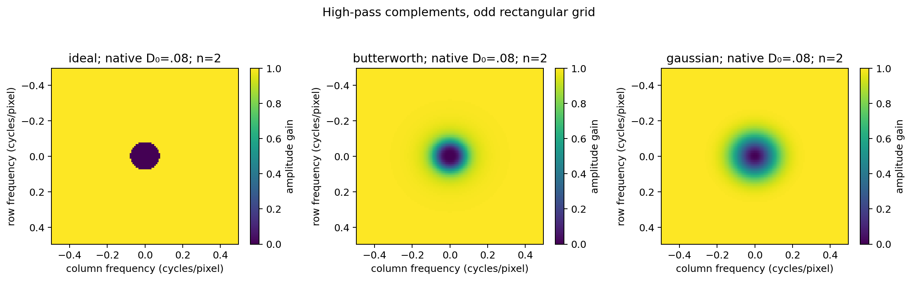

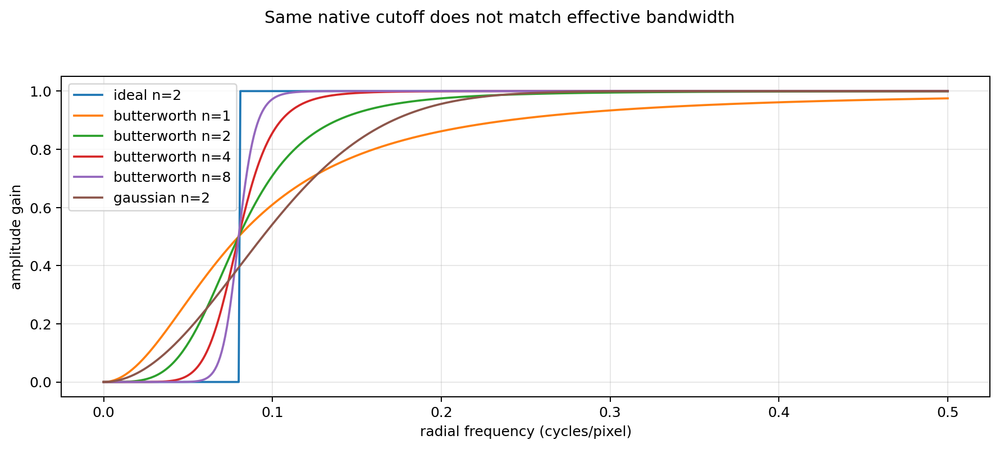

Butterworth orders 1, 2, 4 and 8 are explored. Equal native cutoff values do not match effective bandwidth: Butterworth HP has gain .5 at $D_0$, Gaussian has $1-e^{-1/2}$, and ideal jumps. Native-cutoff comparisons are labeled accordingly. Lab 04 documents response matching. Very small positive HP gains can round to zero in complement subtraction; this implementation intentionally preserves exact complementarity with the existing low-pass arrays. Extreme finite cutoffs inherit stable evaluation from Lab 04.

As $D_0\to\infty$, pure HP tends to zero; as $D_0\to0^+$, it tends to removal of the mean, rather than the identity on constants.

## Five distinct operators and DC gains

Let $L=LP(f)$ and $P=f-L$ on the same domain and extension.

| Method/API name | Spatial relation | Response | DC gain |
| --- | --- | --- | --- |
| Pure HP / `hp` | $P$ | $H_{HP}$ | 0 |
| Unsharp / `unsharp` | $f+kP$ | $1+kH_{HP}$ | 1 |
| High-boost / `boost` | $Af-L$ | $(A-1)+H_{HP}$ | $A-1$ |
| Emphasis / `emphasis` | $af+bP$ | $a+bH_{HP}$ | $a$ |
| Laplacian / `laplacian` | $f-s\Delta f$ | $1-sH_\Delta$ | 1 |

Parameters satisfy $k,a,b,s\ge0$ and $A\ge1$. High-boost $A=1$ is pure HP; $A=2$ equals USM $k=1$. USM equals emphasis with $a=1,b=k$, and high-boost equals emphasis with $a=A-1,b=1$. Other parameter combinations generally differ. Changing $A$ changes mean brightness gain; changing $k$ preserves DC.

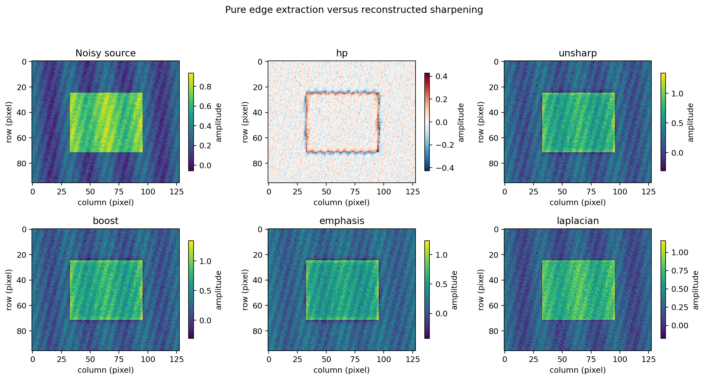

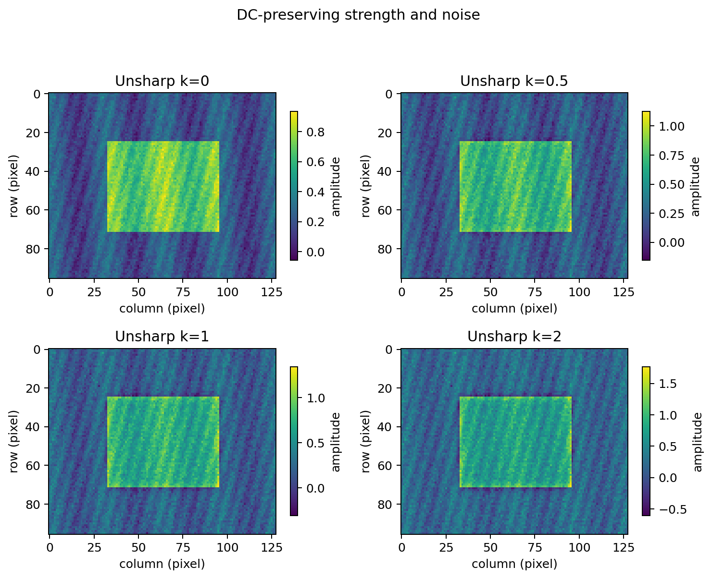

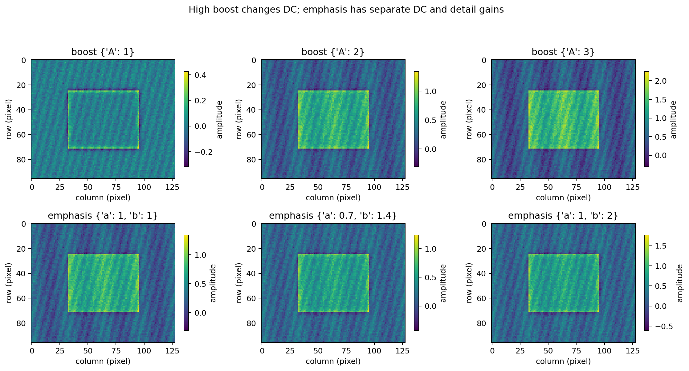

Pure HP outputs are signed edge/texture fields. No absolute-value reconstruction, numeric clipping or uint8 conversion is applied. Signed displays have symmetric color ranges; other panels use individual measured ranges. Each colorbar reports amplitude. These per-panel ranges can visually exaggerate weak responses, so compare numerical tables and shared-axis profiles for absolute strength.

## Discrete Laplacian and sharpening sign

The independent periodic four-neighbor stencil is

$$\Delta f[m,n]=f[m+1,n]+f[m-1,n]+f[m,n+1]+f[m,n-1]-4f[m,n].$$

Indices wrap modulo the corresponding dimension, including singleton axes. Applying the stencil to a complex Fourier mode gives

$$H_\Delta=e^{2\pi jf_y}+e^{-2\pi jf_y}+e^{2\pi jf_x}+e^{-2\pi jf_x}-4
=-4[\sin^2(\pi f_y)+\sin^2(\pi f_x)].$$

Because this is nonpositive, sharpening subtracts $s\Delta f$, giving $1-sH_\Delta\ge1$. The maximum discrete corner gain on an even grid is $1+8s$. The continuous Laplacian is instead $-4\pi^2(f_y^2+f_x^2)$, describing a different differentiation operator. At one-axis Nyquist, discrete response is $-4$ while continuous response is $-\pi^2$. Taylor expansion explains only low-frequency approximate agreement.

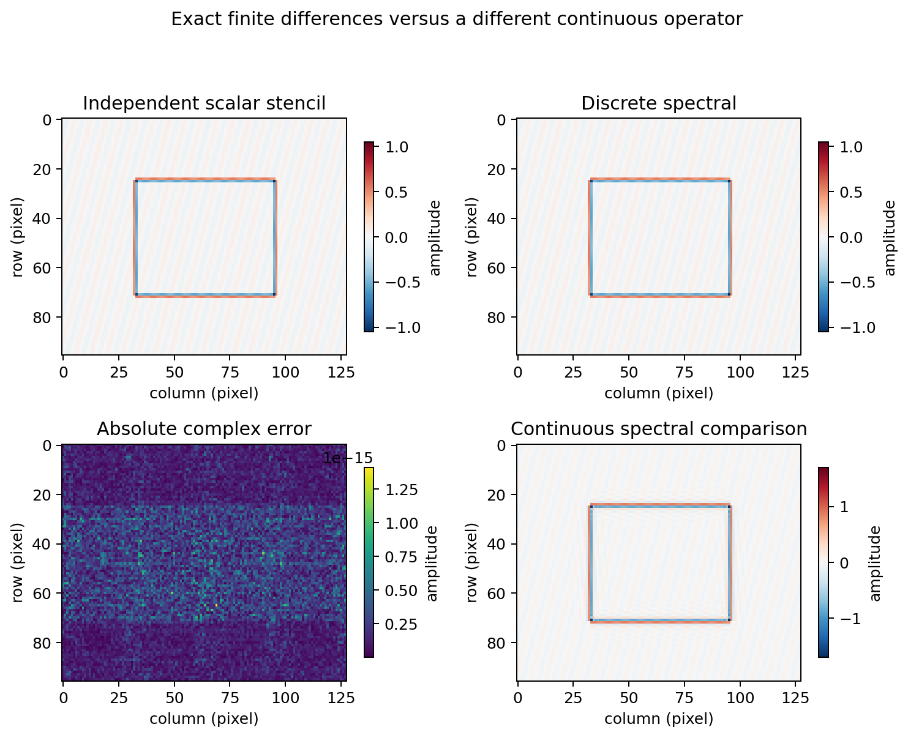

The spatial scalar loop never calls an FFT or spectral response helper. Tests also use separately indexed stencils and eigenmodes. An arbitrary bounded ideal/Butterworth/Gaussian HP complement is not the Laplacian.

## Synthetic inputs and experiments

Images have shape $96\times128$, normalized coordinates $x=n/128,y=m/96$, constant .7, impulse at `(48,64)`, unit step at column 64, a centered rectangle on $.25<x,y<.75$, a ramp, a 12-cycle column cosine and oblique sinusoidal texture. The clean measurement image is

$$f=.2+.5\,\mathrm{rectangle}+.1\cos(2\pi4x)+.06\sin(2\pi(18x+4y)).$$

Seed 505 generates normal noise with standard deviation .04. Clean, noisy and noise arrays are retained separately, allowing the independent check $T(f+\epsilon)-T(f)=T(\epsilon)$.

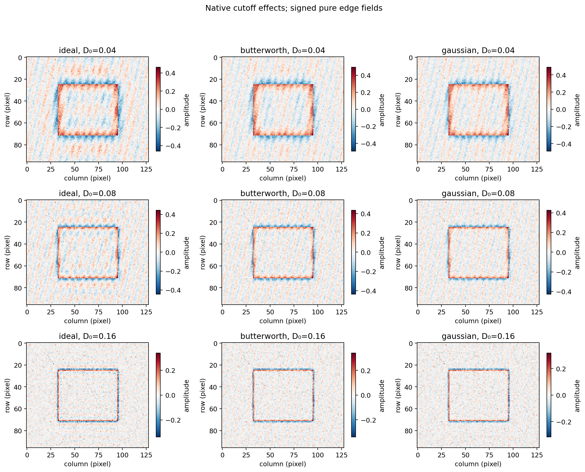

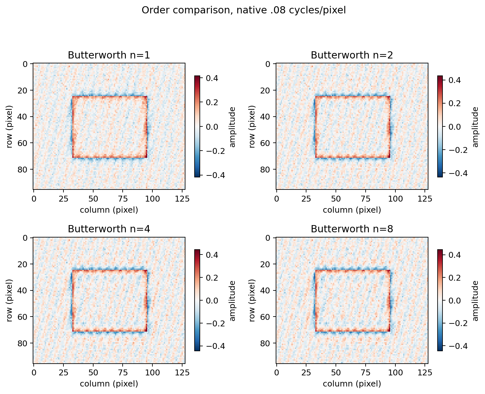

Cutoffs .04, .08 and .16 cycles/pixel are compared. A higher HP cutoff suppresses more low-frequency information; increased Butterworth order sharpens its transition. Neither nominal cutoff equality nor large gradient energy establishes perceptual superiority.

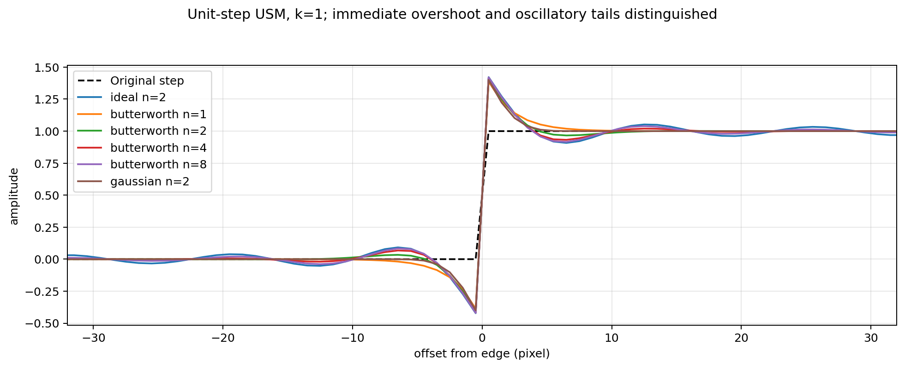

The physical central step is at column 63.5. Ringing metrics use `[40:88]`, away from the local neighborhood of the periodic seam. Overshoot is excursion above the method's DC-gain plateau; undershoot is excursion below zero. USM adds an edge pulse, so even a Gaussian-based USM overshoots an ideal discontinuity. The reported maximum includes immediate enhancement and does not isolate oscillatory Gibbs tails. The complete profiles expose ideal-filter oscillations separately. Finite-grid measurements are not universal Gibbs constants.

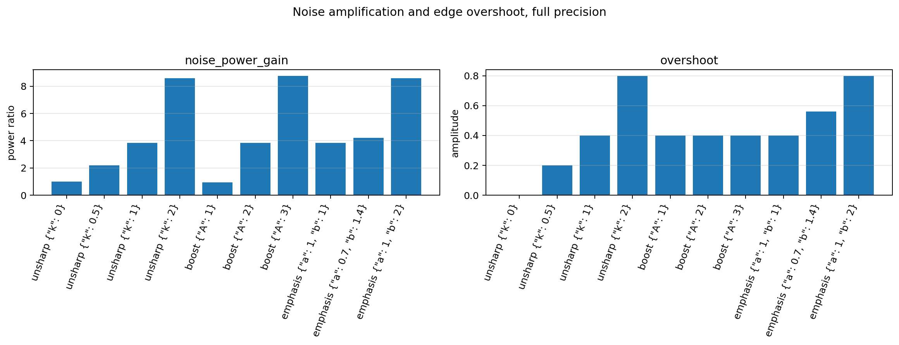

Noise power gain is $\operatorname{mean}|T(\epsilon)|^2/\operatorname{mean}|\epsilon|^2$. MSE compares output to the original clean input; a pure edge field or DC-changing reconstruction is not expected to reproduce that target. Gradient energy sums mean squared periodic adjacent differences over both axes, including seams. Mean error is $|\operatorname{mean}(g)-H[0,0]\operatorname{mean}(f)|$. No metric is labeled as a universal quality score.

| Method | DC | Noise power gain | MSE | Imaginary residual |
| --- | ---: | ---: | ---: | ---: |
| hp | 0 | 0.937079875 | 0.149111549 | 1.397e-16 |
| unsharp | 1 | 3.852533229 | 0.009510808 | 3.573e-16 |
| boost | 1 | 3.852533229 | 0.009510808 | 3.573e-16 |
| emphasis | 0.7 | 4.203820842 | 0.022742767 | 3.857e-16 |
| laplacian | 1 | 3.374953762 | 0.005910795 | 3.148e-16 |

Native Gaussian cutoff .08; USM k=1, boost A=2, emphasis a=.7/b=1.4, Laplacian s=.2.

| USM at native .08 | Order | Overshoot | Undershoot |
| --- | ---: | ---: | ---: |
| ideal | 2 | 0.421875000 | 0.421875000 |
| butterworth | 1 | 0.387027725 | 0.387027725 |
| butterworth | 2 | 0.411251484 | 0.411251484 |
| butterworth | 4 | 0.417905713 | 0.417905713 |
| butterworth | 8 | 0.419522077 | 0.419522077 |
| gaussian | 2 | 0.399734869 | 0.399734869 |

Maximum absolute complex error over 12 checks: **1.410169929999e-15**. Continuous and discrete Laplacian outputs differ by **0.648789191** maximum amplitude, as expected for different operators.


## Boundaries

`padding=(py,px)` adds those samples to **both ends** of each axis, using zero or reflection extension. Reflection excludes edge samples; singleton axes repeat their only value. Filtering remains periodic on the enlarged shape. Crop is exactly `[py:py+M, px:px+N]`. Cutoff stays in cycles/pixel.

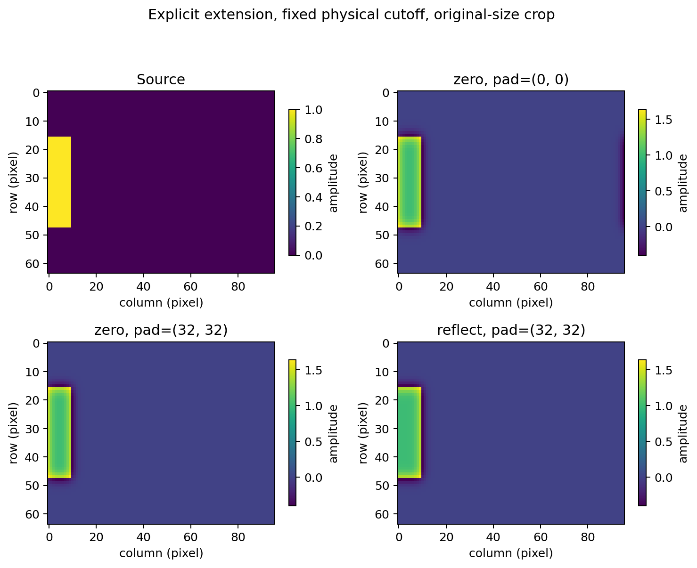

A $64\times96$ boundary-touching rectangle is sharpened with Gaussian USM, using no padding or pads 32. Zero extension and reflection define different neighboring data. Padding moves the seam without universally eliminating global filter tails. Mean/DC identities concern the full periodic domain, not necessarily the original crop of a zero-extended input. A ramp has a periodic seam discontinuity and therefore yields a seam edge.

## Interface, numerical validation and portability

[sharpen.py](sharpen.py) exposes `high_pass`, `response`, `apply`, `laplacian_response` and independent `spatial_laplacian`. `apply` returns Lab 04's `FilterResult`: complex values, full-inverse imaginary residue for real inputs, padded shape and crop start. It supports finite numeric 2D arrays, real/complex, noncontiguous views, singleton axes and rectangular odd/even shapes without mutation.

Cutoffs are positive finite float64-representable scalars. Strengths are finite nonnegative scalars, with $A\ge1$. Order must be an integer 1–1024, and `centered` boolean. Images, shape/padding, family and boundary validation reuse Lab 04. Common cutoff/kind/order arguments are validated even for the Laplacian method, although its response does not depend on them. Overflowing generated responses/outputs raise an error. Choose strengths appropriate for image dynamic range.

Exact comparisons use `rtol=atol=1e-10` in double precision. Independent oracles include analytical complex modes, explicit scalar convolution, finite differences, and independently constructed padded responses. Tests do not assume a subjective sharpness ranking.

Fresh execution: **131 collected, 131 passed, 0 failed, 0 skipped**. All **834 combined chapter tests** passed, including 703 previous tests. All eight assignment suites passed baseline validation. Full normal validation and full regeneration are also verified in disposable snapshots; full logs are supplied separately in the review package. A real Windows runtime is not available.

The local [.gitattributes](.gitattributes) forces LF for generated CSV/JSON and source documentation, and binary handling for PNG/NPZ. Repository-wide settings remain unchanged. JSON regeneration explicitly uses UTF-8 and `newline="\n"`; CSV regeneration uses an explicit LF record terminator, so native Windows generation also preserves the invariant. [audit.py](audit.py) checks **raw** sizes/hashes, full PNG decoding, tables, arrays and independent Laplacian agreement. Forced CRLF tampering is rejected, not normalized away.

Tests perform actual disposable Git index/`checkout-index` cycles with command-local `core.autocrlf=true` and `false`. Both restored artifact sets must pass the same strict audit. They create no commit or working branch and do not change owner settings. These are Linux simulations; a real Windows runtime is unavailable. The owner must perform final Windows acceptance.

Numeric tests inspect `np.finfo` capacities. They accept `longdouble(.1)` and `longdouble(float64.max)`, reject Python integer `10**400` reliably, and reject an extended maximum only if its actual range exceeds float64. When the ranges match, that maximum must be accepted. Dtype alone is not grounds for rejection.

## Artifacts and limitations

All scientific outputs are included:

| File | Contents |
| --- | --- |
| [metrics.json](output/metrics.json) | Settings, measured tables and twelve exact checks |
| [measurements.csv](output/measurements.csv) | Five operator/DC/noise/gradient cases |
| [parameters.csv](output/parameters.csv) | Ten unsharp/boost/emphasis settings |
| [ringing.csv](output/ringing.csv) | Six ideal/Butterworth/Gaussian USM profiles |
| [cutoff_sweep.csv](output/cutoff_sweep.csv) | Nine cutoff/filter RMS measurements |
| [radial.csv](output/radial.csv) | 3006 radial gain samples |
| [reference_arrays.npz](output/reference_arrays.npz) | 29 float64/complex128 arrays; read with `allow_pickle=False` |
| [artifact_manifest.json](output/artifact_manifest.json) | Payload SHA-256 and byte sizes |

The existing PNG publisher encodes in memory, verifies checksums and full pixel decoding, checks and fsyncs a temporary write, atomically replaces and checks final bytes. There are no silent retries. Post-generation auditing checks again. Successful runs do not establish that historical intermittent truncation is fixed. Old assignment algorithms and save behavior remain unchanged. Internal logs are supplied separately in the review package; public links need no internal reports.

Mask generation/multiplication is $O(MN)$, FFT filtering $O(MN\log(MN))$ with $O(MN)$ storage, using enlarged dimensions after padding. Independent spatial Laplacian is $O(MN)$. No unmeasured timing claims are made. Assumptions are square unit-spaced 2D pixels and the stated boundary model; adaptive sharpening, arbitrary physical spacings and Lab 06 are outside scope. Complement subtraction may round tiny gains to zero, and synthetic rankings need not generalize to real images.

References: the task's supplied high-pass/sharpening relationships, [Lab 04](../04-low-pass-filters/README.md) for frequency/normalization conventions, and [Lab 03](../03-fourier-properties/README.md) for periodic finite differences and PNG reliability. No unavailable PDF pages are represented as inspected.
