# Chapter 04 · Lab 06 — Homomorphic Filtering and Illumination Correction

This independent laboratory tests a multiplicative illumination model with **known synthetic reflectance and illumination**. It studies log-domain filtering, brightness compression, detail amplification, parameter sensitivity, boundary assumptions and noise. It is an educational correction model, not a uniquely identifiable physical decomposition of an arbitrary photograph. All numerical arrays retain float64/complex128 precision; display limits never alter the data.

The course PDF is unavailable in this rebuilt environment. The supplied course context identifies Chapter 04 pages 34–35 with homomorphic filtering; those pages were **not independently inspected** here. The relationships used are derived below, and no PDF, personal information or third-party image is distributed. This lab does not implement subsequent laboratories.

## Reproduce

Use the repository's unchanged Python 3.12 requirements, from its root:

```bash
python -m venv .venv
python -m pip install -r requirements.txt
python chapter-labs/chapter-04-frequency-domain/06-homomorphic-filtering/experiment.py
python chapter-labs/chapter-04-frequency-domain/06-homomorphic-filtering/artifact_audit.py
python -m pytest -q chapter-labs/chapter-04-frequency-domain/06-homomorphic-filtering/tests
python scripts/validate_repository.py
```

Activate the environment before installing, or invoke its Python executable directly. On Linux/macOS use `source .venv/bin/activate`. On Windows PowerShell:

```powershell
.\.venv\Scripts\Activate.ps1
# If activation is blocked by local policy, use this executable directly:
.\.venv\Scripts\python.exe -m pip install -r requirements.txt
```

The runner accepts `--output-dir PATH`; otherwise it writes beside its own script, independent of working directory. It produces 11 figures, 32 named reference arrays, four CSV tables, numerical JSON and a content manifest. Seeds and settings are deterministic. There are no performance pass/fail assertions or added dependencies.

Run `python scripts/validate_repository.py --regenerate` **only in a disposable snapshot**. Export exact base `320238de5c718e56741f9cd2390f913cb34c5502` with `git archive`, extract it separately, then use `git apply --check --binary /path/to/Lab06-feature-changes.patch` and `git apply --binary /path/to/Lab06-feature-changes.patch` inside that snapshot. No branch or commit is needed. Existing assignment outputs can be rewritten by their runners; the review package preserves the regeneration logs and independent PNG audit.

## Mathematical model and conventions

For positive intensity,

$$f[m,n]=i[m,n]r[m,n],\qquad z=\ln f=\ln i+\ln r.$$

With backward DFT normalization,

$$Z[k,l]=\sum_{m=0}^{M-1}\sum_{n=0}^{N-1}z[m,n]e^{-2\pi j(km/M+ln/N)},$$

$$s[m,n]=\frac1{MN}\sum_{k=0}^{M-1}\sum_{l=0}^{N-1}H[k,l]Z[k,l]e^{2\pi j(km/M+ln/N)},\qquad g=e^{\operatorname{Re}s}.$$

The original PDF's symbol choices need not match these names. Image rows increase downward and columns rightward; square pixels have unit spacing. With signed frequency bins, $f_y=k_y/M$, $f_x=k_x/N$ in **cycles/pixel**, and

$$D=\sqrt{f_x^2+f_y^2},$$

$$H(D)=\gamma_L+(\gamma_H-\gamma_L)\left[1-\exp\left(-c\frac{D^2}{D_0^2}\right)\right].$$

Require finite $D_0,c>0$ and $0<\gamma_L\le\gamma_H$. Typical correction uses $\gamma_L<1<\gamma_H$, but identity and other positive gain cases remain supported. $H(0)=\gamma_L$ **exactly**, and the asymptotic high-frequency limit is $\gamma_H$. A finite sampled grid need not attain that limit. $D_0$ is a transition scale: $H(D_0)=\gamma_L+(\gamma_H-\gamma_L)(1-e^{-c})$, not a universal half-gain cutoff. Radial corners can exceed .5 cycles/pixel even though .5 is the single-axis Nyquist magnitude.

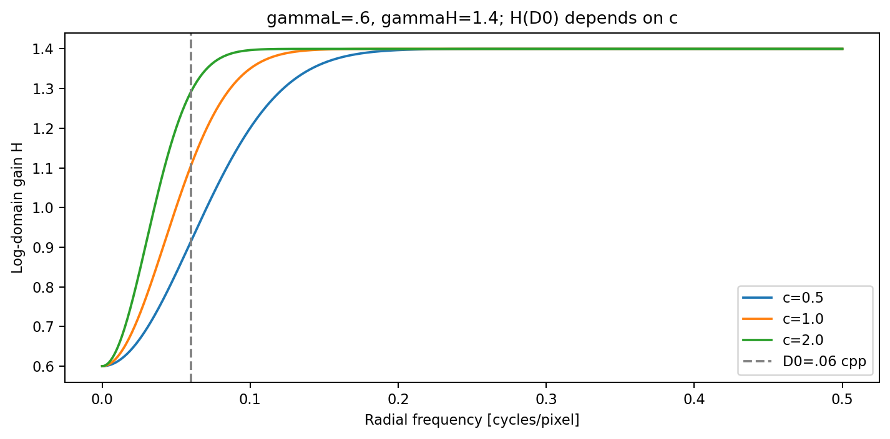

Responses default to unshifted FFT ordering with DC at `[0,0]`. Centered responses are returned to that order with `ifftshift`, including odd dimensions. Only plotted spectra use `fftshift`; spatial inputs are not shifted. Lab 04 supplies the unchanged frequency-radius generator and ordinary Gaussian LP baseline. Lab 03 supplies its unchanged in-memory encoding, verified, fsynced, atomic PNG publisher. Explicit named imports in `homo_support.py` avoid generic module-cache collisions; no previous implementation is copied or edited.

### Exact analytical checks

For a constant $f=a>0$, $g=a^{\gamma_L}$. If $\gamma_L=\gamma_H=1$, $H=1$ and $g=f$ to numerical precision. For a global positive factor $q$,

$$T(qf)=q^{\gamma_L}T(f),$$

because $\ln q$ contributes only to DC. This is **not** ordinary linearity in intensity. For a bin-aligned log cosine $z=A\cos(2\pi(km/M+ln/N))$, the output is $\exp(H(D)z)$; tests use this independent expectation rather than deriving an expected output through the filtering implementation.

## Numerical contract and edge cases

`homomorphic.filter_image` accepts a nonempty real numeric 2D array and returns `FilterResult`: positive intensity, filtered log intensity, full-domain maximum imaginary residual, padded shape, crop start, floor count, zero-underflow count and positive-subnormal count. Complex inputs are rejected even if their imaginary part is zero; log intensity is a real positive model. Rectangular, even, odd and singleton axes are supported.

Strict mode rejects nonpositive values. An explicit `floor=t` applies $\max(f,t)$, records how many original pixels changed, and alters the model accordingly. It does not add an epsilon to every pixel. Inputs are not mutated. NaN/Inf, nonnumeric arrays, invalid dimensions, invalid scalars and unrepresentable float64 values are rejected.

Padding `(py,px)` reflects the **intensity after an optional floor and before log**, adding the stated amount to each end of its axis. The enlarged domain remains periodic. The output crop starts at `(py,px)` and retains the original shape. Singleton axes repeat their sole sample. No logarithm is applied to zero padding, and reflection is a changed boundary model, not an exact infinite-image solution.

The full inverse transform is checked for finite values, and its maximum absolute imaginary component is measured **before real extraction and cropping**. Generated real modular-even responses preserve Hermitian symmetry; the tiny imaginary remainder is roundoff.

The exponential raises on overflow; there is no clipping to the float limit. Zero underflow raises by default. `underflow='allow'` explicitly permits and counts zeros; positive subnormal values remain retained and counted in either mode. Those counts cover the full padded domain. Internal response evaluation uses logarithmic ratios to avoid overflowing $c(D/D_0)^2$; only an exponent tail whose outer exponential already rounds to zero is capped. `np.longdouble` is accepted or rejected according to actual finite float64 representability, not the dtype name or platform-specific precision.

Near the largest representable intensity, even an identity transform may lack enough exponent headroom for FFT roundoff; an overflow guard may conservatively reject such a case. Use normalized physical intensities with headroom; this is not fixed by hidden clipping. Native Windows and Python 3.14 were unavailable for this run; Linux Git/CRLF simulations are not native Windows acceptance.

## Synthetic methodology

Shape is $96\times128$, $x=n/128$, $y=m/96$. Reflectance is

$$r=\exp[.12\cos(2\pi(17x+5y))+.08\sin(2\pi31x)+.18B],$$

where $B=1$ inside $.22<x<.72$, $.23<y<.75$, and zero elsewhere. Illumination fields are:

| Scene | Known illumination $i$ |
| --- | --- |
| Uniform | $.7$ |
| Gradient | $\exp(-1.3+1.6x)$ |
| Vignette | $\exp[-2.2((x-.5)^2+(y-.5)^2)]$ |
| Sinusoidal | $\exp[-.6+.7\cos(2\pi x)+.35\sin(2\pi y)]$ |
| Dark | $\exp(-2.5+1.8x)$ |

Defaults are $\gamma_L=.6,\gamma_H=1.4,D_0=.06,c=1$. Five scenes each compare input, global power $.6$, ordinary intensity-domain Gaussian LP $.06$ cycles/pixel, identity gains 1/1 and homomorphic correction: 25 measurements. Intensity LP is a smoothing control, not an equivalent illumination separator.

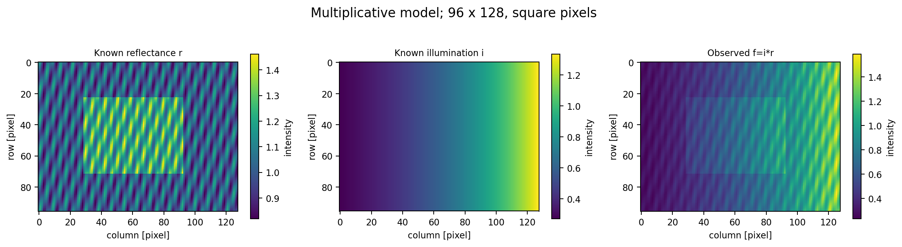

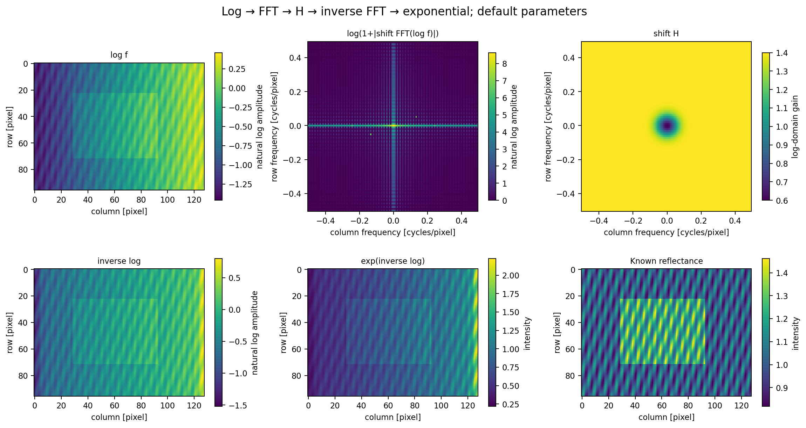

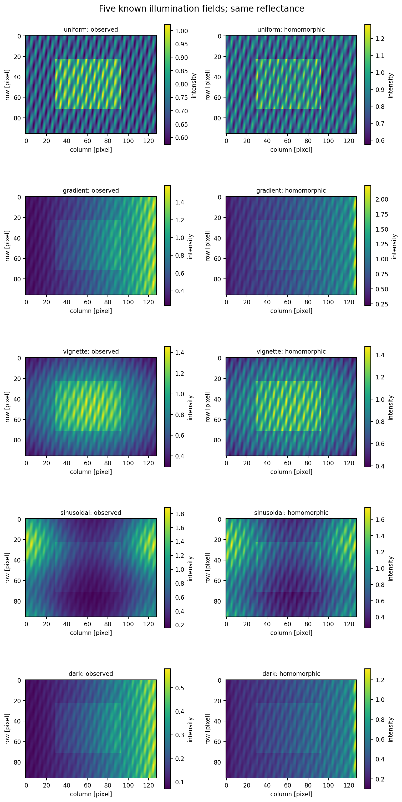

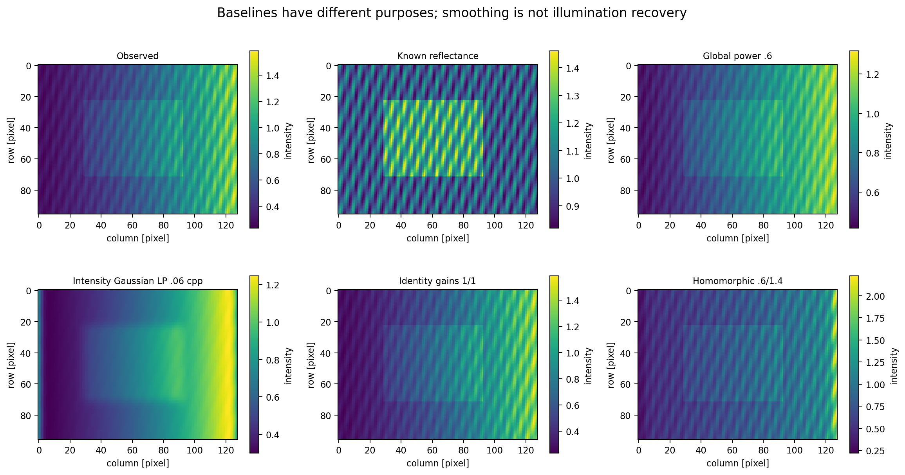

The gain sweep uses $\gamma_L\in\{.3,.6,1\}$ and $\gamma_H\in\{1,1.4,2\}$ (nine combinations). Transition sweeps use $c\in\{.5,2\}$ and $D_0\in\{.03,.06,.12\}$ (six more). The radial table has 501 samples per each of three $c$ values, or 1503 records.

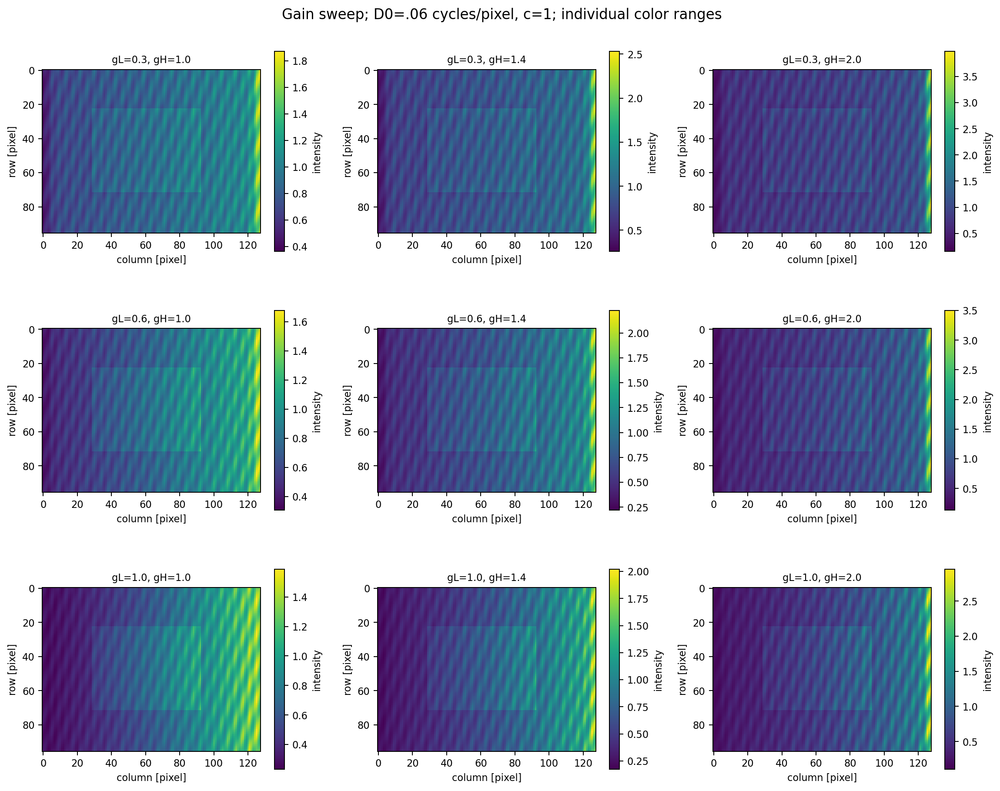

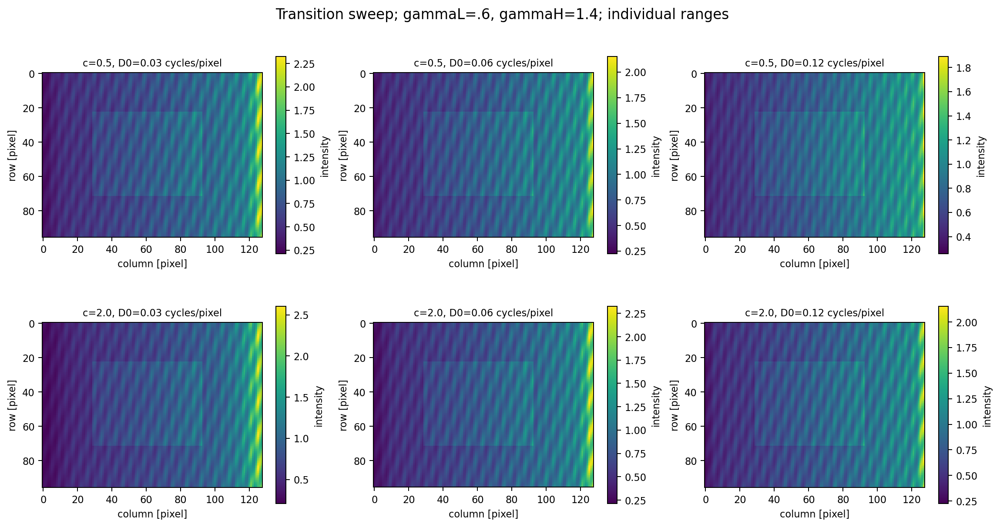

## Metrics and measured interpretation

Illumination and reflectance have a multiplicative scale ambiguity: $ir=(ai)(r/a)$. For known truth, define $d=\ln g-\ln r$, $\mu=\operatorname{mean}(d)$ and $e=d-\mu$. Report aligned log RMSE $\sqrt{\operatorname{mean}(e^2)}$, the removed log offset $\mu$, and aligned intensity RMSE between $e^{-\mu}g$ and $r$. This is one global scale alignment, not local contrast normalization or a fitted spatial illumination correction.

Low-frequency residual standard deviation is the standard deviation of $LP_{.03}(e)$ with Gaussian frequency standard deviation .03 cpp. Detail ratio is $\operatorname{std}[(1-LP_{.08})\ln g]/\operatorname{std}[(1-LP_{.08})\ln r]$; undefined near-constant truth returns JSON null/empty CSV. These metrics measure residual error against known truth, not an identified illumination estimate. Seams, noise and altered reflectance can contribute. Mean intensity and log dynamic range are also retained.

Actual gradient results from `output/measurements.csv`:

| Method | Aligned log RMSE | Low-frequency log residual std | Detail std ratio |
| --- | ---: | ---: | ---: |
| Input | 0.461866120 | 0.397422019 | 1.403999773 |
| Global power .6 | 0.283790511 | 0.241665551 | 0.842399864 |
| Ordinary LP | 0.440738773 | 0.389468942 | 0.234401508 |
| Identity | 0.461866120 | 0.397422019 | 1.403999773 |
| Homomorphic | 0.343569830 | 0.253906662 | 1.937296158 |

Homomorphic correction improves the gradient's residual error compared with input, but the global-power control scores better here. The default also amplifies detail above truth. For uniform illumination, the input aligned log RMSE is approximately $5.10\times10^{-17}$ while correction raises it to **.049239335**: a concrete unnecessary-enhancement failure. Low-frequency reflectance and sharp illumination cannot generally be separated by frequency alone. Enhanced visibility is not proof of recovered physical reflectance.

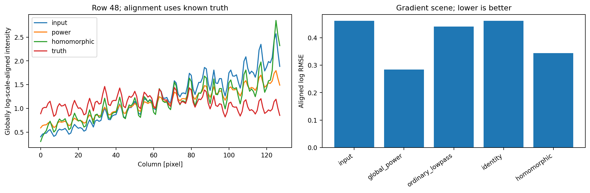

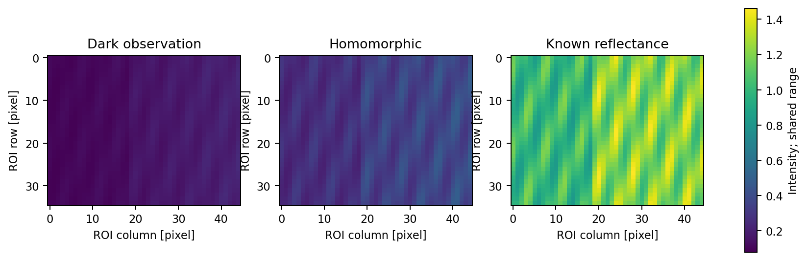

Most other panels use individual actual colorbar ranges, explicitly labeled; do not infer absolute brightness equivalence from apparent similarity. Quantitative profiles use a declared single global log alignment to known truth. No data are clipped or converted to uint8.

## Additive noise and dark-value sensitivity

For small additive $\eta$, $\ln(f+\eta)\approx\ln f+\eta/f$. Thus dark inputs magnify additive perturbations in log space. Seed 606 supplies one standard-normal field. A bright comparison adds noise of standard deviation .004 to the dark scene. A sensor-scale experiment holds absolute noise at $2\times10^{-6}$ while scaling signal by 1, $10^{-4}$ and $10^{-5}$, uses explicit floor $10^{-7}$ and $\gamma_H=1.8$. Compare each noisy result against a clean control with the same scale, parameters and floor.

| Signal scale | Floored original pixels | Output delta RMS / raw noise RMS | Log-output delta RMS |
| --- | ---: | ---: | ---: |
| 1 | 0 | 3.513371 | 0.000022222 |
| $10^{-4}$ | 0 | 142.293431 | 0.230659 |
| $10^{-5}$ | 2029 | 792.094389 | 2.257789 |

This output/input RMS ratio includes nonlinear gain and changed brightness; it is not a scale-invariant SNR metric. The log-output diagnostic provides complementary evidence. Floor activation is a substantial model change, not numerical recovery of lost information.

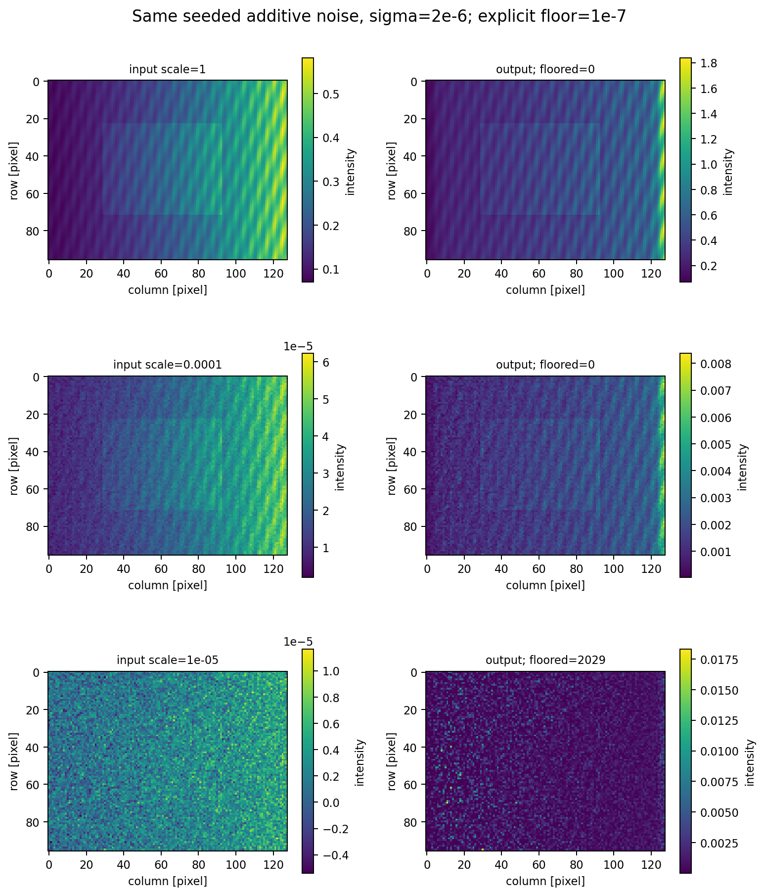

## Boundaries

The gradient is not periodic at its left/right seam. Reflect padding adds 32 pixels to each end of both axes, producing $160\times192$, followed by crop `[32:128,32:160]`. Maximum absolute difference between periodic and reflected default outputs is **.937093600**. This is a boundary-model effect, not an FFT numerical error. No universal claim that reflection is superior is made; extension assumptions must match the scene.

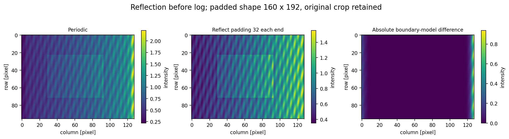

## Validation, portability and artifact integrity

Pytest uses analytic constants, log Fourier modes, global scaling, identity, Hermitian symmetry and explicit independent reflection/FFT formulas on real float64 inputs of shapes `(1,1)`, `(1,7)`, `(6,1)`, `(5,7)`, `(6,8)`, `(7,6)`. It checks DC, ordering, cutoff extremes, floor/no-mutation behavior, invalid input, underflow/overflow/subnormals, scalar capabilities, noise and analytical metric normalization. Suitable cases use `rtol=atol=1e-10`; no tolerance was loosened to suppress a failure. This rebuilt execution passed **89 new tests and 923 combined chapter tests**, including all 834 earlier chapter tests. The normal repository validator also passed all eight assignment suites and all six chapter suites. The separate disposable regeneration run failed in an existing assignment with truncated PNGs; it is not reported as passing. The 15 generated mathematical checks have maximum absolute error **3.552713678800501e-15** in this execution.

`artifact_audit.py` verifies exact file and array inventories, UTF8/CSV/JSON integrity, all 11 complete PNG decodes, 32 array shapes/dtypes/finiteness, analytic scene factors, independent frequency responses and inverse reconstruction, baseline/parameter/noise tables, floor counts and reference arrays. It recomputes the metric formulas independently; forging table numbers together with updated hashes still fails scientific verification.

For JSON/CSV only, canonical hashing changes CRLF to LF, rejects bare CR, rejects invalid UTF8 and a BOM, and otherwise preserves every byte, including spaces and numeric content. Physical and canonical byte counts/hashes plus normalization flags are reported. Binary PNG/NPZ hashes remain exact. `.gitattributes` guides future Git checkouts but is not trusted as the integrity mechanism. Tests use **actual `git apply --check --binary` and `git apply --binary`** with `core.autocrlf=true` and `false`, including binary scientific files. Separate review checks apply the complete feature patch to the exact base.

The existing validator's regenerated comparison PNG checks in the resize assignment historically did not guarantee full decode. This lab changes none of that assignment's code. The review workflow independently checks every real PNG after full regeneration in a disposable snapshot and preserves any failed bytes and diagnostics outside the public patch. A clean observed run does not establish that the historical intermittent truncation is fixed. See the delivered `REVIEW.md` and raw validation logs for this execution's actual results and any failures.

## Complexity and limitations

For $P=M'N'$ padded samples, two FFTs take $O(P\log P)$ time and $O(P)$ working storage; response/log/exp and cropping take $O(P)$. Direct DFT would take $O(P^2)$ and is unnecessary for these image sizes. Lab 01's manual transforms are not duplicated. Repeated sweeps repeat FFT work intentionally for transparent experimental isolation.

The decomposition assumes slowly varying illumination and comparatively faster reflectance, which overlap in real scenes. Sharp shadows, broad objects, saturation, additive sensor noise, zero/negative samples and unknown radiometry violate or weaken it. There is no unique unsupervised recovery guarantee, no automatic parameter estimator, no color-space treatment, no clipping-based stabilization and no claim of native Windows execution.

## Files and references

- `homomorphic.py`: mathematical API and numerical policy.
- `homo_support.py`: explicit unchanged Lab 03/04 reuse.
- `homo_metrics.py`: scale-aware known-truth metrics.
- `experiment.py`: deterministic synthetic inputs and 11 figures.
- `portable_artifacts.py`, `artifact_audit.py`: canonical integrity and independent scientific verification.
- `tests/`: numerical, corruption and Git binary-apply tests.
- `output/metrics.json`, `measurements.csv`, `parameters.csv`, `noise.csv`, `radial.csv`: measured results.
- `output/reference_arrays.npz`: all 32 full-precision reference arrays, load with `allow_pickle=False`.

References: the supplied Chapter 04 homomorphic-filter relationship (original PDF unavailable); Gonzalez and Woods, *Digital Image Processing*, frequency-domain homomorphic filtering; NumPy's DFT backward-normalization convention as independently checked by this laboratory; unchanged repository Labs 01, 03, 04 and 05. No textbook text or third-party illustration is reproduced.
