# Chapter 04 · Lab 07 — Band-Reject and Notch Filtering

This laboratory compares three radial band-reject filters and three local notch-reject filters against known periodic interference. Ten deterministic synthetic conditions retain the clean image, separate periodic and Gaussian noise, exact frequency/amplitude/phase parameters and corrected arrays. An optional spectral detector proposes candidate pairs; it never declares that every bright peak is noise or silently filters an image.

**Course alignment:** the task identifies PDF page 9 of `Chapter04-Art.pdf` as introducing Band-Stop/Band-Reject and Notch filters. That original PDF is unavailable in this execution, so no claim of independently reading its page is made. The six requested filter families are implemented with the explicit mathematical conventions below and checked against analytical cases. University references are linked at the end; no PDF or third-party image is redistributed. Only Lab 07 is added.

## Reproduce

Use the unchanged repository requirements and Python 3.12, from its root:

```bash
python -m venv .venv
# Linux/macOS activation:
source .venv/bin/activate
python -m pip install -r requirements.txt
python chapter-labs/chapter-04-frequency-domain/07-notch-band-reject-filtering/experiment.py
python chapter-labs/chapter-04-frequency-domain/07-notch-band-reject-filtering/notch_audit.py
python -m pytest -q chapter-labs/chapter-04-frequency-domain/07-notch-band-reject-filtering/tests
python scripts/validate_repository.py
```

Windows PowerShell activation is directly executable from the repository root:

```powershell
.\.venv\Scripts\Activate.ps1
# Activation is optional; if policy blocks it, use the interpreter directly:
.\.venv\Scripts\python.exe -m pip install -r requirements.txt
```

The experiment runner accepts `--output-dir PATH`; its default is `output/` next to the script, independent of working directory. It recreates all 12 PNGs, five CSV tables, JSON metrics, 99 reference arrays in NPZ and the artifact manifest. No new dependency is required. Unit tests load immutable generated outputs rather than regenerating every figure repeatedly.

Run full `python scripts/validate_repository.py --regenerate` **only in a disposable snapshot**. The complete review package includes commands and logs; historical old-assignment PNG truncation is not presumed solved. For exact-base review, export `0993f92c46b0198490334b565799ca6fcf5e47e9` into a separate directory with `git archive`, extract it, and run `git apply --check --binary /path/to/Lab07-feature-changes.patch`, then `git apply --binary /path/to/Lab07-feature-changes.patch` there. No branch or commit is required.

## Frequency coordinates and DFT convention

For an $M\times N$ array, rows $m$ increase downward and columns $n$ rightward. Square pixels have unit spacing. Signed frequencies are $f_y=k_y/M$ and $f_x=k_x/N$, in **cycles/pixel**, using NumPy's principal FFT ordering. Radial distance is

$$D=\sqrt{f_y^2+f_x^2}.$$

Transforms use backward normalization:

$$F[k,l]=\sum_{m=0}^{M-1}\sum_{n=0}^{N-1}f[m,n]e^{-2\pi j(km/M+ln/N)},$$

$$g[m,n]=\frac1{MN}\sum_{k=0}^{M-1}\sum_{l=0}^{N-1}H[k,l]F[k,l]e^{2\pi j(km/M+ln/N)}.$$

DC is `[0,0]` in stored unshifted arrays. `centered=True` describes the response ordering; `ifftshift` returns it to FFT ordering before multiplication, including odd lengths. Only spectrum plots use `fftshift`. Frequency plots label both axes in cycles/pixel. A corner radius can exceed .5 even though .5 is the one-axis Nyquist magnitude.

Changing dimensions or padding changes the sampled frequency grid, **not** the physical cutoff, radius or center coordinates. Fixed synthetic frequencies also remain fixed in cycles/pixel when a requested image shape changes; an originally aligned frequency may then become off-bin.

## Radial band rejection: one explicit convention

Require radial center $D_0>0$, width $W>0$, integer Butterworth order $1\le n\le1024$. The ideal annulus rejects its endpoints:

$$H_{IBR}(D)=\begin{cases}0,&|D-D_0|\le W/2,\\1,&\text{otherwise}.\end{cases}$$

For the smooth families, define $Q=|D^2-D_0^2|/(DW)$ for $D>0$:

$$H_{BBR}(D)=\frac{Q^{2n}}{1+Q^{2n}}
=\frac1{1+\left[\frac{DW}{D^2-D_0^2}\right]^{2n}},$$

$$H_{GBR}(D)=1-\exp(-Q^2).$$

The Gaussian exponent has **no extra factor of one half** in this band convention. Exact singular-point definitions are $H(D_0)=0$ and, for the smooth families, $H(0)=1$. At the two positive radii satisfying $|D^2-D_0^2|=DW$, Butterworth gain is .5 and Gaussian gain is $1-e^{-1}$. Their radii are

$$D_\pm=\frac{\sqrt{W^2+4D_0^2}\pm W}{2}.$$

They differ by $W$ and have geometric mean $D_0$. Consequently smooth transition markers are not the ideal annulus's arithmetic endpoints $D_0\pm W/2$. Equal native parameters do not imply identical transition bandwidth at every gain. Orders apply only to Butterworth.

`protect_dc=True` explicitly sets DC to unity, including an ideal annulus wide enough to include DC. With `protect_dc=False`, ideal DC follows the stated annulus; smooth DC follows its analytic limit. This isolated DC exception is documented rather than silently changing the entire low-frequency neighborhood. A zero radial center is rejected because the chosen band-center convention and its DC limit would change; zero or negative widths are invalid, not interpreted via division by zero.

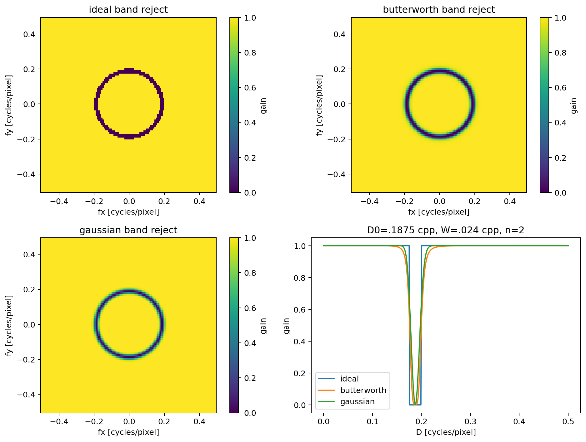

Annular rejection suppresses every orientation in the selected radial range. This can remove legitimate texture at the same radial frequency as interference in another direction.

## Local notch rejection: paired factors on a frequency torus

A center is an ordered pair $(c_y,c_x)$ in cycles/pixel, with each component in $[-.5,.5]$. $+.5$ explicitly aliases $-.5$. Out-of-range values are rejected rather than silently interpreted as bins. Supply one center per desired pair; conjugate duplicates are deduplicated.

For each axis, frequency distance wraps with period one:

$$\delta(f,c)=\min(|f-c|,1-|f-c|),\qquad
 d_c=\sqrt{\delta(f_y,c_y)^2+\delta(f_x,c_x)^2}.$$

This toroidal geometry treats near-Nyquist neighborhoods consistently across the principal-band seam. It differs deliberately from a non-wrapped Euclidean disk in a displayed centered rectangle.

Single-center factors are

$$P_I(d)=\begin{cases}0,&d\le r,\\1,&d>r,\end{cases}\qquad
 P_B(d)=\frac1{1+(r/d)^{2n}},\qquad
 P_G(d)=1-\exp\left(-\frac{d^2}{2r^2}\right).$$

Define $P_B(0)=P_G(0)=0$. Radius $r>0$ is a **single-factor native scale**, not a full bandwidth or a half-gain contour of the whole pair: $P_B(r)=.5$, $P_G(r)=1-e^{-1/2}$. Ideal includes the disk boundary. If $\mathcal C$ is the set of unique centers after adding conjugates,

$$H_{NR}(f_y,f_x)=\prod_{c\in\mathcal C}P(d_c).$$

This is a product of individual high-pass factors, **not** a different convention using the product of paired distances inside one Butterworth expression. Overlapping notches therefore multiply attenuations. DC/Nyquist self-conjugate centers occur only once, not as squared duplicate factors. On an odd axis, $-.5$ can still denote a physical center, but there is no bin exactly at that Nyquist coordinate.

Generated responses are real, finite, within $[0,1]$, and exactly even under modular index negation. Mathematically identical negation orbits share one computed representative to avoid roundoff asymmetry; no averaging of distinct physical filter designs is performed. A DC-centered notch requires explicit `protect_dc=False`. Otherwise DC remains exactly one even if a nearby or broad notch overlaps it; this does not protect all low-frequency image content.

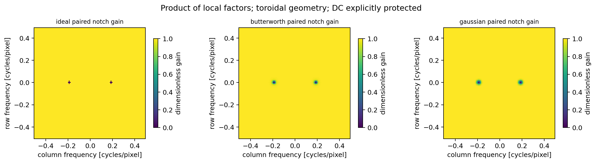

## API, precision and numerical limits

`band_profile` and `notch_profile` evaluate scalar or array distances. `band_reject` and `notch_reject` construct responses for odd, even, rectangular and singleton shapes. `apply_response` accepts a finite real shape-compatible response and retains complex128 inverse output; an externally supplied asymmetric real response can produce a meaningful imaginary part and is not silently projected to real.

`filter_image` pads, generates a response, applies it, then crops. It returns complex values, the **full inverse** imaginary residual for real input (`None` for genuinely complex input), padded shape and crop start. Padding `(py,px)` adds that amount to each end; modes are reflection excluding the edge sample or zeros. The enlarged domain remains periodic. No finite pad is claimed to reproduce a unique nonperiodic infinite-domain result.

Numeric input is converted to float64/complex128 and must be finite. No uint8 conversion, clipping, absolute-value reconstruction or hidden contrast normalization occurs. Signed high-amplitude observations are retained. Invalid shapes, nonfinite values, unsupported scalar types, bool-valued controls where a numeric parameter is required, nonpositive scales and invalid orders are rejected. `np.longdouble` is validated according to actual float64 representability, without assuming extra precision on Windows.

Smooth profiles evaluate logarithmic ratios and logistic forms. Band evaluation factors $|D^2-D_0^2|=|D-D_0|(D+D_0)$ to avoid overflowing squares and uses a log sum. Negligible underflow in exponent tails or log sums is permitted and does not create NaNs. Capping the nested exponent at 1500 affects only a tail whose outer exponential already rounds to zero. Direct use of $D^2$ at extreme scales is avoided in production. Very broad smooth rejection tends to zero at non-DC samples; very narrow rejection tends to unity away from an exact center. DC-protection overrides remain explicit in those limits. Floating-point finite resolution still limits how finely an off-grid center can be resolved.

## Synthetic ground truth and conditions

Default shape is $96\times128$, and $m,n$ below are actual pixel coordinates:

$$f=.4+.16B+.12\exp[-((n-76)/17)^2-((m-44)/13)^2]
+.06\cos(2\pi18m/96)+.035\sin(2\pi(5n/128+3m/96)),$$

where $B=1$ for $25<n<90$ and $24<m<70$. The legitimate horizontal texture at $(18/96,0)$ has the same radial frequency .1875 cpp as the main vertical interference at $(0,24/128)$.

Every periodic component is $A\cos(2\pi(f_y m+f_x n)+\phi)$:

| Condition | Frequency pairs $(f_y,f_x)$ in cpp | Amplitude and phase |
| --- | --- | --- |
| Horizontal stripes | $(16/96,0)$ | $.18,.3$ |
| Vertical stripes | $(0,24/128)$ | $.18,.3$ |
| Diagonal | $(12/96,20/128)$ | $.18,.3$ |
| Multiple | $(16/96,0)$; $(0,24/128)$; $(9/96,-17/128)$ | $(.14,.3)$; $(.16,.7)$; $(.12,1.1)$ |
| High amplitude | $(0,24/128)$ | $.65,.3$ |
| Weak amplitude | $(0,24/128)$ | $.015,.3$ |
| Off-bin leakage | $(10.35/96,22.4/128)$ | $.18,.3$ |
| Near Nyquist | $(0,63/128)$ | $.18,.3$ |
| Exact Nyquist | $(0,.5)$ | $.18,0$ |
| Gaussian mixed | $(0,24/128)$; $(7/96,15/128)$ | $(.18,.3)$; $(.12,.8)$; plus Gaussian sigma $.025$, seed 707 |

Stripes name their **spatial orientation**: horizontal stripes vary along rows, so their peaks lie on the vertical frequency axis. Generic aligned cosine peaks have unnormalized DFT magnitude $MNA/2$ at each conjugate bin. A self-conjugate Nyquist cosine at phase zero has a single coefficient $MNA$, not a duplicated pair. Fractional-bin interference leaks across many coefficients.

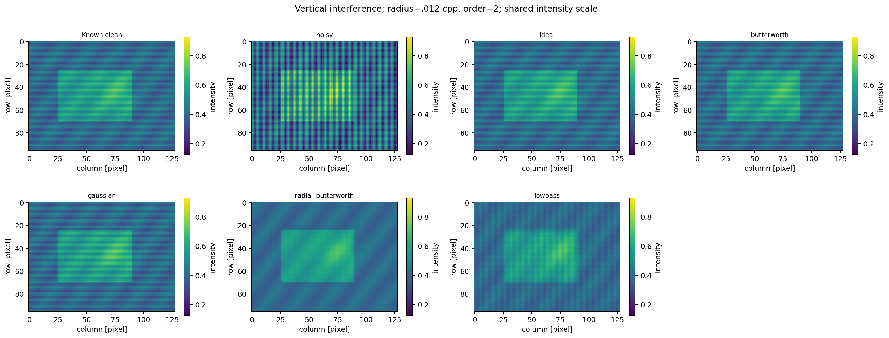

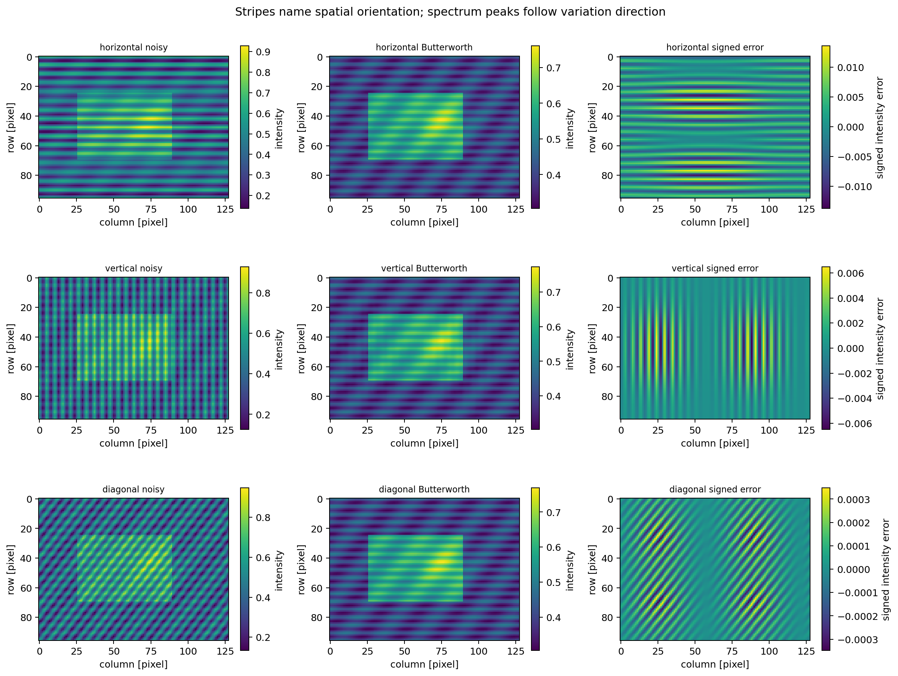

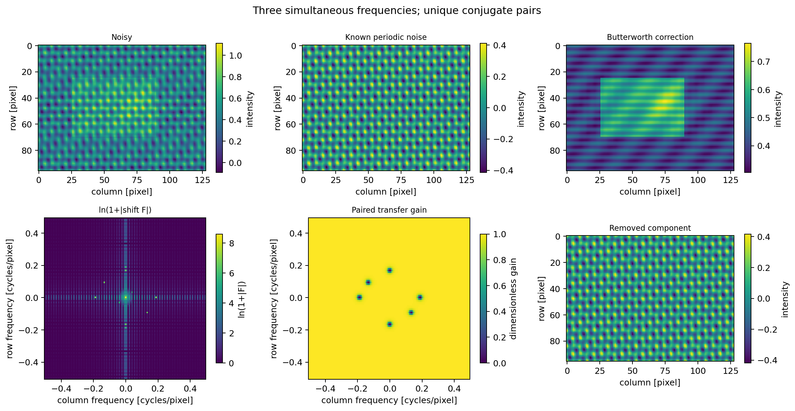

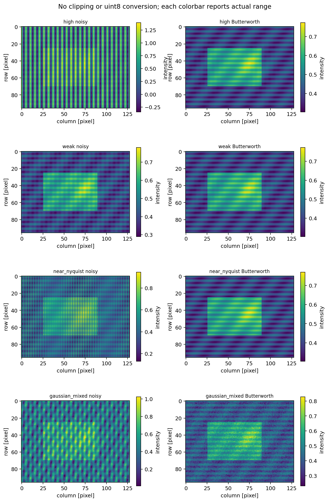

Five methods accompany the noisy baseline: ideal, Butterworth and Gaussian notch rejection; Butterworth radial band rejection; and unchanged Lab 04 Gaussian low-pass smoothing. Default notch radius is .012 cpp and order 2. For multiple components, radial rejection multiplies one band for each **unique radial center**, width .024 cpp. The LP control has frequency standard deviation .10 cpp. This control suppresses legitimate detail and is not claimed equivalent to targeted notch removal.

The radius sweep uses .004/.012/.035 cpp for all three local families. The order sweep uses Butterworth orders 1/2/4/8 at .012 cpp. Both axes have separate records, including measured step ringing and impulse-tail energy.

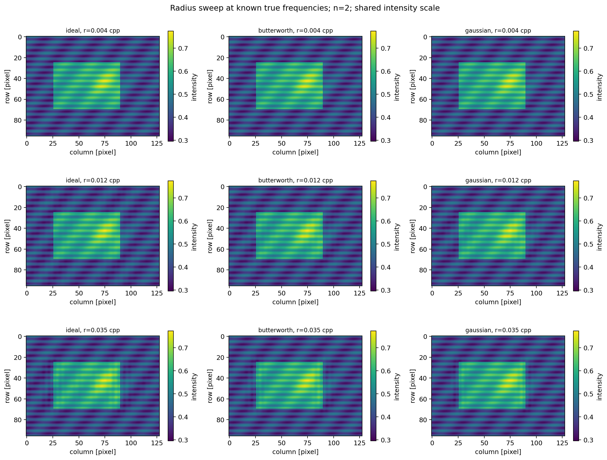

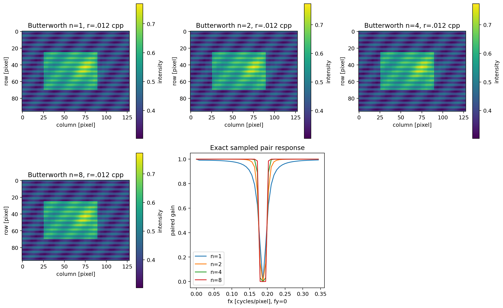

## Optional spectral-peak proposals

`detect_peaks` is deterministic and separate from image filtering. It excludes a DC disk of radius .035 cpp, ranks periodic 3x3 local maxima, deduplicates conjugate index pairs and suppresses nearby selected pairs within .025 cpp. Ties sort by descending magnitude then row/column. Default threshold is 6; experiments retain at most three pairs.

For $L=\ln(1+|F|)$ over the allowed background, the reported contrast score is

$$s=\frac{L-\operatorname{median}(L)}{1.4826\operatorname{MAD}(L)+\epsilon_{64}}.$$

A candidate must also exceed $64\epsilon_{64}\max(1,\max|F|)$ in raw magnitude, a declared numerical-roundoff guard. The score is **not a noise probability, statistical false-alarm guarantee or reconstruction-quality estimate**. The protected region and robust background are user choices, not a complete scene model. Legitimate repetitive texture and object structure can be bright local maxima. Weak interference may rank below them.

JSON/CSV records retain selected bin indices, partner indices, corresponding cpp coordinates, magnitude and score. The synthetic evaluation separately reports whether proposals are within .02 cpp of known noise; that ground truth is not available to the detector. Only explicit counterexample experiments apply all proposals to illustrate the risk.

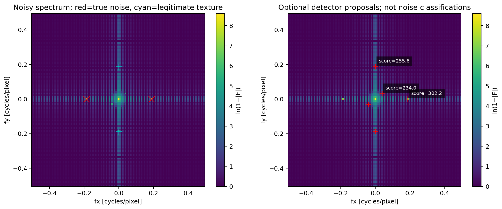

The clean-only detector selects the genuine $(18/96,0)$ texture with score approximately **256.24**. Applying its clean-only proposals gives MSE **.002649864**, despite there being no noise. Applying a wrong manually chosen notch at that one legitimate texture gives MSE **.001874756**. High contrast confidence does not establish that removing a component is appropriate.

## Quantitative metrics and actual measurements

MSE compares corrected intensity against known clean intensity. PSNR uses declared unit reference range, $10\log_{10}(1/\mathrm{MSE})$, even if noisy values exceed $[0,1]$. It never uses the noisy image's enlarged range. The clean reference has MSE zero, JSON PSNR null and an explicit `psnr_infinite=true`; nonfinite JSON numbers are forbidden.

Because filtering is linear, periodic noise and clean signal can be filtered **separately for evaluation only**. Report:

- Spectral periodic-noise gain: $\|H F_p\|/\|F_p\|$ over the .02 cpp union around known conjugate noise centers, with amplitude attenuation $20\log_{10}$ of that gain. Zero gain has null dB rather than a fabricated finite value.
- Full periodic RMS gain: $\|T(p)\|/\|p\|$, which also captures leaked energy outside that union.
- Off-noise clean spectral error: $\|(H-1)F_c\|/\|F_c\|$ outside that union and outside the .025 cpp DC neighborhood. **It does not measure legitimate signal lost inside the excluded union**; MSE and detail diagnostics are needed too.
- Clean gradient ratio and gradient-error RMS: periodic forward spatial differences, respectively measuring damage to the separately filtered clean signal and total corrected-image gradient error against truth.
- Full inverse maximum absolute imaginary residual before extracting real visualization.
- Step over/undershoot beyond its true 0/1 range and impulse-response energy beyond circular spatial radius 4 pixels. These are controlled ringing diagnostics, not perceptual quality scores.

Default vertical-interference results:

| Method | MSE | PSNR dB | Periodic RMS gain | Off-noise clean spectral error | Clean gradient ratio |
| --- | ---: | ---: | ---: | ---: | ---: |
| Noisy | .016200000 | 17.90485 | 1 | 0 | 1 |
| Ideal notch | .000004470 | 53.49698 | $5.25\times10^{-15}$ | 0 | .999031 |
| Butterworth notch | .000003959 | 54.02452 | $5.08\times10^{-15}$ | .002876 | .998201 |
| Gaussian notch | .000004332 | 53.63306 | $4.98\times10^{-15}$ | .006474 | .997890 |
| Radial Butterworth | .001883478 | 27.25039 | $5.09\times10^{-15}$ | .728889 | .420691 |
| Gaussian LP baseline | .001926795 | 27.15164 | .172422 | .638142 | .271122 |

The radial band removes the legitimate same-radius texture as well as the interference. Local notches are much more selective here, yet still remove image content in their neighborhoods. A narrow ideal radius .004 cpp gives synthetic PSNR approximately 150.97 dB because the clean image has extremely small energy in that exact bin; this is **not** a physical reconstruction-precision claim. Residual gains near $10^{-15}$ reflect floating-point roundoff, not credible real-world attenuation to hundreds of dB.

For off-bin leakage, default ideal/Butterworth/Gaussian periodic RMS gains are **.518102/.464038/.435830**. Their PSNRs are **23.61680/24.57417/25.11866 dB**. The LP control scores 27.60942 dB in this case but its clean gradient ratio is only .271122. Thus PSNR alone can prefer substantial smoothing. The Gaussian-mixture default Butterworth score is 32.06323 dB; rejecting discrete periodic peaks does not remove broadband Gaussian noise.

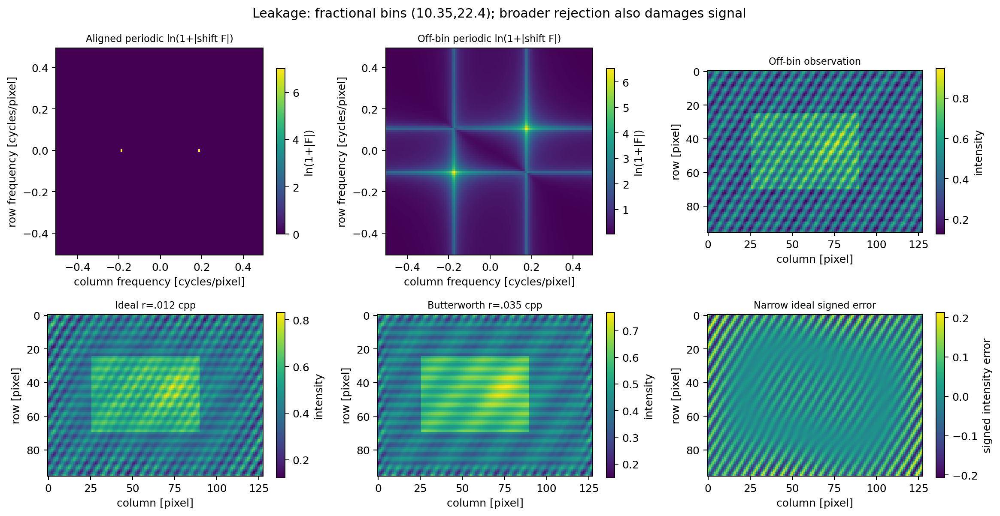

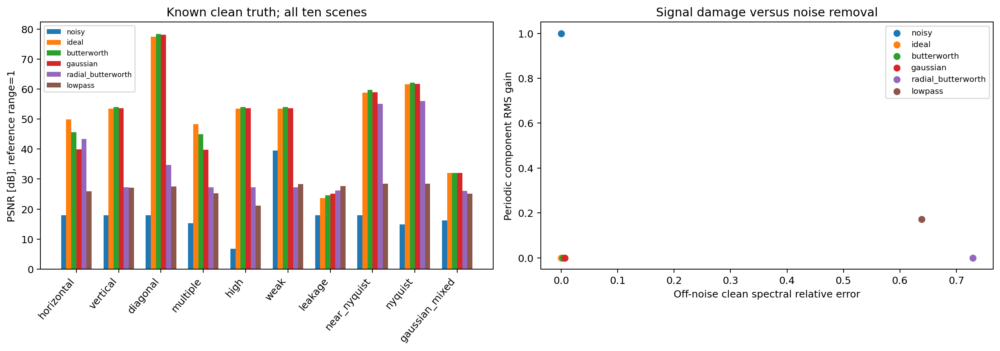

## Ringing, legitimate-detail destruction and boundaries

At the default vertical notch, step overshoot is **.049540 ideal**, **.042192 Butterworth**, **.043196 Gaussian**. A wider radius .035 increases the overshoot to approximately .08554/.08641/.08976; smooth filters do not universally eliminate ringing or signal damage. Increasing Butterworth order sharpens transitions and approaches ideal behavior, including its spatial tail trade-off.

The nonperiodic crop is `[10:83,9:110]`, shape $73\times101$. Original cpp centers stay unchanged. Periodic/no-pad, reflect pad24 and zero pad24 give PSNR **40.05258**, **29.41538**, **27.91357 dB** respectively. Padded shape is $121\times149$, crop starts `(24,24)`. Reflection changes the assumed continuation of both image and interference; it does **not** preserve an arbitrary sinusoid's phase progression beyond the crop. Zero extension also spreads spectral energy. Neither model is guaranteed to improve this known periodic-noise task.

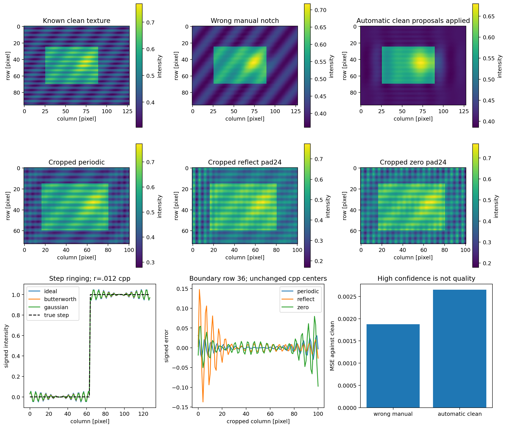

Most panels use individual measured colorbar ranges; overview and radius-sweep intensity panels use a shared range. Quantitative data are not clipped or rescaled. Read the colorbars rather than treating apparent contrast as absolute equality.

## Validation and artifact integrity

Tests use independent known modes, finite response values, DC/center zeros, smooth characteristic radii, toroidal Nyquist cases, exact conjugate symmetry, odd/even/rectangular/singleton dimensions, unit conventions, padding/crop references, off-notch preservation, multiple pairs and deduplication. One small complex case imports Lab 01's unchanged manual DFT/IDFT. Detector tests include legitimate-texture false positives, pair uniqueness, DC protection and numeric-roundoff suppression. Bin-aligned and off-bin spectra are checked quantitatively. Numeric extremes and `longdouble` are tested by representability rather than platform assumptions. Suitable comparisons use `rtol=atol=1e-10` without weakened tolerances.

`notch_audit.py` verifies exact artifact inventory, all PNG chunk checks and complete pixel decoding, all 99 array keys/shapes/dtypes/finiteness, scene parameters, independent direct response formulas, all corrected arrays, all 60 measurements, 13 parameter records, 33 proposal records, three boundary records and 1503 profile rows. `scientific_reference.py` is an intentionally separate, straightforward finite-setting oracle; production filters do not call it. Metric formulas use independently assembled spatial differences. Forged numeric tables or arrays fail even if their integrity hashes are recomputed.

Portable integrity is **reused directly from unchanged Lab 06**. Only CSV/JSON permit CRLF→LF canonicalization. Bare CR/CRCRLF, BOM, invalid UTF8 and every other content change are rejected; binaries retain raw hashes. Audits report physical and canonical sizes/hashes and normalization flags. Tests exercise real `git apply --check --binary` and `git apply --binary` in disposable repositories with `core.autocrlf=true` and `false`; final review also applies the full feature patch to exact-base exports and runs complete validation. `.gitattributes` is guidance, not the integrity mechanism; no manual line-ending repair is required.

PNG publication reuses Lab 03's unchanged verified in-memory encoding and atomic/fsynced publisher. Lab 04 supplies only coordinate/validation utilities and the explicit LP baseline; no prior filtering implementation is duplicated or modified. Existing assignment algorithms and outputs are protected in the working repository. Full regeneration occurs separately, every real PNG is independently decoded, and any failed bytes/logs are retained outside the public patch. A passing normal validator cannot prove full regeneration succeeded. Actual results and all retained failures are in the separately delivered `REVIEW.md` and logs.

Native Windows/Python 3.14 were not available. Linux Git/CRLF tests and portable code design are not a native Windows certification. The owner should run the same commands on the intended Windows environment before publication.

## Complexity and limitations

For $P=MN$ padded pixels and $K$ unique notch centers, response construction costs $O(KP)$ and filtering $O(P\log P)$ with $O(P)$ working storage. The detector's local comparisons cost $O(P)$, sorting at most $P$ candidates costs $O(P\log P)$, and controlled suppression is $O(PK)$. The independent auditor trades extra work for transparent verification and is not an optimized production filter.

A Fourier notch cannot distinguish real texture from additive noise at the same frequency. Finite image windows spread off-bin energy; broad rejection can suppress that spread but erases more signal. Changes of illumination, spatially varying frequency, uncertain noise locations, nonperiodic boundaries and broadband noise require additional models. The detector is optional, manually inspectable and deliberately not an automatic restoration guarantee. No subsequent lab or adaptive filtering system is implemented.

## Files and references

- `notch_filters.py`: six response families, toroidal pair geometry and filtering API.
- `peak_detection.py`: optional deterministic candidate detector.
- `notch_scenes.py`, `notch_metrics.py`: ground truth and declared quantitative diagnostics.
- `experiment.py`: standalone reproducible experiment runner.
- `scientific_reference.py`, `notch_audit.py`: independent scientific and portable-artifact verification.
- `notch_support.py`: explicit named imports of unchanged earlier utilities.
- `tests/`: mathematical, detector, leakage, corruption and real Git-apply tests.
- `output/`: all scientific figures, numerical results, NPZ arrays and integrity manifest.

Primary supporting course references: [University of Utah, 2D Fourier filtering, band-reject formulas](https://users.cs.utah.edu/~tch/CS6640/lectures/Weeks5-6/2DFourierFiltering.pdf); [UC San Diego CSE 166, frequency-domain filtering](https://cseweb.ucsd.edu/classes/fa20/cse166-a/lec7.pdf); [UCLA mathematical image-processing lectures, periodic noise and paired notches](https://www.math.ucla.edu/~lvese/155.1.09w/PCMI_USS_2010/Lectures.pdf). These supplement the unavailable original course PDF and do not replace its exact page attribution. All figures here are original synthetic results.
