# Chapter 04 · Lab 08 — FFT-Based Template Matching and Image Correlation

This laboratory turns correlation identities into a practical, deterministic image-localization application. It compares direct valid correlation, FFT valid correlation, zero-mean normalized cross-correlation (ZNCC) and SSD. Known synthetic placements expose brightness bias, ambiguous repeated objects, incorrect boundary interpretation, noise/occlusion sensitivity and translation-only limitations. It adds no new dependencies and does not duplicate Lab 03's general complex correlation/convolution property laboratory.

**Course alignment and access limitation:** the task identifies `Chapter04-Art.pdf` pages 38, 42–45 and especially page 46, Figure 4.41. That original 46-page PDF is unavailable in this environment and was not independently inspected. The supplied example dimensions are reproduced with a new synthetic image, not the course asset: image $256\times256$, template $38\times42$, minimum full FFT $293\times297$. All mathematical conventions are explicit below. No PDF, personal information or third-party image is distributed.

## Reproduce

From the repository root, with Python 3.12 and unchanged requirements:

```bash
python -m venv .venv
source .venv/bin/activate
python -m pip install -r requirements.txt
python chapter-labs/chapter-04-frequency-domain/08-fft-template-matching/experiment.py
python chapter-labs/chapter-04-frequency-domain/08-fft-template-matching/matching_audit.py
python -m pytest -q chapter-labs/chapter-04-frequency-domain/08-fft-template-matching/tests
python scripts/validate_repository.py
```

Windows PowerShell activation, from the repository root:

```powershell
.\.venv\Scripts\Activate.ps1
# If activation is blocked by local policy, use the executable directly:
.\.venv\Scripts\python.exe -m pip install -r requirements.txt
```

The runner accepts `--output-dir PATH`; otherwise its output directory is beside the script, independent of working directory. It generates all 12 figures, four CSV tables, JSON metrics, 187 named NPZ arrays and the artifact manifest. One table contains environment-specific benchmark observations; timing/memory are intentionally not deterministic numerical targets.

Full `python scripts/validate_repository.py --regenerate` must run **only in a disposable snapshot**. Export exact base `845d2e4499bb5eb5ab8908c3f3777cab08d0c35a` with `git archive`, extract it separately, then apply the delivered patch using `git apply --check --binary /path/to/Lab08-feature-changes.patch` followed by `git apply --binary /path/to/Lab08-feature-changes.patch`. No new branch or commit is needed. See the review package's `REPRODUCE.md` for portable extraction and independent PNG-audit commands. Existing PNG truncation is not assumed fixed.

## Numerical and coordinate contract

Inputs are real numeric, finite, nonempty 2D grayscale arrays, converted to float64. Complex values, including complex dtype with zero imaginary part, strings/objects, invalid ranks, empty arrays, NaN/Inf and a template larger than the image are rejected. Coordinates are **zero-based top-left `(row,column)` in original image pixels**, never centered-spectrum indices.

For image $I$ of shape $(H,W)$ and template $T$ of shape $(h,w)$,

$$C[y,x]=\sum_{i=0}^{h-1}\sum_{j=0}^{w-1}I[y+i,x+j]T[i,j],$$

$$0\le y\le H-h,\qquad0\le x\le W-w.$$

The response shape is exactly $(H-h+1,W-w+1)$. `direct_correlation` evaluates independent spatial window products without FFT or reversal. FFT correlation uses **convolution with reversed template** $K[i,j]=T[h-1-i,w-1-j]$:

$$F=\operatorname{IFFT}_2\{\operatorname{FFT}_2(I)\operatorname{FFT}_2(K)\},\qquad
 C=F[h-1:H,\ w-1:W].$$

Both arrays are zero-extended to $P\ge H+h-1$, $Q\ge W+w-1$. The forward FFT has no scale and the inverse divides by $PQ$ (backward normalization). `fft_correlation` defaults to the exact minimum dimensions, accepts larger dimensions, and rejects insufficient ones because its API promises a correct **full linear map**, not just valid values. Its returned full map is cropped to $(H+h-1,W+w-1)$, while `fft_shape` reports actual transform dimensions. Imaginary residual is measured over the entire inverse array before real extraction, including oversized padding.

`direct_ssd` computes $D[y,x]=\sum(I_{y,x}-T)^2$ directly. For consistent maximization, the matching API uses **negative SSD**; this changes ranking direction without taking absolute values or concealing signs. Raw correlation and SSD retain intensity-squared units; ZNCC is dimensionless. Raw FFTs use exact binary power scaling to prevent avoidable intermediate overflow, then restore raw units and imaginary residual units. This cannot recover relative accuracy of a nearly zero dot product after huge cancellation; raw operations raise if a required result is unrepresentable. No uint8 conversion, display normalization or magnitude-based reconstruction occurs in calculations.

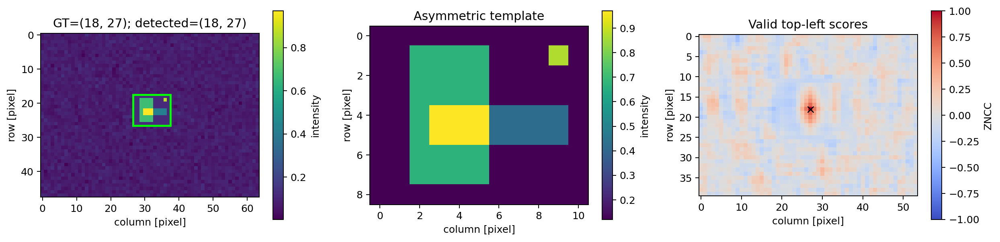

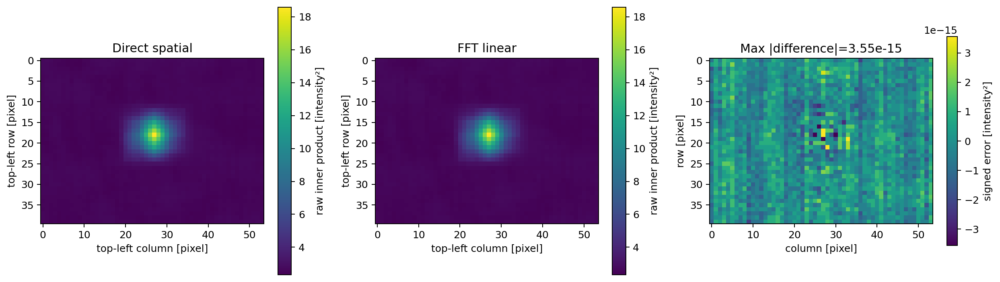

## Full linear versus circular geometry

`circular_correlation` is a deliberately separate demonstration:

$$C_{\rm circ}[y,x]=\sum_{i,j}I[(y+i)\bmod H,(x+j)\bmod W]T[i,j],$$

computed by $\operatorname{IFFT}(\operatorname{FFT}(I)\overline{\operatorname{FFT}(T_{\rm padded})})$. Its image-sized map includes lags where a template wraps across opposite borders. A large peak there is not necessarily a valid whole-template placement. The split-object experiment makes this explicit.

**Important nuance:** image-sized circular correlation still equals linear correlation at valid lags, because those windows do not wrap. Likewise, a reversed-template convolution with $P\ge H,Q\ge W$ can have wraparound confined outside the valid crop. Full linear padding is necessary for a correct full map, but it is false that every valid-only result must be corrupted without it. The public FFT API intentionally enforces the stronger full-map contract.

With $h,w>1$, making just one minimal full FFT dimension one sample shorter folds the last full row/column onto its first row/column. The experiment verifies the aliasing explicitly and also verifies that the selected valid crop remains correct in that example. If an FFT size is smaller than the image itself, input samples can instead be truncated; that is not the valid-only exception and the strict API rejects it.

Full convolution indices are offset from top-left coordinates: a valid peak $(y,x)$ appears at $(y+h-1,x+w-1)$ in $F$. No `fftshift` is used in correlation multiplication, cropping or localization. A shifted visualization would need its own coordinate conversion; arbitrary shifting would break these conventions. Zero extension describes values outside the finite image for the full map; the valid map uses only fully overlapping windows.

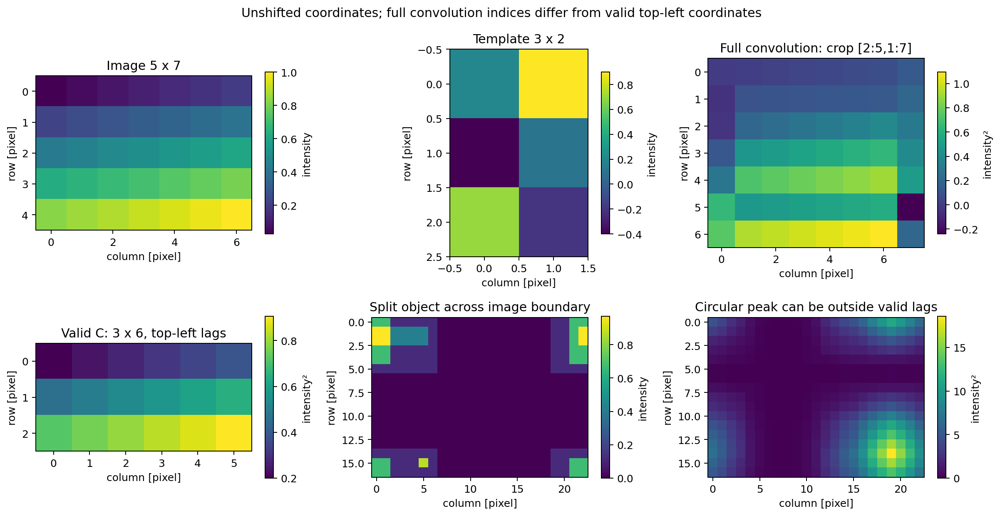

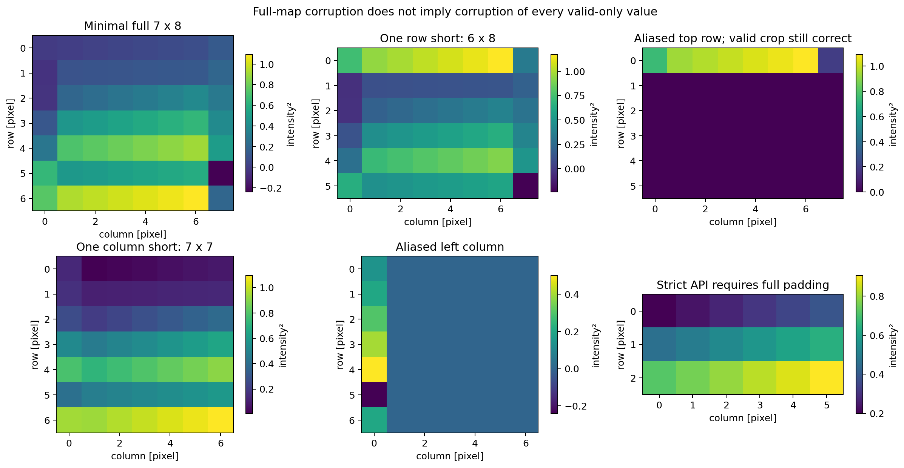

For the supplied course-sized example, full shape is **293×297**, valid shape **219×215**. A synthetic exact insertion at `(218,214)` is the last valid position. Its full-convolution peak is at `(255,255)`, illustrating why full-map indices cannot be reported as original top-left coordinates.

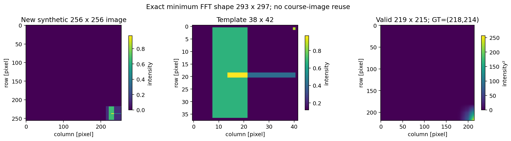

## Stable ZNCC and low-variance handling

For local window $P=I[y:y+h,x:x+w]$,

$$Z[y,x]=\frac{\sum(P-\bar P)(T-\bar T)}
 {\sqrt{\sum(P-\bar P)^2}\sqrt{\sum(T-\bar T)^2}}.$$

A positive affine transformation of either operand preserves its normalized scores under nondegenerate, representable conditions. A negative multiplier reverses the sign; multiplying both operands negatively restores it. Input rounding can erase extremely small contrast, so mathematical invariance does not undo quantization.

A zero-variance template raises a clear `ValueError`. A zero-variance window is **invalid**. Its finite stored score payload is zero, but its validity mask is false and the selector always excludes it. It therefore cannot outrank valid negative matches. A map with no valid positions returns `location=None`, `score=None`, eligible count zero and `psr_status='no_valid'`. This policy keeps saved scientific arrays finite without pretending undefined scores are genuine zeros.

### Centered moments without catastrophic cancellation

The algorithm does not form raw $\sum P^2-(\sum P)^2/K$. It uses binary power scaling, a common origin shift, and sliding hierarchical moment merges. For disjoint groups with counts $n_A,n_B$, means $\mu_A,\mu_B$, centered sums $M_{2,A},M_{2,B}$ and $\delta=\mu_B-\mu_A$,

$$\mu=\mu_A+\delta\frac{n_B}{n_A+n_B},$$

$$M_2=M_{2,A}+M_{2,B}+\delta^2\frac{n_A n_B}{n_A+n_B}.$$

All variance contributions are nonnegative. Sliding dyadic blocks are merged horizontally, then vertically, giving $O(HW(\log h+\log w))$ work rather than an independent full-window variance calculation at every position. Temporary block caches are explicitly cleared and recursive reference cycles broken so large arrays need not await cyclic garbage collection.

The centered template is normalized to unit L2 norm. The numerator comes from FFT correlation of the shifted, scaled image with that template. A residual template sum is corrected by subtracting the local mean times that residual sum. Binary scaling prevents overflow, while a per-window fallback preserves tiny local contrast that a global scale could lose in a mixed dynamic-range image.

The precision screen uses the conservative FFT-dot scale

$$B=128\epsilon_{64}\max(1,\log_2(PQ))\sqrt{hw}\,\|I_s\|_\infty.$$

Windows with centered norm at most $B/10^{-10}$, or zero computed norm, are recomputed directly on their original values. This is a practical roundoff screen, not a certified worst-case hardware bound. Local fallback scales each patch, subtracts an anchor before centering and rescales its differences before forming a norm. It does not assume `np.longdouble` offers extra precision. Constant patches are identified exactly in float64; near-constant nondegenerate patches remain eligible.

Scores outside $[-1,1]$ by more than $10^{-10}$ raise a numerical error. Only overshoot within that declared roundoff tolerance is clipped to the mathematical range. Negative scores are never replaced by their absolute values. `fallback_windows` records the number of precision-screened windows; `imaginary_residual` for ZNCC is in scaled-image/unit-template numerator units, not original raw-correlation units.

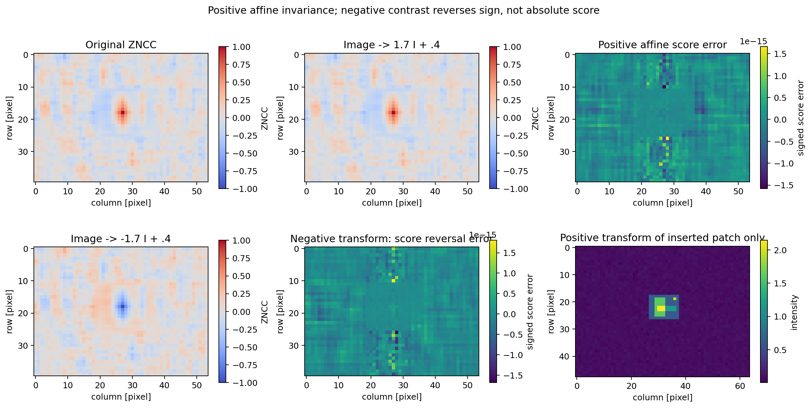

## Localization, top-K and ambiguity

`match_template` returns a `Match` containing top-left location, score, response map, validity mask, eligible count, diagnostics and numerical metadata. Method names are `direct`, `fft`, `zncc`, `ssd`. Lower-level `select_peaks` and `localize` accept numerical tie tolerances and NMS parameters explicitly.

A candidate within

$$\tau=10^{-12}+4096\epsilon_{64}|s_{\max}|$$

of the highest eligible score is treated as a numerical tie, with row-major selection. This is a declared candidate-score resolution policy, not exact bitwise equality of FFT results. Rectangular NMS excludes $|\Delta y|\le r_y$ **and** $|\Delta x|\le r_x$ after each selection. Defaults are template half-sizes `(h//2,w//2)` and top-K two. Very small raw-score units may need a different absolute tie tolerance; the lower-level API exposes this rather than silently changing units.

`second_score` and the peak gap refer to the next **NMS-separated** candidate, not the immediately adjacent response pixel. `tie_count` counts valid near-equal scores before NMS. Gaps within the tie resolution are zero; an unrepresentable raw absolute gap is undefined rather than infinity. `ambiguous` flags multiple numerical ties or a zero separated-peak gap. These are diagnostics, not probabilities of a correct match.

PSR excludes the same rectangle around the selected peak:

$$\operatorname{PSR}=\frac{s_{\rm peak}-\mu_{\rm side}}{\sigma_{\rm side}}.$$

It is undefined for an empty sidelobe set or when $\sigma_{\rm side}\le\sqrt{\epsilon_{64}}\max(1,|s_{\rm peak}|,\max|s_{\rm side}|)$. Computation is scaled to avoid overflow. JSON stores null plus `psr_status='empty'` or `'constant_or_precision_floor'`, never fabricated infinity or an unstable huge ratio. No logarithmic near-zero ratio is compared using a universal tight tolerance. PSR thresholds are response-scale and scene dependent.

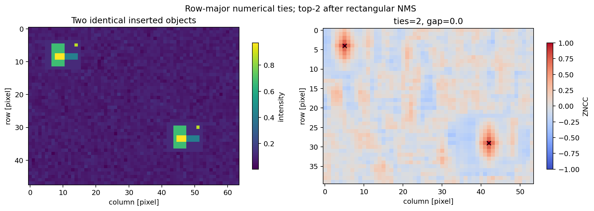

## Synthetic scenes and controlled interpretation

The default asymmetric $9\times11$ template has positive .12 background, a .55 vertical block, a .30 lower arm and a .75 isolated marker. Geometry and exact pixel inequalities are in `matching_scenes.py`; no course image is reused. Default image is $48\times64$ with background $.08+N(0,.02^2)$, seed 808. Source clean images, observed images, templates and all true top-left insertion locations are retained.

Fifteen scenes cover unique `(18,27)`, top-left `(0,0)`, lower-right `(39,53)`, odd image/even template `(47,61)/(8,10)`, repeated objects `(4,5)/(29,42)`, similar distractors, positive affine patches, brightness decoys, additive noise, partial occlusion, 90-degree rotation, nearest-neighbor 2× scale, near-constant template and low-texture background. The final scene lacks an intended target.

The affine patch is $1.8T+.4$. The occluded patch replaces its right six of eleven columns with .08. The near-constant query is $2+10^{-10}(T-\bar T)$. Low-texture background is exactly .08, leaving many constant candidate windows invalid. Rotation/scale scenes retain the transformed object's top-left anchor as ground truth while the matcher still uses the original template; the API is not pose invariant.

Three sweeps supply 68 method records: Gaussian sigma `[0,.04,.12,.24,.4,.7]` with one fixed noise field (seed 1808); requested occlusion fractions `[0,.2,.4,.6,.8]`, realized by `floor(fraction*w)` rightmost columns; and contrast multipliers `[-1.5,-.5,.25,1,2,4]` plus offset .3 at the true patch. Discrete realized occlusion fractions therefore differ slightly from requested values.

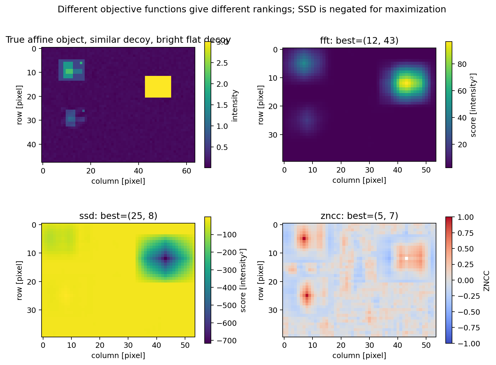

In the brightness-decoy scene, actual predictions are:

| Method | Selected top-left | Error against `(5,7)` |
| --- | --- | ---: |
| Direct/FFT raw correlation | `(12,43)`, bright flat distractor | 36.67424 pixels |
| SSD | `(25,8)`, similar object | 20.02498 pixels |
| ZNCC | `(5,7)`, true affine object | 0 pixels |

The unique scene localizes exactly for all methods. The repeated scene selects `(4,5)` first and `(29,42)` second with zero gap. In the occluded scene, ZNCC reaches **.805818** but localizes one pixel left of the true anchor; high score does not prove exact coordinates. The 90-degree and 2× objects have ZNCC anchor errors **2** and **7.21110** pixels respectively.

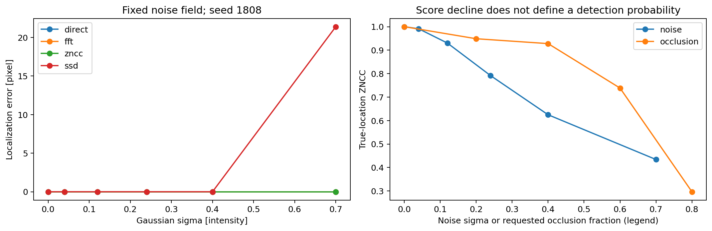

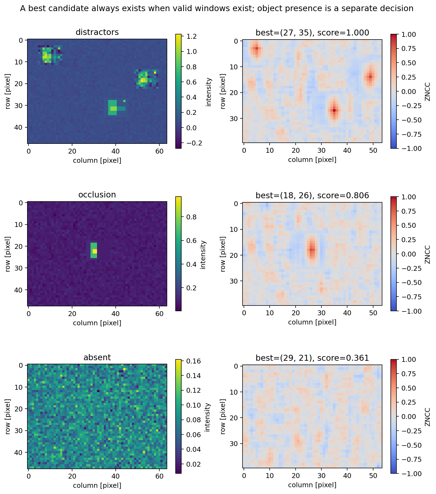

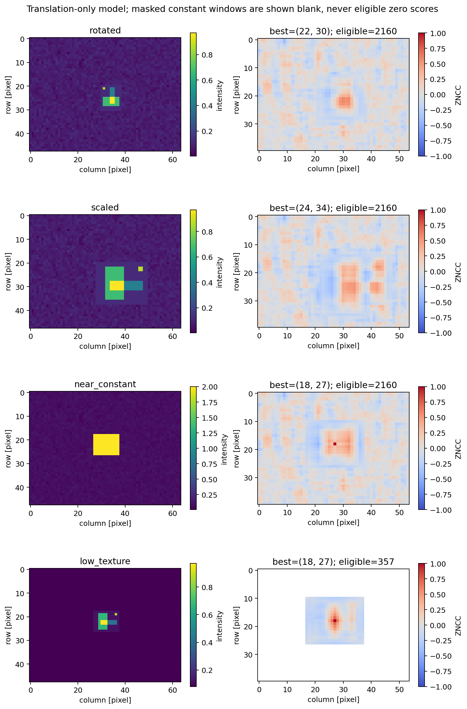

Localization error is Euclidean distance in pixels to the nearest acceptable GT insertion. A controlled localization false match means error greater than .5 pixel; integer coordinates therefore require the exact anchor. Across 14 target-bearing scenes, direct/FFT/SSD rates are **5/14**, ZNCC **3/14**. These include intentionally transformed and occluded objects and are not general population performance estimates. Absent scenes have undefined GT coordinate error, not a fabricated zero success; their bars are omitted and explicitly labeled as having no GT error and the separate detection panel handles them.

The 20 separate negative trials use seeds 9000–9019: ten random backgrounds and ten prescribed near-lookalikes $T+N(0,.08^2)$ at `(20,30)`. With illustrative acceptance threshold .8, measured false-positive rates are **0/10 background** and **10/10 near-lookalike**. Negative labels are prescribed by object identity in this construction; the latter deliberately overlap the appearance distribution of noisy positives. No score threshold can infer that hidden intended identity from identical-looking pixels. This is an ambiguity counterexample, not a calibrated classifier or proof that noisy positives should be rejected.

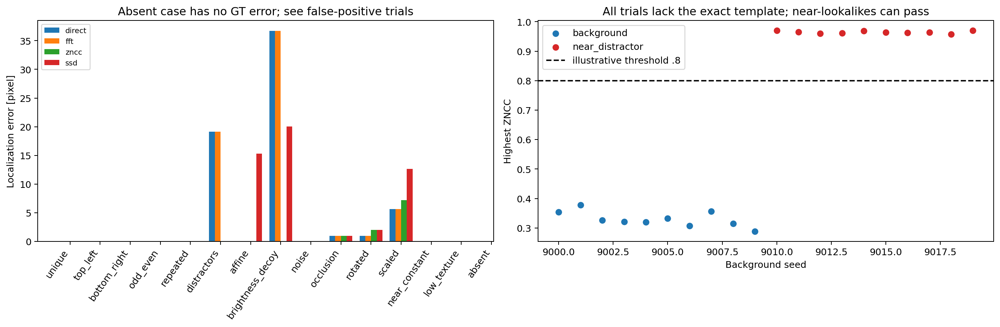

## Measured runtime, memory and complexity

`benchmark.csv` is separate from deterministic scientific metrics. It measures the complete matching call, including localization/diagnostics, with one warm-up and median of three calls, then an additional tracemalloc run. Peak tracked allocations are **not whole-process RSS**; native FFT workspaces may not be completely visible. There are no timing pass/fail assertions.

Actual Linux Python 3.12.14 measurements from this execution:

| Image / template | Direct ms | FFT raw ms | FFT ZNCC ms | SSD ms |
| --- | ---: | ---: | ---: | ---: |
| 32×48 / 5×7 | 4.485 | 0.302 | 0.516 | 8.403 |
| 64×80 / 9×11 | 22.252 | 0.427 | 0.789 | 15.311 |
| 128×128 / 15×17 | 56.050 | 1.971 | 2.720 | 56.417 |

For the largest case, peak tracked bytes were 563,488 direct, 1,514,800 FFT raw, 2,630,904 ZNCC and 563,488 SSD. These are measured observations, not a universal ranking; hardware, transform factorization, template sizes, allocation, cache state and fallback frequency matter. Re-execution regenerates the benchmark table with fresh numbers, so its hash legitimately changes.

For $V=(H-h+1)(W-w+1)$ valid positions and $K=hw$, direct correlation/SSD cost $O(VK)$. Full FFT raw correlation costs $O(PQ\log(PQ))$ time and $O(PQ)$ storage. Stable sliding moments cost $O(HW(\log h+\log w))$ time/storage bounds; precision fallback adds $O(FK)$ work for $F$ suspect windows, potentially returning to direct complexity in low-texture cases. Top-K selection costs $O(K_{\rm peaks}V)$ for small controlled K. The independent auditor intentionally uses direct local windows and an existing SciPy direct reference for the course-sized example; it is not a production speed implementation.

## Validation, portability and artifact auditing

Automated tests use literal asymmetric results, independent corner-impulse formulas, direct-window references, spatial circular sums and explicit folding of a full convolution into underpadded shapes. They cover corner anchors, correct crop dimensions, even/odd/rectangular/singleton axes, exact minimum course padding, affine sign behavior, constant invalid windows, near-constant and mixed extreme dynamic ranges, numerical ties, NMS, undefined PSR, invalid parameters and finite-range failures. Numerical comparisons use justified float64 tolerances; no exact equality is demanded of roundoff-sensitive FFT errors or ratios.

`matching_audit.py` verifies every expected output, full PNG decoding, raw binary SHA-256, canonical text SHA-256, all 187 reference-array keys/shapes/dtypes/finiteness, response maps against independent direct windows, masks, GT coordinates, scores, separated candidates, ambiguity, false-match rates, sweeps and controlled detection trials. Its source-input checks are tight enough to preserve near-constant template contrast. Inverse imaginary residuals are independently bounded as roundoff quantities, not required to equal another platform's measured tiny residual exactly. Benchmark timing/memory receive schema/finite-value checks, not deterministic time equality.

The portable canonical model is imported unchanged from Lab 06: only CSV/JSON permit CRLF→LF, rejecting standalone CR/CRCRLF, BOM, invalid UTF8 and every other byte-content change. Binary files remain byte-exact. Actual `git apply --check --binary` and `git apply --binary` tests run with both `core.autocrlf=true/false`; false mode correctly preserves an already-CRLF producer rather than being assumed to convert it to LF. No manual post-apply line-ending correction is needed.

Scientific replay compares arrays and deterministic tables/JSON separately from `benchmark.csv`. The artifact manifest's benchmark entry changes accordingly; the other entries must remain consistent. Same-environment PNG byte equality is recorded when observed, but renderer/font differences on another platform need not imply changed mathematical results. Every generated PNG still must fully decode and match its own freshly generated manifest.

Publication of PNGs reuses unchanged Lab 03's verified in-memory encoding, fsynced atomic publication and full decoding. Full repository regeneration is performed only in disposable exact-base patched exports, followed by an independent scan of every real PNG. Any corruption is preserved separately from public changes. A zero process exit or passing ordinary validator does not establish healthy regenerated images. The review package reports this execution's actual success/failure evidence without altering protected legacy code.

Native Windows and Python 3.14 were not executed here. Representability-based `longdouble` checks, LF/CRLF tests and precision-floor regressions do not replace the owner's native Windows validation. The previous labs, assignments, workflows and dependencies remain unchanged.

## Files and references

- `template_matching.py`: numerical API, local moments, precision policy, top-K/NMS and ambiguity.
- `matching_scenes.py`: synthetic source/observations, transforms and known locations.
- `experiment.py`: standalone runner and 12 deterministic figures.
- `benchmark.py`: separate environment-specific timing and tracked-memory observations.
- `matching_reference.py`, `matching_audit.py`: independent scientific verification.
- `matching_support.py`: explicit unchanged PNG/portable utility imports.
- `output/`: all figures, four CSVs, JSON metadata, NPZ references and artifact manifest.

References: the course-page descriptions supplied in the task (original PDF unavailable); the standard centered-moment merge relationship associated with Chan, Golub and LeVeque's pairwise variance work, derived algebraically above; [SciPy's official correlation definitions](https://docs.scipy.org/doc/scipy-1.17.0/reference/generated/scipy.signal.correlate.html) and [2D valid correlation](https://docs.scipy.org/doc/scipy/reference/generated/scipy.signal.correlate2d.html). SciPy is an independent verification dependency already in the repository; production correlation and ZNCC use NumPy and direct spatial code only.
