# Chapter 05 · Lab 01 — Noise Models, Image Degradation and Statistical Characterization

This independent laboratory generates six course noise laws, demonstrates controlled PSF degradation and measures their statistical and Fourier signatures. It retains ground truth and uses independent scientific oracles. No denoising, adaptive filtering, inverse filtering or Wiener restoration is implemented. Periodic interference is generated and analyzed, not removed; see [Chapter 04 Lab 07](../../chapter-04-frequency-domain/07-notch-band-reject-filtering/README.md) for notch rejection.

**Course access:** `Chapter05-Art.pdf` was unavailable and was not independently opened. Alignment follows the supplied description: pages 1–3 degradation; 4–9 six distributions; 10–13 illustrations; 14–15 periodic interference; page 16 estimation. Pages 17 onward belong to later restoration labs. All images and diagrams here are original synthetic constructions. No course PDF, student information or third-party image is distributed.

## Reproduce

From the repository root with the unchanged pinned requirements:

```bash
python -m venv .venv
source .venv/bin/activate
python -m pip install -r requirements.txt
python chapter-labs/chapter-05-image-restoration/01-noise-models-and-degradation/experiment.py
python chapter-labs/chapter-05-image-restoration/01-noise-models-and-degradation/noise_audit.py
python -m pytest -q chapter-labs/chapter-05-image-restoration/01-noise-models-and-degradation/tests
python scripts/validate_repository.py
```

Directly usable Windows PowerShell activation and optional direct-interpreter alternative:

```powershell
.\.venv\Scripts\Activate.ps1
# If activation is restricted by local policy, no policy change is necessary:
.\.venv\Scripts\python.exe -m pip install -r requirements.txt
.\.venv\Scripts\python.exe chapter-labs/chapter-05-image-restoration/01-noise-models-and-degradation/experiment.py
```

The runner accepts `--output-dir PATH`; the default is `output/` beside the script regardless of the working directory. The auditor accepts an optional output directory. Random calls receive explicit `numpy.random.Generator` objects; no legacy global RNG state is touched. Zero-sigma Gaussian sampling returns a constant without consuming random draws. Reproducibility is defined for the documented pinned environment, not promised across arbitrary library versions.

Run full `--regenerate` **only in a disposable exact-base patched export**, never in the owner's working tree. Independently verify every generated PNG afterward, including old assignments. The review package supplies extraction/patch commands, full logs and a forensic PNG scanner. A zero validator exit does not establish healthy PNGs or fix the historical intermittent truncation problem.

## Degradation model and boundaries

The ideal image $f$, PSF $h$, additive noise $\eta$ and observation $g$ obey

$$g[y,x]=(h*f)[y,x]+\eta[y,x].$$

The star denotes convolution, not pointwise multiplication. A restoration operator would estimate $f$ from $g$ and is reserved for later labs. For anchor $(a_y,a_x)$,

$$(h*f)[y,x]=\sum_{i,j}h[i,j]f[y-(i-a_y),x-(j-a_x)].$$

`spatial_blur` uses independent weighted spatial sums, with `boundary='periodic'` (circular extension) or `boundary='zero'` (zero exterior and a same-size output). Default anchor is $(\lfloor k_h/2\rfloor,\lfloor k_w/2\rfloor)$, including even kernels. Normalized, nonnegative, finite PSFs are required; normalization tolerance is relative $10^{-13}$, absolute $10^{-15}$. No hidden normalization or output clipping occurs. Identity PSF is `[[1.]]`. The asymmetric blur PSF is

$$h=\frac1{16}\begin{bmatrix}0&1&2\\3&7&1\\2&0&0\end{bmatrix},\quad(a_y,a_x)=(1,1).$$

Asymmetry makes accidental correlation/reversal detectable. The independent reference enumerates original pixel indices using `math.fsum`, rather than production rolls/slices.

For periodic boundaries, place the PSF origin explicitly using

$$h_0[(i-a_y)\bmod H,(j-a_x)\bmod W]\mathrel{+}=h[i,j].$$

With NumPy backward normalization (unscaled forward, inverse divided by $HW$),

$$G[u,v]=H_0[u,v]F[u,v]+N[u,v].$$

This image-size product describes circular convolution. Zero-exterior linear convolution instead needs full padding of at least $(H+k_h-1,W+k_w-1)$ and anchor-aware cropping; it is not the same unpadded spectral product. The lab validates both spatial boundary conventions and the periodic Fourier identity without performing deconvolution.

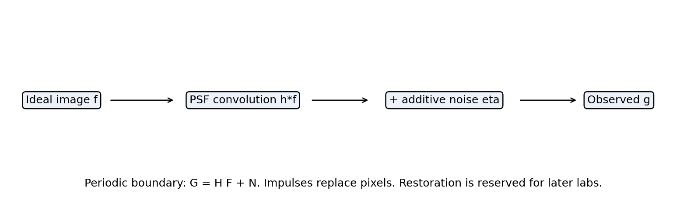

## Six noise laws

Nominal grayscale intensity is dimensionless in $[0,1]$, but all scientific arrays are unclipped float64. Positive noise can increase brightness; it is never silently centered or standardized. Five additive laws use `Distribution(name,a,b)`:

| Law | API parameters | Mean | Variance | Sampling conversion |
| --- | --- | --- | --- | --- |
| Gaussian | $a=\mu$, $b=\sigma\ge0$ | $\mu$ | $\sigma^2$ | $\mu+\sigma Z$, $Z\sim N(0,1)$ |
| Rayleigh | location $a$, $b>0$ | $a+\sqrt{\pi b}/2$ | $b(4-\pi)/4$ | unit Rayleigh times $\sqrt b/\sqrt2$, plus $a$ |
| Erlang | rate $a>0$, integer shape $b\ge1$ | $b/a$ | $b/a^2$ | unit-scale Gamma(shape=$b$) divided by $a$ |
| Exponential | rate $a>0$; finite unused `b` | $1/a$ | $1/a^2$ | unit exponential divided by $a$ |
| Uniform | $a<b$ | $(a+b)/2$ | $(b-a)^2/12$ | $(1-U)a+Ub$, $U\sim U[0,1)$ |

The continuous PDFs are

$$p_G(z)=\frac{e^{-(z-\mu)^2/(2\sigma^2)}}{\sqrt{2\pi}\sigma},\quad\sigma>0,$$

$$p_R(z)=\frac{2(z-a)}b e^{-(z-a)^2/b},\quad z\ge a,$$

$$p_E(z)=\frac{a^b z^{b-1}e^{-az}}{\Gamma(b)},\quad z\ge0,$$

$$p_X(z)=ae^{-az},\quad z\ge0,\qquad p_U(z)=\frac1{b-a},\quad a\le z\le b.$$

Each PDF is zero outside its support. Uniform's mathematical support includes both endpoints; finite random draws normally use a half-open interval before rounding. Gaussian $\sigma=0$ is a point mass at $\mu$, not an ordinary continuous PDF. At $\mu=0$ it gives exact zero noise. The public Erlang API intentionally rejects noninteger shapes; generalized Gamma is not silently substituted. SciPy PDF overlays are independent references, not part of production generation/degradation.

```python
from numpy.random import default_rng
from noise_models import Distribution, impulse_replace
eta = Distribution('rayleigh', a=0., b=.01).sample((63,91), rng=default_rng(501))
```

Salt-and-pepper uses `impulse_replace(image,p_pepper=...,p_salt=...,rng=...)`, returning observation and int8 event labels: $-1$ pepper, $+1$ salt, $0$ unchanged. A single uniform draw $U$ selects pepper if $U<p_p$, salt if $p_p\le U<p_p+p_s$, otherwise the original pixel. Require $p_p,p_s\ge0$, $p_p+p_s\le1$. Default replacement levels are 0 and 1; configurable levels must be finite with `pepper < salt`. This is categorical **replacement**, not independent additive noise. The saved residual `observed-clean` is signal dependent. Event labels remain necessary when a clean pixel already equals a replacement value. Unselected values, including out-of-range input values, are retained exactly.

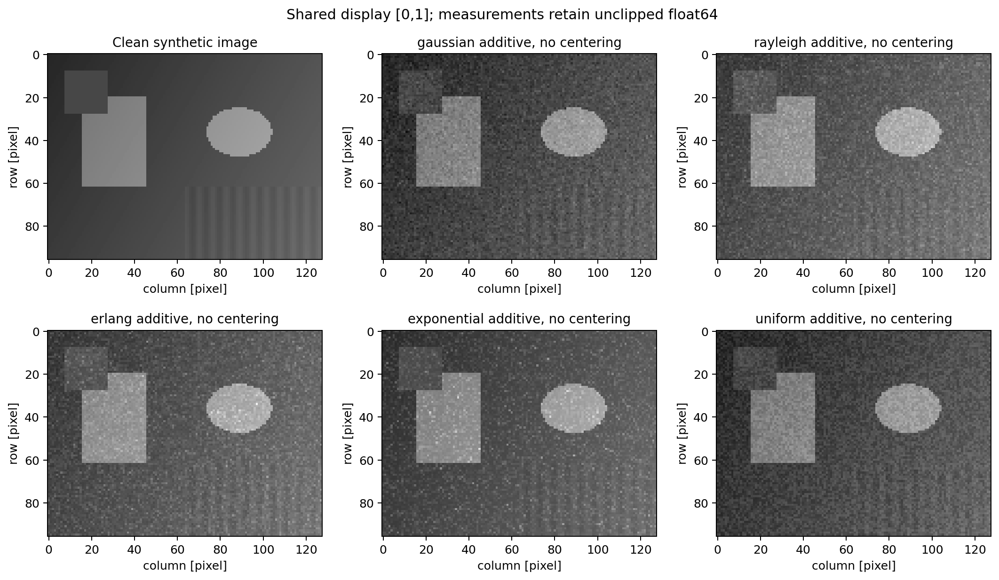

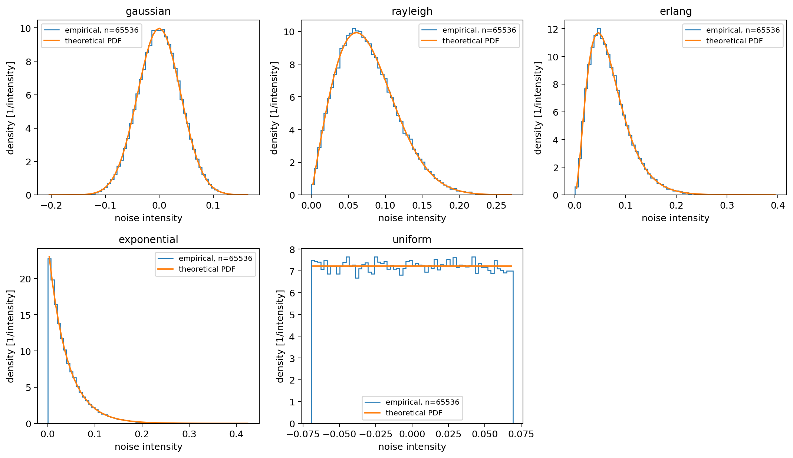

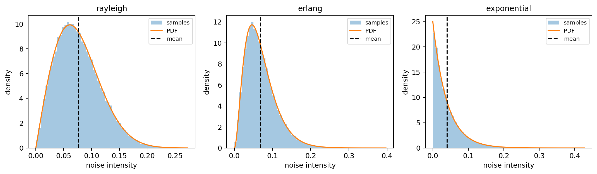

## Statistical measurements and uncertainty

`describe` reports mean, population variance $v_0=\sum(x_i-\bar x)^2/n$ and standard deviation $\sqrt{v_0}$ (`ddof=0`), plus unbiased sample variance $s^2=\sum(x_i-\bar x)^2/(n-1)$ (`ddof=1`). Singleton sample variance is undefined and represented by null. Binary scaling and anchored centering avoid unnecessary overflow/cancellation. No wider `np.longdouble` assumption is made.

Histogram edges must be finite, increasing and include every sample. The last bin includes its right endpoint. Density $c_j/(n\Delta_j)$ integrates to one; no tail mass is silently excluded. ECDF returns sorted values with ranks $i/n$, including repeated-value steps. Quantiles use linear interpolation between order statistics (NumPy `method='linear'`).

$$\mathrm{MSE}=\frac1n\sum(g_i-f_i)^2,\qquad\mathrm{PSNR}=20\log_{10}\frac{L}{\sqrt{\mathrm{MSE}}},\quad L=1.$$

MSE includes blur, noise and bias against retained clean ground truth. Exact equality has MSE 0 and mathematical PSNR $+\infty$; strict JSON uses `psnr_db=null, psnr_status='exact'`. Logarithmic PSNR uses scaled error terms so it can remain finite when the squared MSE underflows. For noise-only degradation, empirical MSE equals population noise variance plus squared empirical mean. Equal variance does not imply equal MSE, appearance or perceptual quality.

Each additive law has a separate 65,536-sample characterization set and a $96\times128$ image-noise realization. The metrics separately identify statistics of characterization samples, actual image noise and observed images. Population parameters are not substituted for sample measurements.

For IID data with population variance $v$ and fourth central moment $\mu_4$,

$$\mathrm{SE}(\bar X)=\sqrt{v/n},\quad\mathrm{SE}(s^2)=\sqrt{\frac{\mu_4-\frac{n-3}{n-1}v^2}{n}}.$$

Tests use a conservative six-SE diagnostic, not exact equality or a universally Gaussian confidence interval. Chebyshev bounds each individual six-SE tail by $1/36$; this does not assert simultaneous family-wise coverage. An independent empirical-CDF check uses DKW $\epsilon=\sqrt{\log(2/\alpha)/(2n)}$ with $\alpha=10^{-6}$. Fixed-seed checks are not proof of universal RNG correctness. Impulse frequencies use marginal binomial standard errors; endpoint probabilities 0 and 1 are exact. No Gaussian-calibrated MAD is generalized to other laws.

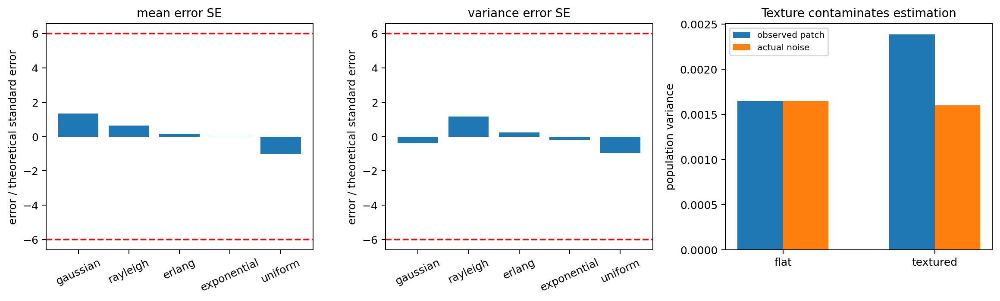

## Synthetic scenes and experiments

The original scene combines geometric blocks, a disk, smooth illumination, edges and fine low-contrast texture. The genuinely flat calibration patch is rows 8:28, columns 8:28; the textured patch is rows 65:90, columns 70:120. Noise estimation from an apparently flat patch fails if texture or illumination contributes variance; finite-patch covariance also matters. Actual noise is saved for both patches, so contamination is measured rather than assumed away.

Seed 501 plus model index generates image noise; 1501 plus index generates characterization sets. Gaussian sweeps share seed 2501 and therefore the same standardized realization at six sigma levels. Impulse sweeps share uniform draws from seed 3501. Blur noise uses seed 4501. Sweep rows are deliberately paired, not independent replicates.

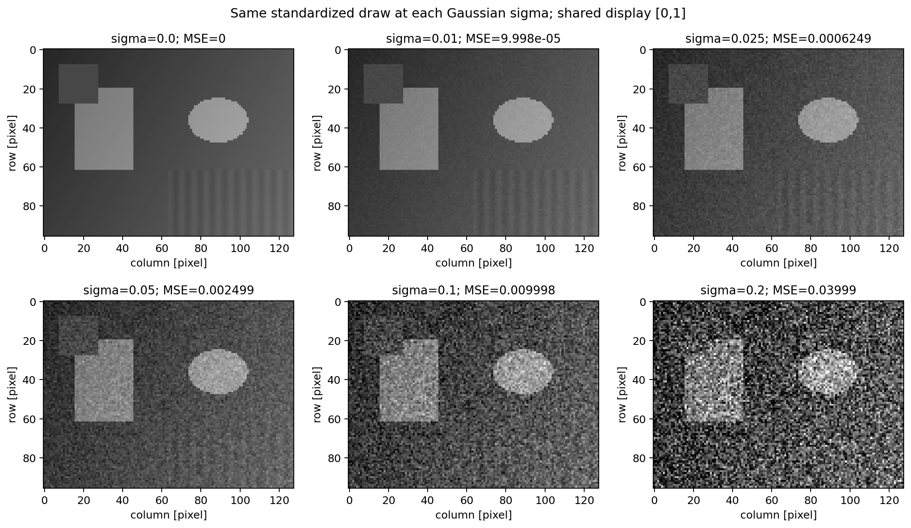

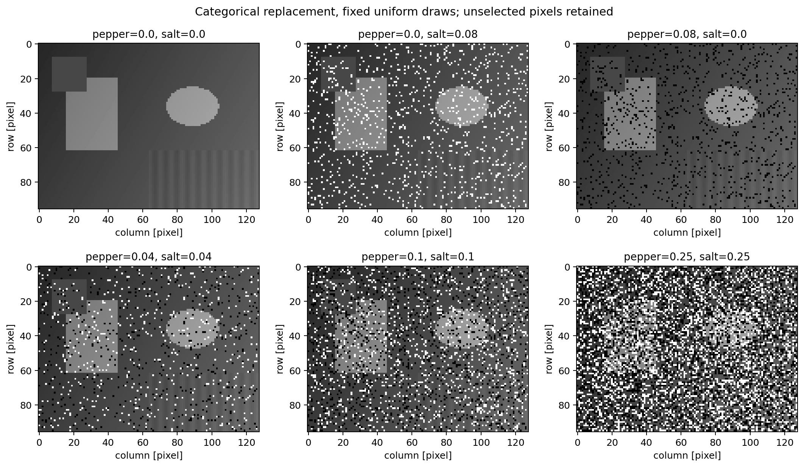

Equal theoretical variance $v=.04^2=.0016$ is obtained analytically using Gaussian $\sigma=\sqrt v$, Rayleigh $a=0,b=4v/(4-\pi)$, Erlang shape $b=3$ and rate $a=\sqrt{3/v}$, Exponential rate $a=1/\sqrt v$, and Uniform endpoints $\pm\sqrt{3v}$. Positive means are retained, and empirical variances are not forced equal. The low-contrast crop illustrates different bias/tails at the same population variance.

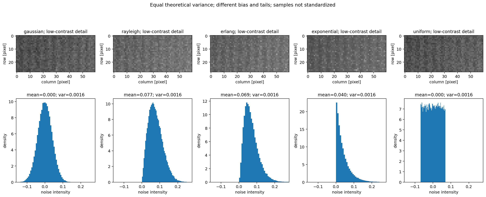

## Periodic interference and spectral conventions

$$\eta_p[y,x]=\sum_k A_k\cos[2\pi(f_{y,k}y+f_{x,k}x)+\phi_k].$$

Each frequency lies in $[-.5,.5]$ cycles/pixel; amplitudes are nonnegative and phases finite radians. Large phases are reduced through libm sine/cosine and atan2, avoiding loss from division by a rounded $2\pi$; quarter-cycle analytical tests include phase $10^{308}$. Wavevector angle is measured from +column toward +row; stripe orientation is perpendicular. Horizontal stripes vary with row coordinate. Multiple components add without standardization. On an even grid the Nyquist signs alias: self-conjugate bins contain $nA\cos\phi$, not two distinct $nA/2$ complex coefficients. DC has the same degeneracy. Odd, even, rectangular and singleton cases are tested.

The unshifted periodogram is $P[u,v]=|\mathrm{FFT}_2(\eta)|^2/n$, $n=HW$, with `fftfreq` axes in cycles/pixel. Parseval gives $\sum P/n=\mathrm{mean}(\eta^2)$. Optional `demean=True` uses anchored centering (so even a huge constant has exactly zero power) and analyzes centered power; saved examples retain the mean so positive-noise DC remains visible. Sampling intervals are one pixel, with no taper. Directional summaries sum over one frequency axis and retain the other; radial averaging is avoided for anisotropic periodic signals.

Only displays apply `fftshift`; plot extents are half-bin edges around shifted frequency centers. Display power is $10\log_{10}(\max(P,10^{-12}))$, relative to one intensity-squared unit, with shared color limits. Raw power arrays remain unfloored. The plotting floor is not a physical noise-floor estimate. No centered spectrum is multiplied or inversely transformed in the numerical degradation identity.

Six cases cover horizontal, vertical, diagonal, multiple, nonaligned and near-Nyquist components. Frequencies $(12.4/96,20.3/128)$ deliberately leak beyond their nearest conjugate pair. The near-Nyquist component is $f_x=63/128$. These deterministic directional fields are not spatially white or IID; IID sampling uncertainty formulas are not applied to them.

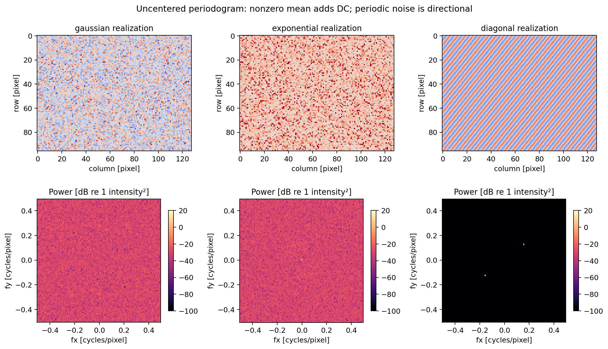

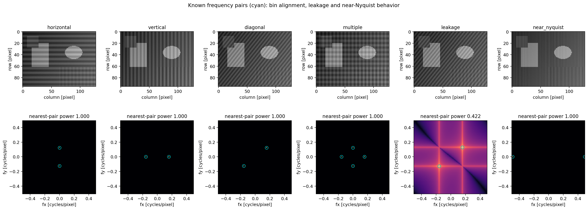

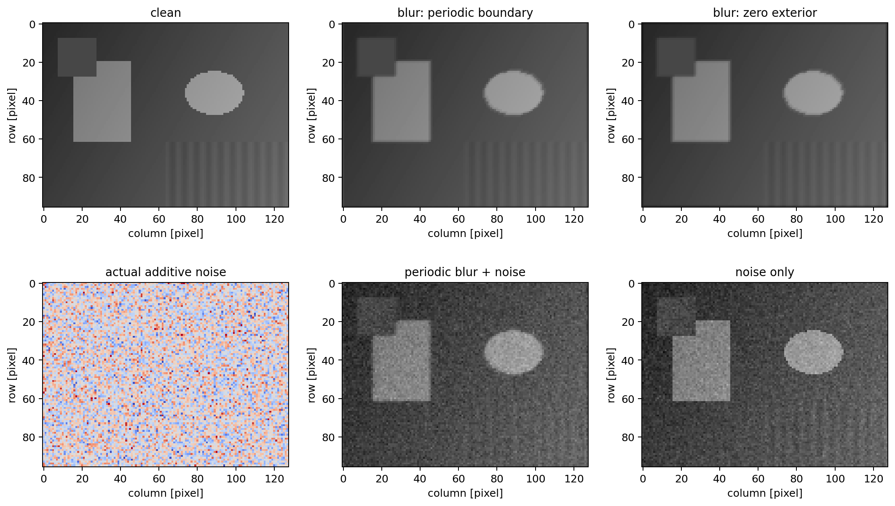

## Actual measured results

Measured in this rebuild, using 65,536 characterization samples per law and separate $96\times128$ noisy images. Theoretical variance is .0016 for all five additive laws.

| Model | Theory mean | Sample mean | Sample population variance | Mean error / SE | Unbiased variance error / SE | Image MSE | Image PSNR [dB] |
| --- | ---: | ---: | ---: | ---: | ---: | ---: | ---: |
| gaussian | 0 | 0.00020981044 | 0.0015966478 | 1.34279 | -0.37649 | 0.001610906 | 27.929298 |
| rayleigh | 0.076522335 | 0.076623421 | 0.0016108376 | 0.64695 | 1.15990 | 0.0076232387 | 21.178605 |
| erlang | 0.069282032 | 0.069308723 | 0.001602847 | 0.17082 | 0.22972 | 0.0063898113 | 21.945120 |
| exponential | 0.04 | 0.039993442 | 0.0015966971 | -0.04197 | -0.18546 | 0.0031635152 | 24.998301 |
| uniform | 0 | -0.00015974922 | 0.0015945718 | -1.02239 | -0.96666 | 0.0016093913 | 27.933384 |

Maximum absolute degradation residuals:

- `identity_max_error`: 0.
- `spatial_max_error`: 5.5511151231257827e-17.
- `fourier_max_error`: 4.5474735088646412e-13.

Known nearest-conjugate-bin captured power fractions:

- `horizontal`: 1.
- `vertical`: 1.
- `diagonal`: 1.
- `multiple`: 1.
- `leakage`: 0.421979445178.
- `near_nyquist`: 1.

Full numerical precision is retained in JSON/CSV/NPZ. See the review package for this rebuild's actual test counts, normal versus regeneration outcomes and all failures. Native Windows/Python 3.14 success is not inferred from Linux tests.

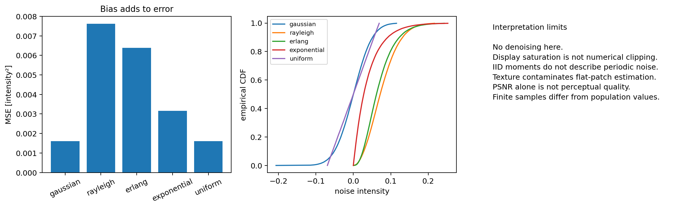

## Implementation and artifact inventory

- `noise_models.py`: NumPy distribution, impulse, sinusoid and degradation implementations.
- `noise_statistics.py`: measurement functions without sampler calls.
- `noise_scenes.py`: original geometry and parameter definitions.
- `noise_reference.py`: independent analytical/SciPy and literal spatial oracles.
- `experiment.py`: standalone experiment runner.
- `noise_audit.py`: independent scientific and artifact auditor.
- `noise_support.py`: explicit imports of unchanged Chapter 04 publication/canonicalization helpers.
- `tests/`: independent mathematical/statistical and corruption/patch tests.
- `output/`: 12 PNGs, four CSV tables (5/6/6/2 rows), JSON metrics, 116 reference arrays in NPZ and manifest: 19 files.

NPZ contains clean/observed/noise samples, histogram/ECDF/quantiles, impulse event labels/residuals, PSF/boundary results, power/directional axes and complex Fourier-model arrays. Load with `allow_pickle=False`. Float arrays are float64, Fourier arrays complex128, histogram counts int64 and labels int8. Inputs must be finite nonempty real 2D numeric arrays (bool images accepted, complex/object/string rejected). Shape requires two positive integers, including singleton axes. Invalid probabilities, nonfinite scalars, fractional Erlang shapes, invalid PSFs and unsupported frequencies fail explicitly.

## Integrity, portability and limitations

The manifest excludes itself to avoid circular hashing. CSV/JSON sizes/hashes are canonical UTF-8 LF, permitting equivalent CRLF only. Standalone CR, BOM and malformed encoding fail. PNG/NPZ are raw byte-exact binaries. The auditor checks exact inventory, full PNG decoding, every NPZ key/type/shape/finiteness, independent samples/scene geometry, distribution moments/CDFs, all CSV fields, quality and degradation values. Rehashed numeric forgeries are rejected; checksums alone are insufficient. Near-zero spectral bins use an explicit absolute roundoff tolerance $10^{-20}$ along with $10^{-10}$ relative tolerance; raw Fourier-identity residuals are bounded rather than compared bitwise. No universal tight relative tolerance is imposed on near-zero logs or spectra.

Real binary Git patch application tests exercise LF/CRLF behavior without manual correction after application. Their private source fixture is canonical LF even when the enclosing checkout is CRLF, because `autocrlf=false` preserves existing text bytes. This fixture preparation does not alter published data. The source compatibility design does not establish native Windows/Python 3.14 compatibility.

PNG writing reuses unchanged Chapter 04 Lab 03's in-memory encoding, full decoding, fsync and atomic publication, without retries hiding failures. Full regeneration runs only in disposable snapshots, followed by independent decoding of every PNG. Any damaged historical bytes are preserved outside the public patch and reported honestly. Neither a healthy execution nor a zero validator exit proves the intermittent historical defect permanently fixed.

Generation and simple statistics cost $O(n)$; sorted ECDF/quantiles $O(n\log n)$. Spatial PSF sums cost $O(nk_hk_w)$ time and $O(n)$ working storage. FFT periodograms cost $O(n\log n)$ time and $O(n)$ memory. The scientific auditor intentionally uses slower independent references. Retaining arrays and publication-sized figures requires additional memory.

Float64 cannot recover fluctuations already quantized away. Genuine range overflow in a requested moment or actual result raises `FloatingPointError`; tiny variances may underflow to zero. Samples can still be representable when a population variance is not. Uniform sampling uses convex endpoint interpolation and scaled moments; Erlang variance uses $(\sqrt b/a)^2$, avoiding premature overflow of $a^2$. Unit-scale draws are divided by rate rather than forming an overflowing reciprocal. No assumption about extra longdouble precision is used. Physical acquisition noise can differ from these simple models; high PSNR is not a complete quality criterion.

## References

1. Supplied course outline for `Chapter05-Art.pdf`, pages 1–16; original PDF unavailable in this runtime.
2. [NumPy 2.3 random Generator](https://numpy.org/doc/2.3/reference/random/generator.html), explicit Rayleigh/Gamma/Exponential scale conventions.
3. [NumPy FFT normalization](https://numpy.org/doc/2.3/reference/routines.fft.html).
4. [SciPy Rayleigh](https://docs.scipy.org/doc/scipy/reference/generated/scipy.stats.rayleigh.html) and [Gamma](https://docs.scipy.org/doc/scipy/reference/generated/scipy.stats.gamma.html), independent reference PDFs/CDFs/moments.
5. Dvoretzky, Kiefer and Wolfowitz (1956), *Asymptotic Minimax Character of the Sample Distribution Function and of the Classical Multinomial Estimator*, Annals of Mathematical Statistics 27(3), 642–669; Massart (1990), sharp DKW constant.
