# Chapter 05 · Lab 02 — Mean Filters for Image Restoration

This laboratory implements arithmetic, geometric, harmonic and contraharmonic spatial means, compares controlled noise suppression against detail destruction, and audits every saved map independently. It reuses the published [Lab 01 noise interface](../01-noise-models-and-degradation/README.md) without changing it. No median, other order-statistic, adaptive, inverse, Wiener or notch filters are implemented.

**Course access:** the original `Chapter05-Art.pdf` was unavailable and was not independently opened. Alignment follows the supplied page inspection: arithmetic p.17; geometric pp.18–19; harmonic p.20; contraharmonic/Q pp.21–23; order-statistic filters from p.24 belong to later labs. Course claims about less blur and impulse suppression are examined as conditional claims, not guarantees. All images are original synthetic data; no course PDF or protected textbook graphics are distributed.

## Reproduce

From the repository root using unchanged pinned requirements:

```bash
python -m venv .venv
source .venv/bin/activate
python -m pip install -r requirements.txt
python chapter-labs/chapter-05-image-restoration/02-mean-filters/experiment.py
python chapter-labs/chapter-05-image-restoration/02-mean-filters/mean_filter_audit.py
python -m pytest -q chapter-labs/chapter-05-image-restoration/02-mean-filters/tests
python scripts/validate_repository.py
```

Windows PowerShell activation and direct-interpreter alternative:

```powershell
.\.venv\Scripts\Activate.ps1
# If local policy blocks activation, no policy change is required:
.\.venv\Scripts\python.exe -m pip install -r requirements.txt
.\.venv\Scripts\python.exe chapter-labs/chapter-05-image-restoration/02-mean-filters/experiment.py
```

The runner accepts `--output-dir PATH`; its default output directory is beside the script regardless of the working directory. The auditor accepts an optional output directory. Reproducibility is defined within the pinned environment. Full `--regenerate` must run only in a disposable exact-base patched export, followed by an independent scan of **every** PNG. A passing validator does not prove historical PNG health. Review packages provide commands, full logs and the scanner.

## API, window and padding contract

```python
from mean_filters import arithmetic_mean, geometric_mean, harmonic_mean, contraharmonic_mean
A = arithmetic_mean(image, window=(3,5), mode='reflect')
G = geometric_mean(positive_image, window=(3,3), mode='edge')
H = harmonic_mean(nonnegative_image, window=(5,5), mode='constant', cval=0.)
C = contraharmonic_mean(nonnegative_image, Q=-1.5, window=(3,3), mode='reflect')
```

Each call returns a **new float64 array of identical shape**, without mutating its finite nonempty real 2D input. Integer/bool images convert to float64 without intensity normalization; complex (including zero imaginary part), object/string, invalid ranks, empty and nonfinite arrays are rejected. Noncontiguous views are supported. No intensity clipping, uint8 conversion, absolute-value repair or hidden epsilon occurs.

`window=(height,width)` requires two positive integers and rejects booleans. Default is odd 3×3, but 1×1, 1×3, 3×1, rectangular and even windows are supported. The anchor is $(\lfloor m/2\rfloor,\lfloor n/2\rfloor)$; even windows therefore have their extra samples above/left of the output pixel. Padding per axis is `(anchor, size-1-anchor)`.

| Mode | Exact behavior | SciPy ndimage comparison |
| --- | --- | --- |
| `reflect` | NumPy reflection **excluding** the edge sample | `mirror` |
| `edge` | Replicate nearest boundary sample | `nearest` |
| `constant` | Use finite user `cval`, default 0 | `constant` |

A singleton axis reflects by repeating its sole sample. Windows may exceed an image dimension. `cval` must be finite even when unused; domain restrictions on it apply only to constant padding. Negative padding is accepted only by arithmetic/Q=0. Zero padding is supported by the declared nonnegative limits and can strongly bias nonlinear-filter borders. Constants are preserved exactly when the exterior is compatible (`reflect`, `edge`, or matching constant padding); an incompatible constant exterior deliberately breaks that assumption.

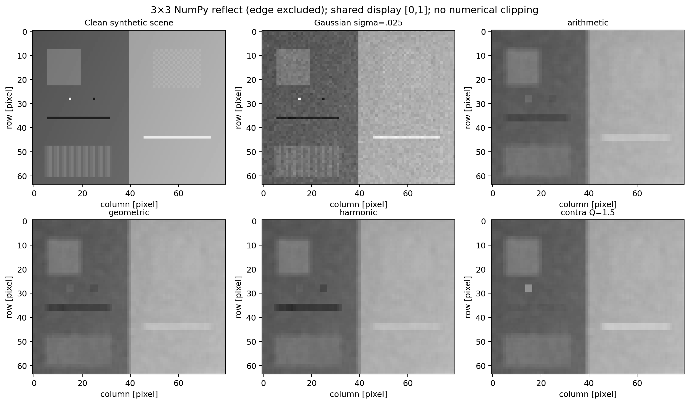

## Definitions and exact zero conventions

For neighborhood values $z_i$, $N=mn$:

$$A=\frac1N\sum_i z_i,\qquad
G=\exp\left(\frac1N\sum_i\log z_i\right),\qquad
H=\frac{N}{\sum_i1/z_i},$$

$$C_Q=\frac{\sum_i z_i^{Q+1}}{\sum_i z_i^Q}.$$

Arithmetic supports signed finite values. Geometric, harmonic and contraharmonic with $Q\ne0$ use the **nonnegative domain**. A finite real Q is required; bool, complex, nonscalar and nonfinite Q are rejected. Integer Q does not silently extend the domain to negative intensities. Q=0 is explicitly dispatched to signed arithmetic; Q=-1 to harmonic, giving identical arrays under the supported conventions.

| Case | Defined output | Justification |
| --- | --- | --- |
| Geometric, any zero | Exactly 0 | Product/positive-domain continuous limit |
| Harmonic, any zero | Exactly 0 | Reciprocal sum tends to infinity |
| Contraharmonic, Q<0 and any zero | Exactly 0 | Unique continuous nonnegative extension; diverging zero weights dominate |
| Contraharmonic, Q>0 with some positive values | Zeros have exactly zero weight | Literal nonnegative powers |
| Contraharmonic, Q>0 and all zero | Exactly 0 | Homogeneity and min/max bounds force the limiting value |
| Q=0, including zeros | Arithmetic over **all N** samples | Explicit algebraic convention, not a Q→0 limit |

For Q<0, the raw expression at zero contains undefined/infinite terms; the implementation **does not pretend those raw powers are finite**. It defines their continuous nonnegative limit without evaluating them or replacing zeros by epsilon. For Q>0, the all-zero raw ratio is 0/0 but its unique intensity-domain limit is zero. Negative constant padding remains unsupported for nonlinear means and raises a clear error.

This extension is continuous in intensities for each fixed nonzero Q, but is **not jointly continuous in Q at zero when exact zeros are present**. For the analytical neighborhood `[0,.5,.5]`, every Q<0 gives 0 under the limit policy, Q=0 gives 1/3, and every Q>0 gives .5. The Q sweep therefore legitimately jumps at zero. This is a mathematical/domain distinction, not a hidden implementation default.

## Stable numerical evaluation

Direct products, reciprocals and large raw powers are not used in production:

- Arithmetic normalizes each window by its maximum absolute value. Near severe signed cancellation it uses `math.fsum` on original samples; rare intermediate overflow falls back to exact binary-float rational accumulation before division. This retains tiny residuals without overflowing a representable mean.
- Geometric uses logarithms. For moderate log span, max anchoring preserves nearly constant huge values; for very wide spans, `exp(mean(log z))` avoids losing a representable answer through an underflowing intensity ratio.
- Harmonic uses max-normalized reciprocals for moderate spans and min-normalized ratios for wide spans. It never forms an overflowing `1/z` for tiny positive z.
- Contraharmonic is a weighted mean with $w_i\propto z_i^Q$. Log weights are anchored at the max for positive Q and min for negative Q. Near-unity log ratios use `log1p` with an accurate local difference, rather than subtracting two nearly equal large logs.

The moderate-span threshold is 500 natural-log units, leaving ample float64 range for ordinary normalized operations. It changes the numerical formulation, not the mathematical mean. For a wide span and Q<-1,

$$C_Q=z_{\min}\frac{\sum_i e^{(Q+1)\log(z_i/z_{\min})}}{\sum_i e^{Q\log(z_i/z_{\min})}}.$$

For -1<Q<0, use the convex log anchor

$$\log C_Q=(Q+1)\log z_{\max}-Q\log z_{\min}
+\log\sum_i e^{(Q+1)\log(z_i/z_{\max})}
-\log\sum_i e^{Q\log(z_i/z_{\min})}.$$

This avoids subtracting enormous $Q\log z$ terms. Underflow of negligible *internal weights* is allowed; at least one normalized weight is exactly 1. Exact zeros are handled analytically, never via a numerical floor. Constant neighborhoods bypass approximations. No additional `np.longdouble` precision is assumed. Genuine floating-point representability limits remain; subnormal quantization cannot be undone.

Independent tests use literal indexed neighborhoods and ordinary direct products/reciprocal/power ratios, SciPy arithmetic comparison, and **100-digit Decimal scalar oracles** for selected extremes. Decimal consumes the exact binary float values via `Decimal.from_float`. Very large ±Q concentration cases use analytical float64 limiting bounds instead of attempting astronomically large powers. These are selected-case oracles, not a claim of universal correct rounding.

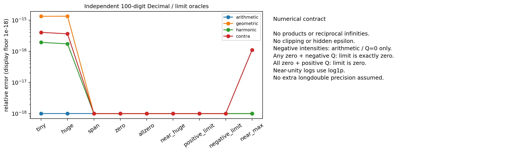

## Synthetic experiments and measurements

The main 64×80 scene has constant/local gray regions, a smooth gradient, a sharp vertical step, a dark thin line at row 36/columns 6:32, a bright thin line at row 44/columns 46:74, isolated points `(28,15)` and `(28,25)`, fine alternating structures and repeating texture. A second scene sets those features to true 0/1. Truth coordinates are exported and independently checked.

Published Lab 01's `Distribution` and `impulse_replace` generate the main eight conditions without copying its noise implementation. Seeds 551–558 identify Gaussian (sigma .025), Uniform [-.05,.05], salt-only (.08), pepper-only (.08), mixed (.04+.04), and corresponding impulse cases on true black/white features. Additive-noise examples are verified positive before nonlinear filtering; no negatives are clipped or offset to force validity. Separate signed Gaussian tests exercise arithmetic's larger domain.

All clean/corrupted arrays, actual residuals, event labels, corruption masks and filter outputs are retained. Additive masks label every generated pixel; impulse masks label replacement events, even if a replacement equals its original value. Metrics on originally uncorrupted pixels are null when no such pixels exist.

For every main output, export MSE, RMSE, MAE, residual bias, PSNR with fixed range $L=1$, input MSE, output/input residual-error ratio and separate corrupted/uncorrupted MSE. No display-normalized data are measured. Exact equality uses `psnr_db=null, psnr_status='exact'`, representing mathematical +infinity; ratios with zero input MSE are null rather than fabricated infinities.

Thin-line metrics compare center contrast against adjacent rows, isolated-point absolute errors, and thresholded vertical widths at known columns. Width classification has an explicit $10^{-12}$ intensity resolution: threshold ties are not counted. A widened line can have small adjacent-row contrast even when some dark pixels remain; width and profiles are provided alongside global MSE.

An isolated clean step from .25 to .75 at column 40 separates blur from noise. The 10–90% width linearly interpolates crossings at .30 and .70. The sampled unfiltered jump has width **.8 pixel**, not zero. Midpoint shift is relative to column 39.5; gradient preservation is peak first difference divided by the original .5 jump. These are declared sampled-profile metrics, not universal physical resolution measures.

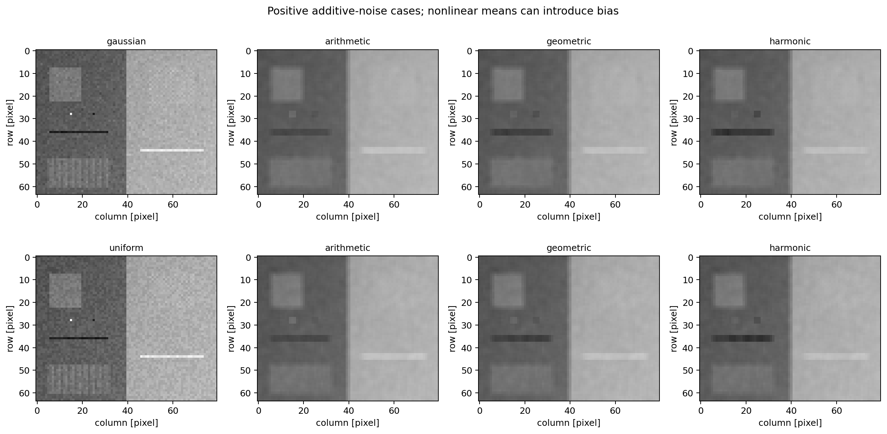

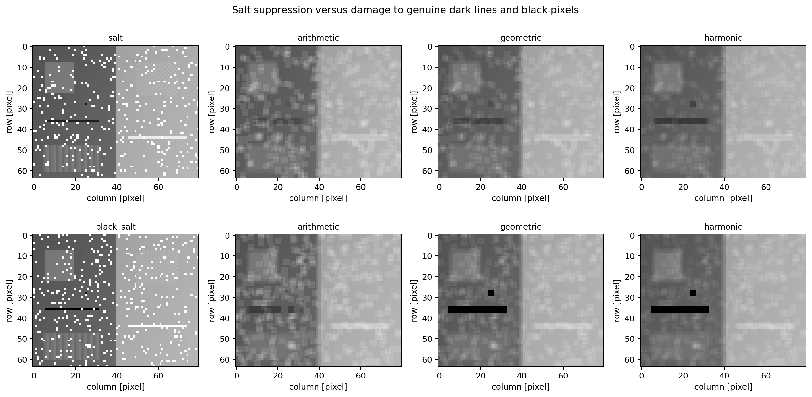

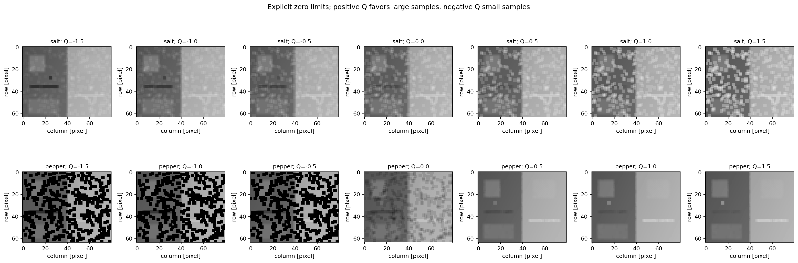

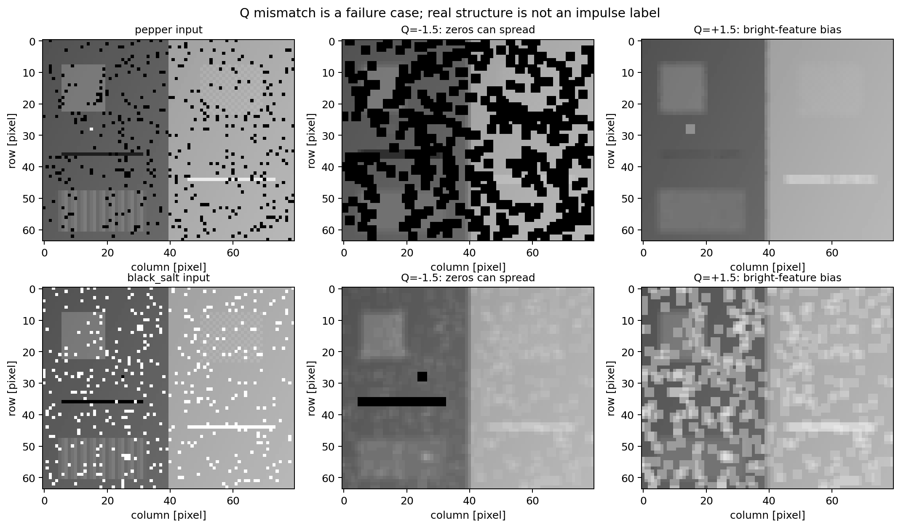

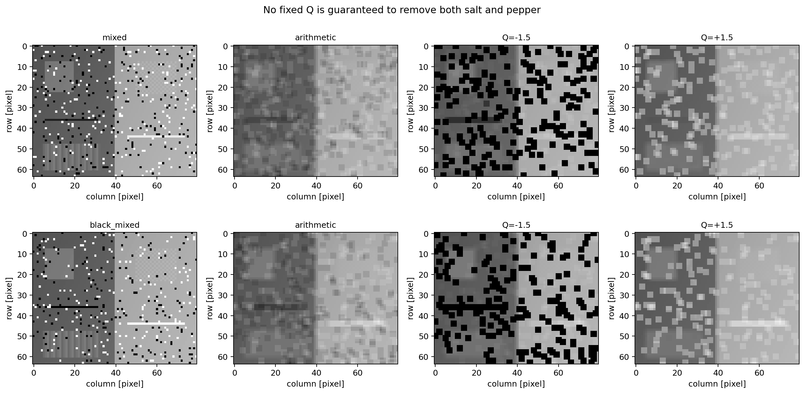

## Measured results from this execution

Selected 3×3 NumPy-reflect results. Higher PSNR is not a complete ranking of feature preservation.

| Noise | Filter | PSNR [dB] | MSE | Dark-line contrast ratio | Bright-line contrast ratio |
| --- | --- | ---: | ---: | ---: | ---: |
| gaussian | arithmetic | 30.56342 | 0.0008783309 | -0.00187 | 0.00335 |
| gaussian | geometric | 30.41659 | 0.0009085326 | -0.00128 | 0.00363 |
| gaussian | harmonic | 29.93507 | 0.001015062 | -0.00076 | 0.00383 |
| gaussian | contra Q=1.5 | 29.65090 | 0.001083703 | -0.00385 | 0.00228 |
| uniform | arithmetic | 30.53399 | 0.0008843019 | 0.00166 | 0.01780 |
| uniform | geometric | 30.35870 | 0.0009207249 | 0.00200 | 0.01979 |
| uniform | harmonic | 29.84626 | 0.001036033 | 0.00187 | 0.02163 |
| uniform | contra Q=1.5 | 29.59966 | 0.001096563 | 0.00027 | 0.01144 |
| salt | arithmetic | 24.17836 | 0.003820884 | -0.02782 | -0.04694 |
| salt | geometric | 26.45176 | 0.002263729 | -0.01059 | -0.04367 |
| salt | harmonic | 27.84432 | 0.001642739 | -0.00263 | -0.04025 |
| salt | contra Q=1.5 | 17.14224 | 0.0193097 | -0.11630 | -0.05550 |
| pepper | arithmetic | 22.70605 | 0.005362847 | -0.01672 | 0.04040 |
| pepper | geometric | 7.99294 | 0.1587471 | 0.05622 | 0.28248 |
| pepper | harmonic | 7.99176 | 0.1587904 | 0.04928 | 0.27988 |
| pepper | contra Q=1.5 | 30.11035 | 0.0009749104 | -0.00242 | -0.00496 |
| mixed | arithmetic | 24.74621 | 0.003352582 | 0.00463 | -0.05588 |
| mixed | geometric | 10.14582 | 0.09669821 | 0.09663 | -0.44248 |
| mixed | harmonic | 10.15300 | 0.09653838 | 0.07782 | -0.44060 |
| mixed | contra Q=1.5 | 19.39011 | 0.01150771 | -0.03902 | 0.02605 |

Q sign comparison, with the same clean/noisy data and zero policy:

| Scene | PSNR Q=-1.5 [dB] | PSNR Q=+1.5 [dB] |
| --- | ---: | ---: |
| salt | 28.43431 | 17.14224 |
| pepper | 7.99007 | 30.11035 |
| mixed | 10.15321 | 19.39011 |
| black_salt | 25.21398 | 16.29079 |
| black_pepper | 7.93422 | 27.86172 |
| black_mixed | 10.62164 | 19.27731 |

The negative sign helps these salt cases, but zeros spread and severely damage pepper/mixed cases. Positive Q helps these pepper cases while favoring salt and genuine bright structures. Harmonic/geometric are not immune to true black pixels. No fixed Q reliably recovers simultaneous impulses or distinguishes noise from legitimate structures.

Arithmetic slightly outperforms geometric on global Gaussian/Uniform PSNR in these scenes; both strongly attenuate the one-pixel lines. The noiseless bright-line counterexample has a lower geometric peak than arithmetic, so the course's “less blurring” statement cannot be generalized. The clean profiles expose different edge shifts and polarity-dependent detail loss.

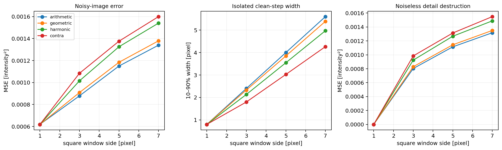

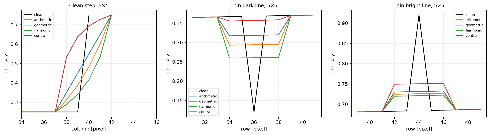

### Noise-variance calibration

For independent zero-mean Gaussian samples averaged uniformly over N pixels, $\operatorname{Var}(A)=\sigma^2/N$. Boundary reuse and spatial signal variation invalidate treating every output window as N independent new observations. A separate unit test uses **disjoint 3×3 windows** and a six-standard-error Gaussian variance check. The experiment instead reports empirical flat-interior variance and variation across three independent seeds, with paired realizations across sigma levels.

Calibration uses constant .55 images of size 32×40, sigma [0,.01,.03,.06], seeds [601,602,603], default 3×3 reflect. Plotted error bars are sample SD across three seeds, not confidence intervals or independent-pixel standard errors. Nonlinear means can reduce variance while adding bias.

At sigma .03, theoretical point variance is **0.0001**; measured mean flat-interior residual variance across the three seeds is **9.84618676e-05**. Overlapping output pixels are correlated.


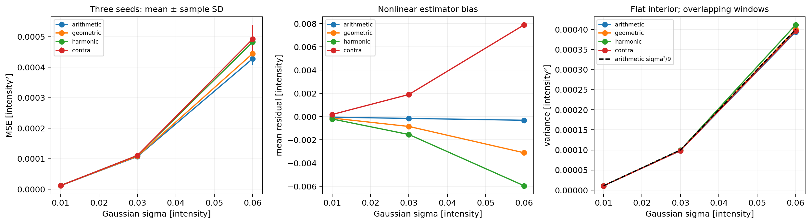

### Boundaries and stress

For 7×7 windows, a three-pixel border band is evaluated separately from the valid interior. Reflect/edge/constant agree exactly in the valid interior. Constant cval=0 creates a strong artificial dark border for geometric, harmonic and negative-Q filters under the supported zero limit. This is a boundary assumption, not evidence of noise removal.

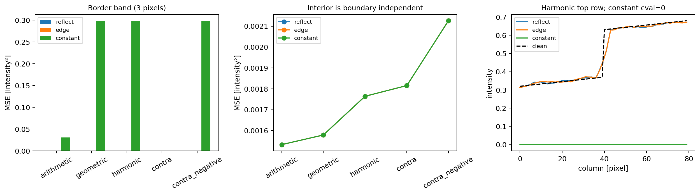

Stress cases include tiny/huge intensities, more than 600 orders of dynamic range, low variance near large values, values near float64 maximum, zeros/all-zeros, Q=±1e12 and Q=±float64 maximum. Reference values and absolute/relative/ULP errors are stored separately. Large absolute errors at values near 1e308 can be one ULP; relative errors and magnitude must be interpreted together. The scientific audit reports ordinary-map and stress errors separately.

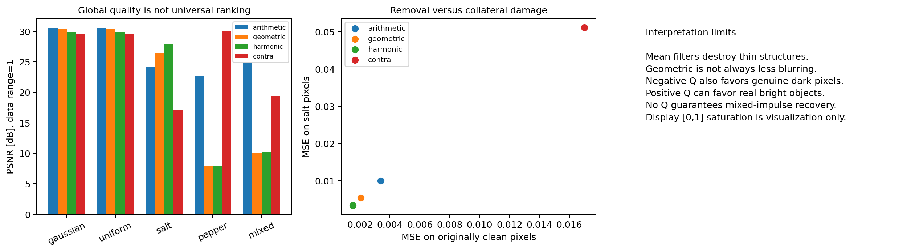

## Independent audit and portability

`mean_filter_audit.py` verifies every expected filename, canonical sizes/hashes, full PNG decoding, and loads NPZ with `allow_pickle=False`. It validates all **327** array keys/dtypes/shapes/finiteness, masks and coordinates. It independently reconstructs all ordinary filter maps by explicit spatial offset enumeration with its own index reflection, and checks stress maps using Decimal/analytical oracles. No production filter is imported by the auditor. Saved MSE/PSNR, edge/detail quantities, Q identities and all CSV/JSON records are checked. A coherently rehashed map-plus-metric forgery is tested and rejected.

CSV/JSON permit only UTF-8 LF versus equivalent CRLF. Bare CR, BOM, malformed encoding, changed/missing rows and binary corruption fail. PNG/NPZ bytes are strict. CSV/JSON numeric equality compares two serializations of the **same record** exactly after parsing; independent derived values retain justified tolerances. Ordinary independent maps use rtol $10^{-10}$, atol $10^{-12}$; stress maps use atol 0 with relative tolerance, and exact-zero policies remain exact. Near-zero derived biases/ratios are not forced to equal another algorithm bitwise.

Real `git apply --binary` tests use both autocrlf modes and a canonical-LF private source fixture, even when the enclosing checkout is CRLF. No manual line-ending repair after patch application is required. The implementation does not rely on Windows longdouble being wider than float64. Linux tests are not native Windows/Python 3.14 certification.

New figures use the unchanged verified PNG publication helper from Chapter 04 Lab 03. Historical full-regeneration PNG corruption is investigated only in disposable exports with an independent chunk/CRC/zlib/Pillow scan. Any damaged bytes are preserved outside the public patch. Healthy scans do not prove the intermittent defect permanently fixed; actual outcomes are in the review report.

## Files, complexity and limits

- `mean_filters.py`: four importable implementations and domain/boundary validation.
- `mean_scenes.py`, `mean_measurements.py`: deterministic scenes and raw scientific metrics.
- `mean_reference.py`: literal slow scalar/spatial and 100-digit Decimal oracles.
- `mean_audit_reference.py`, `mean_filter_audit.py`: independent full-map/artifact verification.
- `mean_support.py`: explicit reuse of unchanged Lab 01 noise and Chapter 04 publication utilities.
- `experiment.py`, `tests/`: experiment runner and meaningful automated validation.
- `output/`: **12 PNGs, six CSV tables (32/42/28/15/48/36 rows), JSON metrics, 327-array NPZ and manifest: 21 files**.

All intensities/filter outputs are float64; event labels are int8 and masks bool. The straightforward production/reference spatial operations cost $O(HWmn)$ time and up to $O(HWmn)$ window storage. There is no separable acceleration or library spatial filter in production. Rare severe signed-cancellation fallback adds exact-accumulation work. Large windows/images require substantial memory; accuracy and inspectability take priority over optimization. Reference direct products/powers are intentionally confined to moderate experimental data; stress oracles use Decimal/limits.

These are local smoothers. They can erase isolated objects, broaden black lines, shift edges and bias brightness. Valid settings need not improve PSNR, and no method is universally best. Corruption masks/clean truth are available only because the data are synthetic; real images do not reveal which bright/dark samples are noise. The lab does not estimate an automatically optimal Q or implement later restoration methods.

## References

1. Supplied `Chapter05-Art.pdf` outline, pp.17–23; original PDF unavailable here.
2. [NumPy pad modes](https://numpy.org/doc/2.3/reference/generated/numpy.pad.html), especially edge-excluding reflection.
3. [SciPy uniform_filter modes](https://docs.scipy.org/doc/scipy/reference/generated/scipy.ndimage.uniform_filter.html), used only as an additional arithmetic reference.
4. [Python Decimal](https://docs.python.org/3/library/decimal.html), independent high-precision scalar checks.
5. Published Chapter 05 Lab 01 and Chapter 04 Labs 03/06, reused without modification.
