# Chapter 05 · Lab 03 — Order-Statistic Filters

Five fixed-window filters are implemented directly using NumPy, with independent
literal-neighborhood references and original synthetic restoration experiments.
Course alignment follows the supplied description of Chapter05-Art.pdf pages
24–30. **The original PDF was unavailable; no direct PDF reading is claimed.**
Adaptive local-noise/adaptive median (pages 31/34 onward) are outside this lab.

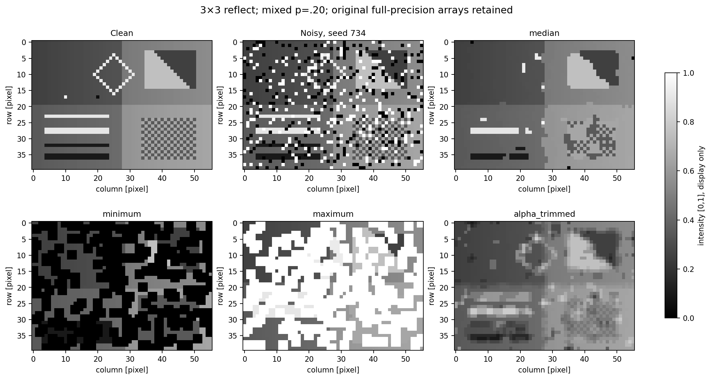

## Mathematical definitions

For N=mn finite samples sorted as $z_{(1)}\le\cdots\le z_{(N)}$:

$$\operatorname{median}(z)=\begin{cases}z_{((N+1)/2)},&N\text{ odd},\\
(z_{(N/2)}+z_{(N/2+1)})/2,&N\text{ even}.\end{cases}$$

$$\operatorname{min}(z)=z_{(1)},\quad\operatorname{max}(z)=z_{(N)},\quad
\operatorname{midpoint}(z)=(z_{(1)}+z_{(N)})/2.$$

$$\operatorname{trim}_d(z)=\frac1{N-d}\sum_{i=d/2+1}^{N-d/2}z_{(i)},
\qquad d\in\{0,2,4,\ldots\},\quad 0\le d<N.$$

d is the **total removed**, half per tail. d=0 is the arithmetic mean. For odd
N, d=N−1 leaves the median. For even N, N−1 is odd and invalid; maximal valid
d=N−2 leaves two central samples and equals the conventional even median.
Ties retain multiplicity. The table `survivors` field is N−d, the original
population count for non-trimming methods.

Median is nonlinear, not convolution: medians of (0,0,10) and (0,10,0) sum to
zero, but the median of their sum is ten. Minimum/maximum correspond to flat
grayscale erosion/dilation on the footprint; a morphology library is not added.

## API and boundaries

```python
from order_statistic_filters import order_filter, alpha_trimmed_mean
out = order_filter(image, 'median', window=(3, 5), mode='reflect')
trim = alpha_trimmed_mean(image, window=(3, 3), d=4, mode='edge')
```

Convenience functions: median_filter, minimum_filter, maximum_filter,
midpoint_filter and alpha_trimmed_mean. Common API method names are median,
minimum, maximum, midpoint, alpha_trimmed. Nonzero d is rejected for other methods.

Input: nonempty finite real numeric 2D image. Signed/unsigned integers, bool
pixels and floating inputs promote to float64; integers above 2^53 may round.
Complex (including zero imaginary), object/string, empty, NaN and infinite
inputs fail. Output: a new same-shape float64 array, with no clipping, uint8
conversion or mutation; noncontiguous and singleton arrays work.

Window dimensions must be positive integers; bool and fractional shapes fail.
Both odd/even windows work. At output (y,x), offsets are dy−floor(m/2),
dx−floor(n/2); even windows have the extra sample above/left. Trim must be an
even nonboolean integer in range. cval must always be finite real and nonboolean.

| Mode | Explicit extension |
| --- | --- |
| reflect | NumPy reflection excluding the edge, called `mirror` in SciPy |
| edge | Repeat nearest value |
| constant | Explicit finite user cval outside image |

Singleton reflection repeats the sole value. Windows can exceed image size.
All methods share identical boundaries. Constants are preserved with reflect,
edge, or constant padding equal to the constant. Additive-shift equivariance
also requires shifting cval in constant mode. Min/max are monotone under
matched boundaries; median and midpoint lie between local extrema, and the
trimmed mean lies within the retained sorted interval. Tests check these claims
with their preconditions and provide nonlinearity counterexamples.

## Numerical implementation and costs

Sliding windows provide neighborhoods; sorting implements median/trimmed mean.
Minimum/maximum/midpoint cost O(HWN); sorting costs O(HWN log N), with dense
O(HWN) memory. These educational implementations are not streaming filters.

Scaled averaging prevents overflowing finite sums. Midpoint uses a stable
two-sample average. Exact binary-rational fallback handles severe signed
cancellation and subnormal averages; constant neighborhoods are exact. No
extended longdouble, epsilon-altered inputs or invalid-output repair is used.
Negligible internal scaled underflow is explicitly permitted; nonfinite public
outputs fail. Near-FMAX errors must be interpreted relative to magnitude.

## Controlled scenes and reproducibility

The original 40×56 composite contains gradients, horizontal/vertical steps,
diagonal edges, one/two-pixel bright/dark lines, isolated bright/dark objects,
fine checker texture and a thin diamond boundary. Negative samples use a
downward-shifted scene. Separate 24×32 constant fields study estimator efficiency;
a 12×16 boundary pattern has deterministic corner contamination.

The unchanged [Lab 01](../01-noise-models-and-degradation/README.md) noise API
generates Gaussian/uniform additive noise and categorical impulse replacement.
The unchanged [Lab 02](../02-mean-filters/README.md) arithmetic mean is the
baseline; its implementation is imported, not copied.

Main seeds 730–738 cover Gaussian, uniform, salt, pepper, mixed, uniform+impulse,
Gaussian+impulse, high density and negative data. Additive σ=.04. Uniform
bounds ±sqrt(3)σ match Gaussian population variance. Impulse probability .20
is total, except high density .85. Combined noise adds noise before replacement.
Labels are −1 pepper, +1 salt, 0 unchanged; replacement levels are 0/1.
Zero uniform scale is a noiseless identity, without constructing an empty interval.

| Study | Design |
| --- | --- |
| Main | 9 scenes × 6 methods, 3×3 reflect, experimental trim d=4 |
| Trimming | 6 scenes × d=0,2,4,6,8 |
| Windows | mixed/noiseless × widths 3,5,7 × 6 methods; trim d=4,12,24 |
| Density | p=0,.1,.3,.5,.7,.9,1; 3 seeds 750–752, median/trim/mean |
| Calibration | Gaussian/uniform × σ=.01,.04,.08 × 4 seeds 760–763 × midpoint/median/mean |
| Boundary | 3 modes × 5 methods, 5×5, constant cval=−.2 |
| Stress | 8 small arrays × 5 methods; exact rational references |

Seeds are paired across noise levels. Error bars are across-seed **sample SD**,
not confidence intervals. Overlapping filtered pixels are correlated and are not
treated as independent trials. Full clean/noisy/noise/event/label/filter arrays,
structure masks and parameters are retained, with no display clipping in metrics.

## Metrics and actual results

$$\operatorname{MSE}=K^{-1}\sum_i(\hat f_i-f_i)^2,\quad
\operatorname{RMSE}=\sqrt{\operatorname{MSE}},\quad
\operatorname{MAE}=K^{-1}\sum_i|\hat f_i-f_i|,$$
$$\operatorname{PSNR}=10\log_{10}(L^2/\operatorname{MSE}),\quad L=1.$$

L=1 is a declared range, also for negative shifted data, not the observed max−min.
Zero MSE has null JSON PSNR representing positive infinity. Empty mask
denominators have null metrics. Bias/variance use the population residual.
Constant residuals/textures have analytically zero variance, not roundoff noise.

Corrupted/uncorrupted metrics use impulse-event masks for replacement/combined
trials. Combined non-event pixels still contain additive noise. Pure additive
trials mark every pixel affected; noiseless trials mark none. Correction means
|output−truth|≤.05 on event pixels. False alteration means |output−input|>1e−12
on non-event pixels. It is not a perceptual correctness probability.

Border MSE uses a two-pixel band. Gradient RMSE compares adjacent-column
differences. Row-19 profile RMSE/max-gradient measure the known step. Structure
survival is the fraction within .1 of truth on the original line/object/ring/
texture mask; this measures intensity retention, not connectivity. Texture SD
ratio supplements these measures. Tests separately verify exact step localization.

Measured main PSNR [dB], 3×3 reflect (high row p=.85):

| Noise | Median | Min | Max | Midpoint | Trim d=4 | Mean |
| --- | --- | --- | --- | --- | --- | --- |
| gaussian | 20.887 | 14.784 | 13.532 | 18.382 | 21.059 | 20.541 |
| uniform | 20.841 | 14.740 | 13.540 | 18.454 | 21.028 | 20.581 |
| salt | 16.920 | 15.940 | 5.513 | 11.799 | 17.245 | 15.663 |
| pepper | 16.618 | 6.959 | 14.920 | 13.329 | 17.058 | 16.291 |
| mixed | 19.208 | 8.026 | 6.663 | 13.372 | 19.693 | 17.913 |
| uniform_impulse | 18.900 | 8.175 | 6.613 | 13.691 | 19.013 | 17.773 |
| gaussian_impulse | 18.785 | 8.048 | 6.708 | 13.755 | 18.761 | 17.667 |
| high | 7.524 | 6.313 | 4.819 | 14.580 | 10.651 | 13.050 |


Flat-field mean MSE at σ=.04, four seeded trials:

| Noise σ=.04 | Method | Mean MSE | Seeds |
| --- | --- | --- | --- |
| uniform | midpoint | 0.00010539262 | 4 |
| uniform | median | 0.00047893824 | 4 |
| uniform | arithmetic | 0.00021193437 | 4 |
| gaussian | midpoint | 0.0003124313 | 4 |
| gaussian | median | 0.00029697266 | 4 |
| gaussian | arithmetic | 0.00019155427 | 4 |


Minimum suppresses isolated salt but propagates dark structure; maximum
suppresses isolated pepper but propagates bright structure. Median handles
moderate mixed impulses but can remove genuine thin features. Midpoint benefits
from bounded uniform noise on flat regions; Gaussian tails and a single extreme
outlier make it fragile. Arithmetic averaging outperforms median in the tested
Gaussian flat-field case. These are controlled examples, not universal rankings.

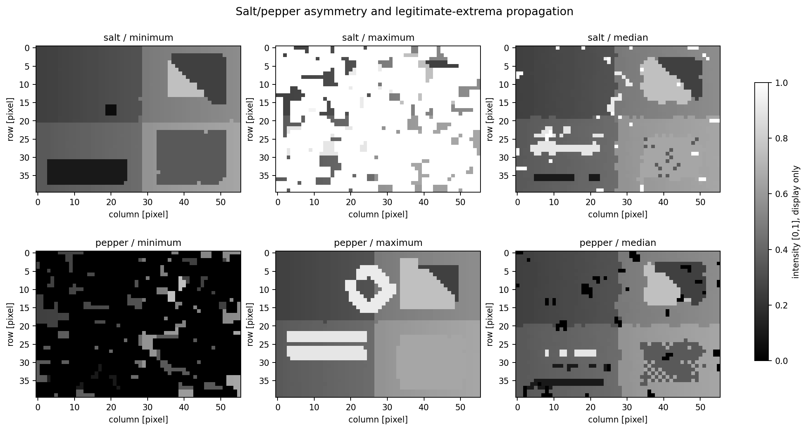
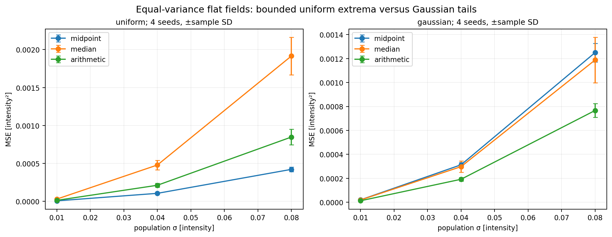
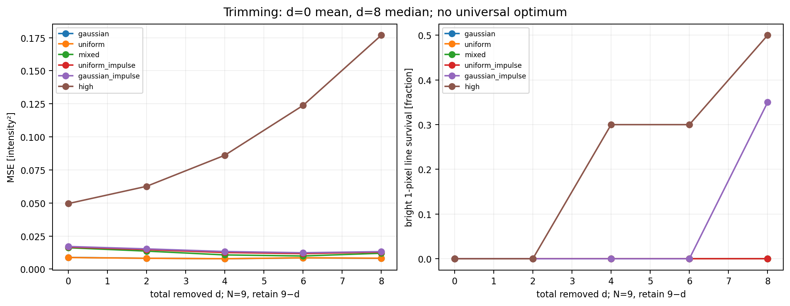
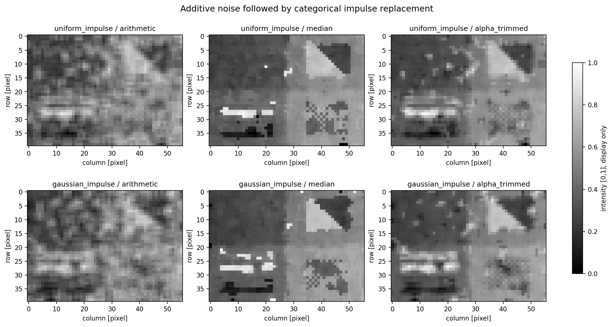
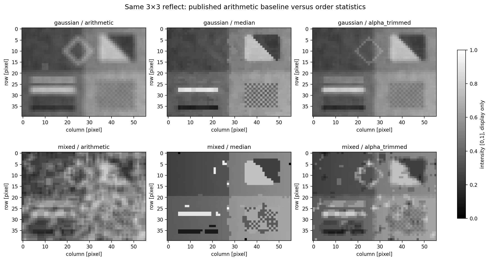

Trimming trades averaging efficiency for outlier resistance, but cannot ensure
recovery when too many extremes survive. Aggressive trimming removes genuine
bright/dark features. Larger windows can erase lines, small objects and fine
texture, round corners and alter edge profiles even without noise.

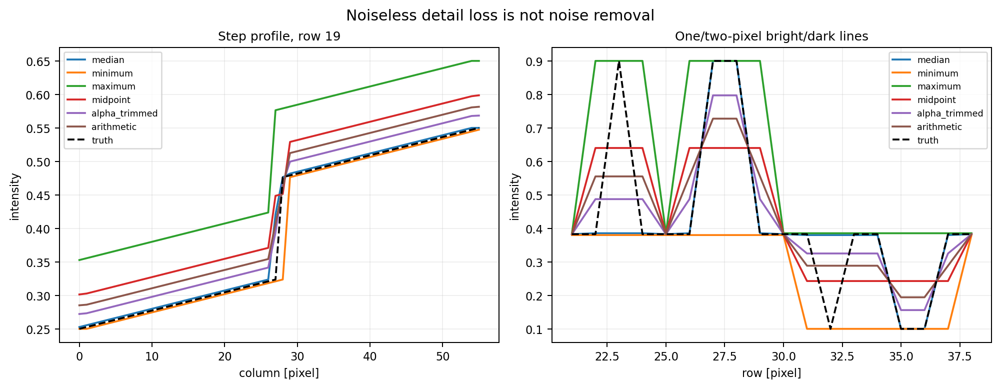
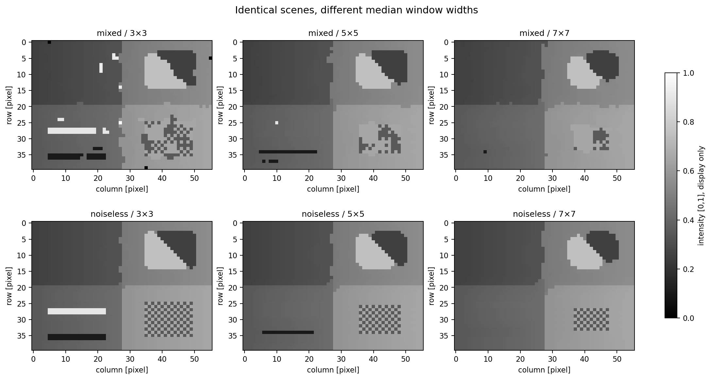

For a flat .5 scene, a 3×3 median is exactly .5 when at least five virtual
samples are clean. Reflected counts include repeated virtual samples, not
distinct physical pixels. More than four impulses can still yield .5 when
tails balance. Therefore no global deterministic probability threshold follows.
At p=1 every sample is 0 or 1, so an odd median cannot recover .5. Local counts,
clean-majority fractions and conditional recovery/error rates are retained.

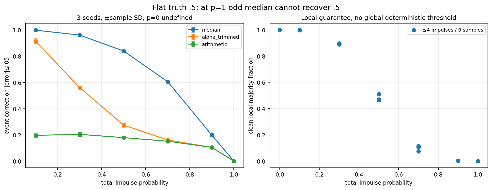
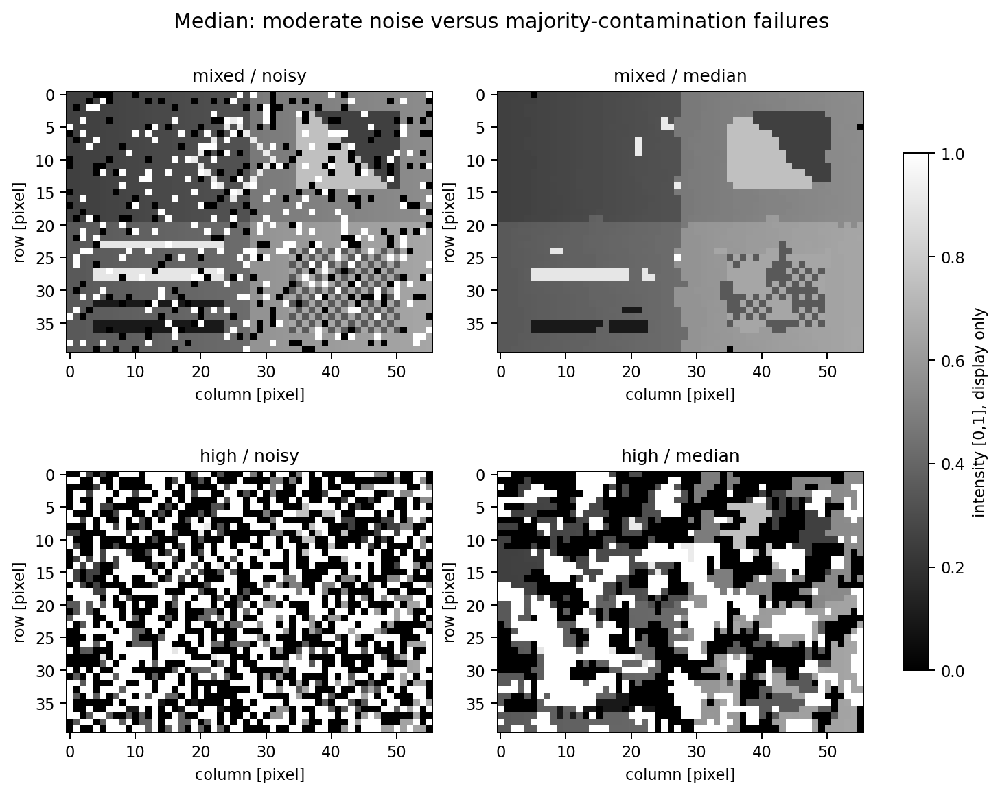
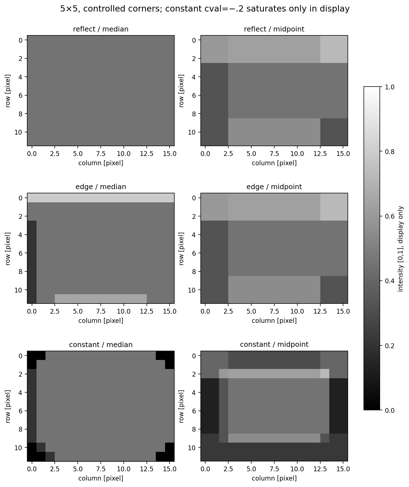
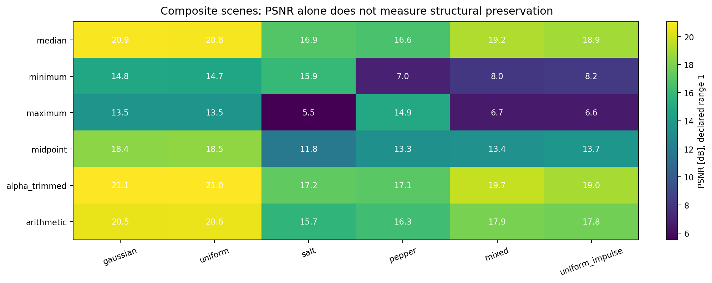

PSNR, correction rates and structure measures complement one another; none
alone determines perceptual quality or an automatically optimal window/d.

## Independent science and artifact audit

order_reference.py enumerates coordinates independently, folds reflection
indices, sorts Python samples and averages exact binary fractions. No production
filter, np.pad, sliding-window view or SciPy filter generates expected values.
Hand-calculated maps, ties, signed data, odd/even anchors, noncontiguous views,
singleton axes, constants, impulses, extremes and counterexamples are tested.

order_statistic_audit.py checks all array keys/dtypes/shapes/finiteness, all
ground-truth draws from direct formulas, full scalar metrics and structural
measurements, local majority counts, selected pixels from every ordinary result
and full stress maps against the literal oracle. It checks CSV/JSON coherence
and parsed values, not hashes alone. Selected-pixel auditing is not a proof of
every pixel for every possible input. Exact zeros/extrema/odd medians remain exact.

All **666 NPZ arrays, 310 table rows, 12 figures, 7 CSVs, metrics.json and
artifact manifest** are retained (22 scientific files). NPZ is pickle-free.
Main/trim/windows/density/calibration/boundaries/stress tables have respectively
54/30/36/63/72/15/40 rows. Canonical UTF-8 integrity permits equivalent LF/CRLF
only; bare CR, BOM, actual numeric/content modifications and binary corruption
fail. Tests intentionally rehash forged arrays, masks, metrics and truncated
PNGs; independent checks still reject them. CRLF conversion tests are idempotent
when the real Git patch has already supplied CRLF.

Verified PNG publication reuses the unchanged Chapter 04 in-memory encoding,
full decode, fsync and atomic replacement helper. Shared [0,1] grayscale limits
cause visualization-only saturation, explicitly including negative border values.
Full scientific arrays are never saturated. This rebuilt execution measured ordinary selected-pixel maximum absolute error
1.1102230246251565e−16 and relative error 3.642919299551296e−16. Stress
maximum relative error was 2.2204460492503126e−16; absolute error near FMAX
was 1.99584030953472e292. Full fresh validation logs accompany the review package.

## Run and reproduce

Use unchanged pinned requirements, from repository root:

```sh
python -m venv .venv
source .venv/bin/activate
python -m pip install -r requirements.txt
python chapter-labs/chapter-05-image-restoration/03-order-statistic-filters/experiment.py
python chapter-labs/chapter-05-image-restoration/03-order-statistic-filters/order_statistic_audit.py
python -m pytest -q chapter-labs/chapter-05-image-restoration/03-order-statistic-filters/tests
python -m pytest -q --import-mode=importlib -o norecursedirs=pytest-of-root chapter-labs
python scripts/validate_repository.py
```

PowerShell activation: `.\.venv\Scripts\Activate.ps1`. If blocked, use
`.\.venv\Scripts\python.exe` directly without changing execution policy.
Native Windows/Python 3.14 testing is not claimed; no extended longdouble is used.

Separate replay and audit:

```sh
python chapter-labs/chapter-05-image-restoration/03-order-statistic-filters/experiment.py --output-dir /path/to/fresh-output
python chapter-labs/chapter-05-image-restoration/03-order-statistic-filters/order_statistic_audit.py /path/to/fresh-output
```

Full `python scripts/validate_repository.py --regenerate` must run only in a
disposable exact-base snapshot with the complete binary patch applied. Decode
every assignment/lab PNG independently afterwards. A successful validator exit
does not prove the historical intermittent PNG defect fixed. Review logs
distinguish ordinary validation, regeneration and independent PNG results.

## Files, limitations and references

Production: order_statistic_filters.py. Independent oracle: order_reference.py.
Design/metrics: order_design.py, order_measurements.py. Reused public utilities:
order_support.py. Runner: experiment.py. Auditor: order_statistic_audit.py.
Automated coverage: tests/. Complete scientific evidence: output/.

Dense window memory and sorting cost limit large images/windows. Finite float64
rounding, fixed neighborhoods, detail destruction and distribution-specific
performance remain limitations. No adaptive filtering or Lab 04 is implemented.

References: supplied Chapter05-Art.pdf page descriptions 24–30 (PDF unavailable);
Gonzalez & Woods, *Digital Image Processing*, image-restoration/order-statistic
definitions; published repository Chapter 05 Labs 01–02 and Chapter 04 Labs
03/06 for unchanged noise/baseline, PNG and canonicalization utilities.
