# Chapter 05 · Lab 04 — Adaptive Noise Reduction and Adaptive Median

Two adaptive restoration algorithms are implemented directly with NumPy and
verified independently: local-statistics noise reduction (literal and explicitly
clipped variants) and the course's strict two-stage adaptive median. Original
synthetic scenes quantify restoration, parameter sensitivity, failures, genuine
detail destruction and diagnostic decisions. No adaptive method is universally best.

Course alignment follows the supplied descriptions of Chapter05-Art.pdf pages
31–36. **The PDF itself was not available; no direct PDF access is claimed.**
Periodic-noise filtering, inverse/Wiener deconvolution and later labs are outside scope.

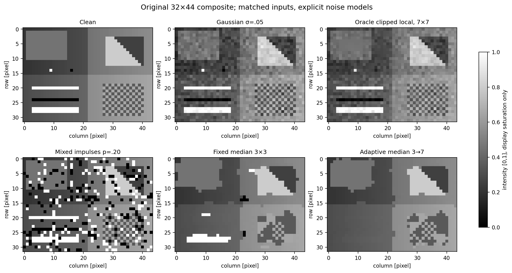

## Adaptive local noise reduction

For observed center g, local mean mL, population variance vL and known/assumed
additive-noise variance vη, the literal course formula for vL>0 is

$$\hat f=g-\frac{v_\eta}{v_L}(g-m_L)
=m_L+\left(1-\frac{v_\eta}{v_L}\right)(g-m_L).$$

The separately named **clipped** variant uses

$$w=\min(1,v_\eta/v_L),\qquad\hat f=g-w(g-m_L).$$

It is not silently substituted for the literal equation. The effective center
coefficient is α=1−vη/vL literally, and α=1−w in [0,1] when clipped. A literal
ratio above one extrapolates beyond the mean and can amplify errors.

| Condition | Explicit policy |
| --- | --- |
| vη=0 | Exactly return the promoted original observation |
| vL≫vη | Approach original center |
| vL=vη>0 | Return local mean within floating-point rounding |
| 0<vL<vη | Literal can overshoot; clipped uses w=1 |
| vL=0, vη>0 | Return local mean, including variance underflow to zero |
| Negative/nonfinite/bool variance | Reject |

No arbitrary epsilon replaces variance. The local population convention is
ddof=0. Mean/variance use differences from an actual window sample, a scaled
mean offset and scaled centered squares. This avoids catastrophic
E[g²]−E[g]² cancellation, overflowing sums and negative variance artifacts.
An exactly constant neighborhood has exactly zero variance. Underflowed
positive variance rounds to zero under the stated policy. A genuinely
unrepresentable float64 variance raises FloatingPointError instead of emitting
an invalid output. In particular opposite near-FMAX values cannot generally
have representable variance. Zero-noise identity without diagnostics bypasses
unneeded statistics even there. With diagnostics, the requested statistics must
be representable. A rare exact binary-rational fallback avoids spurious literal
ratio-times-deviation overflow; unrepresentable output or diagnostic weight raises.
No wider longdouble, hidden clipping or epsilon-modified samples are used.

Small neighborhoods give uncertain variance estimates; their population local
variance includes both noise and actual structure. Even in a flat field, ddof=0
has finite-sample bias (N−1)/N for independent zero-mean noise. Boundary replication
and overlapping windows create correlations; pixels are not independent trials.

## Adaptive median: exact course fallback

At each original center Zxy, start with an odd square (default 3×3). At each
size compute Zmin, Zmed, Zmax from the **original observation**.

1. Stage A passes iff Zmin<Zmed<Zmax (equivalent to A1>0 and A2<0).
2. If A passes, Stage B retains Zxy iff Zmin<Zxy<Zmax; otherwise return Zmed.
3. If A fails, grow the square by two while allowed.
4. If A still fails at Smax, **return original Zxy**, not the median.

Comparisons implement the strict signed-difference tests without risking
overflow on extreme finite intensities. Ties are not treated as strict interior
values. All-constant windows fail A and retain the original center at the limit.
No intensity is automatically classified as noise merely because it is 0 or 1.
Genuine extrema can still be replaced if A succeeds, while some isolated extrema
survive by fallback. This Smax fallback also means Smax=initial_size is **not**
universally equivalent to a fixed median: on an otherwise zero 3×3 window with
center 1, A fails and original 1 survives.

Production uses vectorized unresolved-pixel masks at successive window sizes;
the independent oracle recursively visits sizes per coordinate. No progressively
filtered neighbor enters later decisions. Positive odd initial_size (including 1)
and max_size≥initial_size are supported; even/bool/noninteger/nonpositive sizes fail.
The finite size sequence guarantees termination within resource limits.

## Public API and boundaries

```python
from adaptive_filters import (
    adaptive_local_noise_filter, adaptive_median_filter,
    local_statistics, estimate_noise_variance,
)
local = adaptive_local_noise_filter(image, (7, 7), noise_variance=.05**2,
                                    regularization='clipped', mode='reflect')
result, maps = adaptive_median_filter(image, initial_size=3, max_size=7,
                                      return_diagnostics=True)
estimated = estimate_noise_variance(image, (2, 10, 2, 14))
```

Inputs are nonempty finite real numeric 2D arrays, including signed integers,
negative floats, bool pixels, rectangular/singleton shapes and noncontiguous
views. Integer promotion above 2^53 may round. Complex (even imaginary zero),
object/string, invalid rank, empty, NaN and infinite inputs fail. All results are
new same-shape float64 arrays; inputs are never mutated. There is no uint8 cast
or scientific clipping. Shape/variance/cval/ROI parameters reject booleans.

Local-statistics windows accept odd/even rectangular positive integer shapes.
At output (y,x), offsets are dy−floor(m/2), dx−floor(n/2); even windows have the
extra sample above/left. Adaptive median uses centered odd squares only.

| Mode | Precise extension |
| --- | --- |
| reflect | NumPy reflection excluding edge sample (SciPy calls this mirror) |
| edge | Repeat nearest boundary value |
| constant | Explicit finite user cval outside image |

Singleton reflect repeats the sole sample; actual tests include wide windows
on singleton axes. Each median size pads from the same original image. All
methods share these semantics; cval must be finite real even if unused.

Optional local maps: mean, variance and weight. Optional adaptive-median maps:
size (last attempted width), expansions, stage_a_passed, stage_b_replaced,
retained, fallback, stage_a_failures, minimum, median, maximum. Boolean retained
includes Stage-B retention **and** fallback. Per pixel, A failures equal
expansions+fallback, so total A failures count attempts, while failed-pixel and
fallback counts count final failures. All maps retain original image coordinates.

## Known versus estimated variance

Oracle variance is σ² from simulation, explicitly unavailable in ordinary real
restoration. The practical estimator receives **only noisy observations and a
predeclared rectangle**, not the clean reference. ROI (rows 2:10, columns 2:14)
is designed as a flat region; its ddof=0 variance estimates noise under stationary
independent additive noise and approximately constant signal assumptions. It
has sampling uncertainty and finite-sample bias, and is not tuned on hidden truth.

A second ROI (12:24,22:32) deliberately crosses structure in the composite.
It inflates noise estimates by including signal variance. The same second ROI
in a separate constant calibration image is genuinely flat, so its label
`contaminated` denotes the selected ROI protocol, not guaranteed contamination.
Under/overestimation sweeps use controlled 0,.25,1,4,16 multiples of oracle
variance; these are sensitivity experiments, not estimated parameters.

For nonuniform noise the left half is noise-free and the right has σ=.08.
The nominal known right-half variance is applied globally to demonstrate the
stationary-model limitation. The flat ROI lies in the clean half and estimates
zero, causing the estimated variant to retain the noisy observation. For impulse
model-mismatch trials, the `assumed_mismatch` variance .0025 is clearly **not**
an oracle additive variance of categorical replacement noise.

Actual estimated variances and relative errors (estimate/σ²−1):

| Scene | Estimated variance | Relative error |
| --- | --- | --- |
| low | 0.00029005558 | 0.28914 |
| medium | 0.0020918974 | -0.16324 |
| high | 0.013917575 | -0.033502 |
| nonuniform | 0 | -1 |


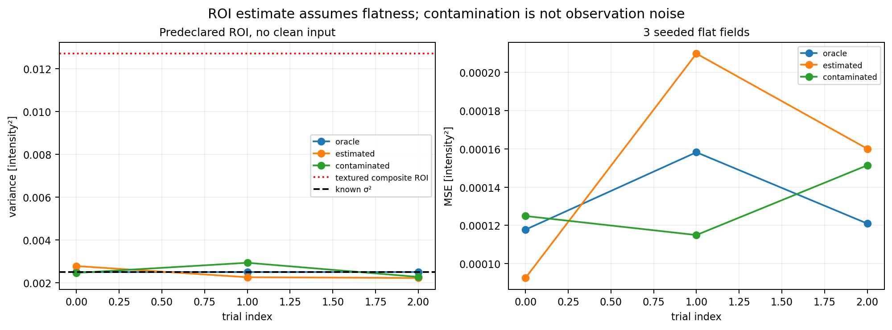
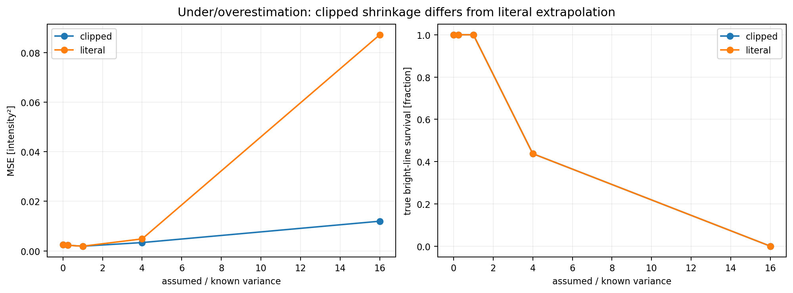

## Experiments and actual results

The original 32×44 scene contains flat gray, gradients, strong vertical/horizontal
steps, diagonal boundaries, thin genuine 0/1 lines, small dark/bright objects
and repetitive texture. A noiseless scene exposes false replacements. Separate
24×32 flat fields and a 12×16 corner-contaminated scene isolate statistical and
boundary behavior. A negative-valued scene is also included.

Published [Lab 01 noise](../01-noise-models-and-degradation/README.md),
[Lab 02 arithmetic mean](../02-mean-filters/README.md) and
[Lab 03 fixed median](../03-order-statistic-filters/README.md) are imported
unchanged. No fixed restoration implementation is copied.

Main Gaussian σ values .015,.05,.12 use recorded seeds 900–902; main impulse
rate is .20 total, severe .85. Labels −1/+1 record exact pepper/salt replacement
events. Gaussian fields use explicit generators; no global RNG state is used.
Density p=0,.1,.3,.5,.7,.9,1 is repeated with seeds 950–952 and Smax=3,5,7,9
against fixed median 3×3. Flat-variance calibration uses seeds 970–972.
Local window comparison uses 3,5,9 plus main 7; mean baselines use matched local
windows. Main fixed median 3×3 versus adaptive 3→7 is labeled as such.
Shared seeds across densities produce paired, correlated curves. Error bars
are across-seed **sample SD**, not confidence intervals or independent pixels.

Measured main PSNR [dB], declared intensity range L=1 (∞ means exact identity):

| Scene | Mean 7 | Median 3 | Clipped local | Literal local | Estimated local | Adaptive 3→7 |
| --- | --- | --- | --- | --- | --- | --- |
| low | 16.770 | 20.022 | 36.627 | 36.627 | 36.643 | 24.658 |
| medium | 16.777 | 20.067 | 27.240 | 27.235 | 27.140 | 23.509 |
| high | 16.765 | 19.106 | 21.632 | 21.610 | 21.588 | 19.318 |
| salt | 14.256 | 14.999 | 11.736 | 11.736 | 14.836 | 15.161 |
| pepper | 15.430 | 17.373 | 14.193 | 14.193 | 15.698 | 15.332 |
| mixed | 16.346 | 17.582 | 12.813 | 12.813 | 17.002 | 16.917 |
| severe | 14.236 | 7.119 | 6.168 | 6.168 | 14.129 | 11.409 |
| nonuniform | 16.758 | 19.368 | 25.782 | 25.272 | 25.585 | 17.270 |
| clean | 16.771 | 19.942 | ∞ | ∞ | ∞ | 16.733 |


The main local variants use 7×7. Impulse rows use the explicitly assumed mismatch
variance; nonuniform uses nominal right-half variance. Matched raw input and
oracle/estimated distinctions matter when interpreting these figures.

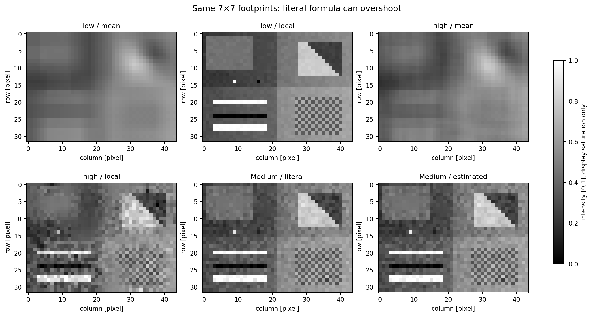
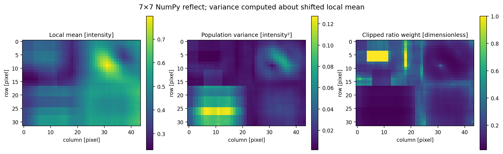
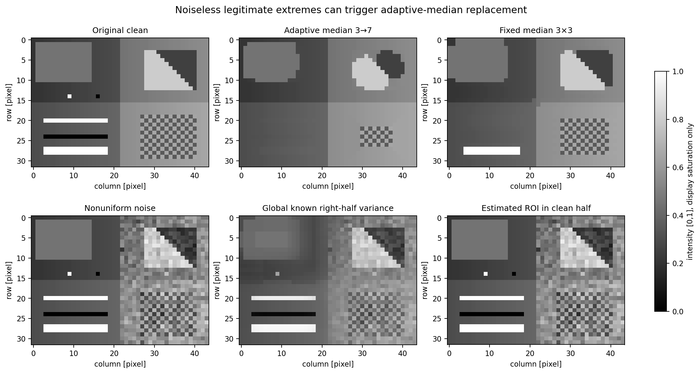
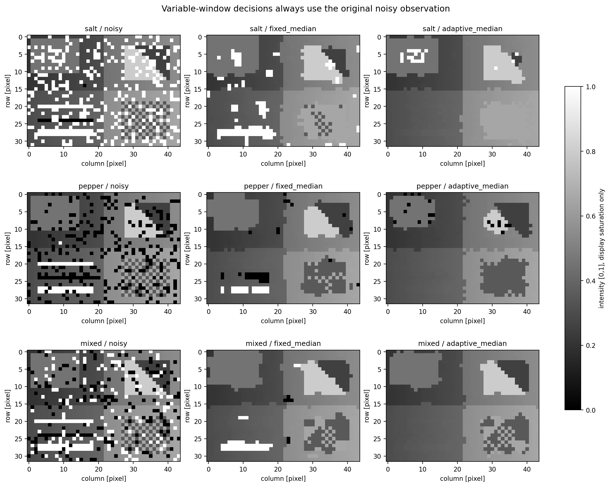
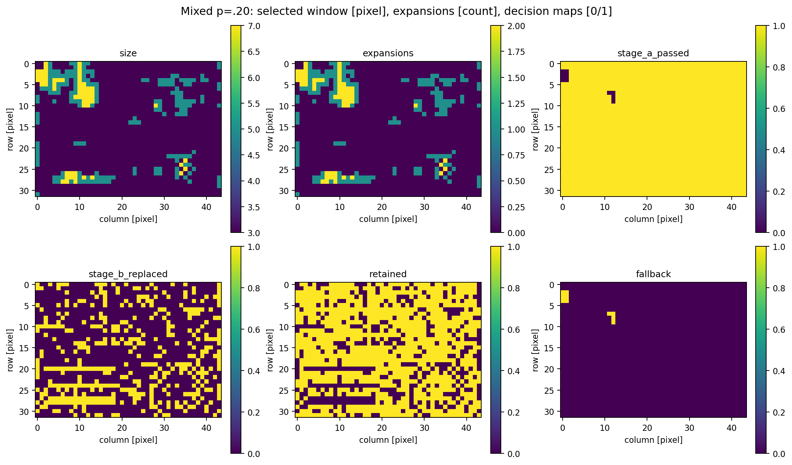
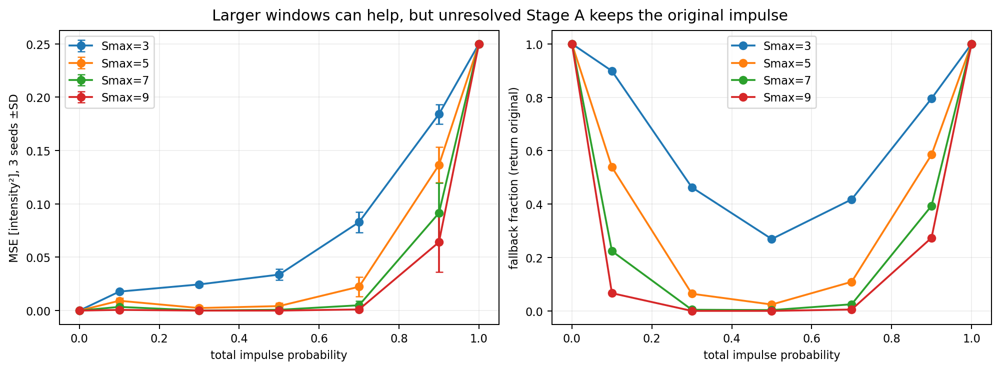
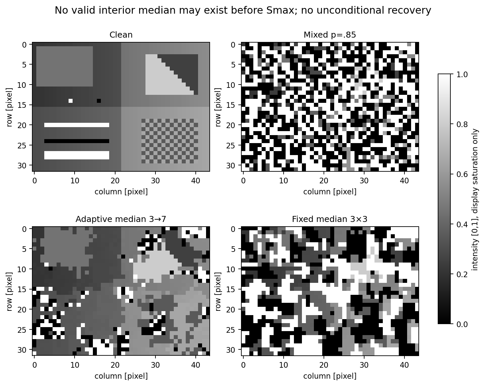
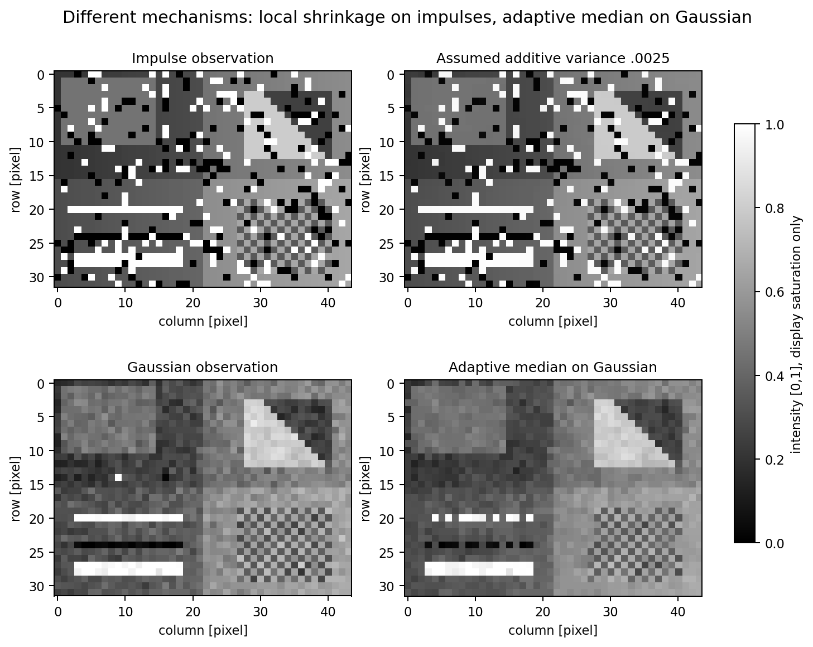
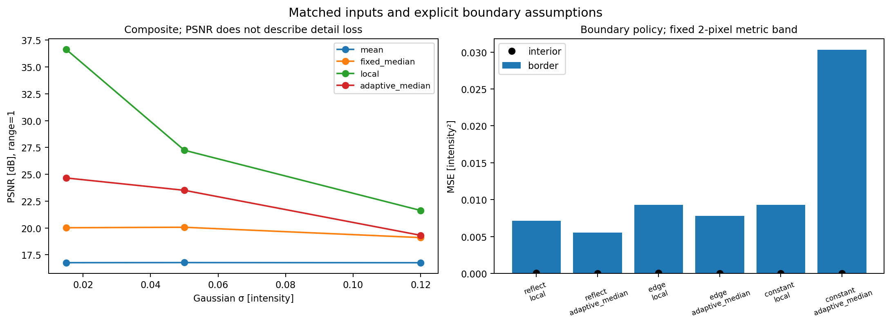

The measured adaptive local filter preserves this composite better than a wide
mean under Gaussian corruption. That is not universal superiority: parameter
overestimation, model mismatch and genuine signal variance can cause loss.
Adaptive median improves the severe-noise example over the small fixed median,
but its moderate mixed-noise PSNR is worse here, and it damages noiseless
genuine extrema. At p=1 an odd-window median is always an endpoint; A can fail
all sizes and the original noise is retained. Increasing Smax does not ensure
recovery and can remove real details. PSNR alone is not perceptual quality.

## Measurements and independent verification

$$\operatorname{MSE}=K^{-1}\sum e_i^2,\quad\operatorname{RMSE}=\sqrt{MSE},\quad
\operatorname{MAE}=K^{-1}\sum|e_i|,\quad\operatorname{PSNR}=10\log_{10}(L^2/MSE),\ L=1.$$

All calculations use full-precision arrays, not PNGs. Zero MSE has null JSON
PSNR representing positive infinity; empty masks yield null rather than a
meaningless rate. Bias and population residual variance are recorded. Event
masks mean categorical replacements for impulses, every pixel for Gaussian,
only the right half for spatially nonuniform noise, none for noiseless input.
Correction means |output−truth|≤.05 on event pixels. False alteration means
|output−observation|>1e−12 on non-event pixels. It does not guarantee correctness.
Gradient RMSE compares adjacent-column differences; a two-pixel border band is
reported separately. Original flat/edge/texture/line/object masks retain regional
MSE and intensity survival within .1 of truth; survival is not a connectivity metric.
Variance errors, full window histograms and all diagnostic counts are stored.

The independent oracle literally enumerates coordinates, computes exact binary
rational means/variances/formula values and recursively follows strict median
stages. It does not call production algorithms or np.pad/sliding windows.
Hand examples, equality/zero/large/small variance, overshoot, strict ties,
original-center fallback, actual expansions, near-constant large values,
rectangular/singleton/view inputs and corruption rejection are tested.

Standalone adaptive_filter_audit.py verifies binary size/hash/PNG decode,
pickle-free NPZ shape/dtype/finiteness/key inventory, direct independent random
draws/masks, independent ROI variance, selected formula and Stage A/B pixels
from every ordinary map, full boundary/stress maps, all aggregate metrics,
regional measurements, window/count consistency and CSV/JSON coherence. Selection
is not a proof of every pixel for every possible input. Hashes alone are insufficient;
intentionally rehashed outputs/diagnostics/masks/metrics and truncated PNGs fail.
LF/CRLF equivalence is canonical UTF-8 only; bare CR, BOM, modified scientific
content and binary corruption fail. CRLF tests are idempotent on actual Git CRLF.

Actual initial audit: 2925 independent ordinary reference pixels; max absolute
output error 2.220446049250313e−16, max relative 4.881376889291554e−15;
local variance max relative 5.551115123125782e−16. Stress max absolute error
1.734723475976807e−18, relative 4.625929269271486e−16. Tolerances were not
weakened after failures. Near zero, exact checks and stress-relative comparisons
without arbitrary absolute floors supplement ordinary scaled tolerances.

**All 1639 arrays, 215 numerical rows, 12 original PNGs, 7 CSVs, metrics.json,
reference_arrays.npz and artifact_manifest.json are retained: 22 scientific files.**
Local and median diagnostic maps are included, not discarded. PNG publication
reuses unchanged verified in-memory encoding, fsync and atomic replacement.
Image panels share [0,1] display limits, which saturate only visualization;
local-statistic/decision maps have labeled color scales. Scientific data are unclipped.

## Run and reproduce

Use unchanged pinned requirements, from repository root:

```sh
python -m venv .venv
source .venv/bin/activate
python -m pip install -r requirements.txt
python chapter-labs/chapter-05-image-restoration/04-adaptive-noise-filters/experiment.py
python chapter-labs/chapter-05-image-restoration/04-adaptive-noise-filters/adaptive_filter_audit.py
python -m pytest -q chapter-labs/chapter-05-image-restoration/04-adaptive-noise-filters/tests
python -m pytest -q --import-mode=importlib -o norecursedirs=pytest-of-root chapter-labs
python scripts/validate_repository.py
```

PowerShell activation: `.\.venv\Scripts\Activate.ps1`. If policy blocks activation,
use `.\.venv\Scripts\python.exe` directly, without changing policy.
Native Windows/Python 3.14 validation is not claimed; no extended longdouble is used.

Lab-only replay:

```sh
python chapter-labs/chapter-05-image-restoration/04-adaptive-noise-filters/experiment.py --output-dir /path/to/fresh-output
python chapter-labs/chapter-05-image-restoration/04-adaptive-noise-filters/adaptive_filter_audit.py /path/to/fresh-output
```

Complete `python scripts/validate_repository.py --regenerate` belongs only in a
disposable exact-base snapshot with the binary patch applied. Independently decode
every assignment/lab PNG afterwards. Validator success alone does not establish
PNG integrity or permanently fix the historical intermittent truncation issue.
Review evidence separates normal validation, regeneration and independent scans.

## Complexity, files and limitations

Local dense windows require O(HWmn) work/memory. Adaptive median tries odd
sizes up to Smax; its partition work is O(HW sum s²), plus padded/dense storage
O(HW Smax²) in this vectorized educational implementation. Diagnostic storage
also scales with image size. No speed or universal optimality claim is made.

adaptive_filters.py is importable production; adaptive_reference.py is the
independent oracle; adaptive_design.py/measurements.py specify experiments;
adaptive_support.py imports protected APIs; experiment.py generates artifacts;
adaptive_filter_audit.py independently audits; tests/ and output/ retain evidence.

Limits include fixed stationary-noise assumptions, flat-ROI contamination,
small-window uncertainty, finite precision/representability, memory costs,
genuine-feature replacement and original-center fallback at severe corruption.
No inverse/deconvolution/frequency-domain method or Lab 05 is implemented.

References: supplied Chapter05-Art.pdf descriptions, pages 31–36 (PDF unavailable);
Gonzalez & Woods, *Digital Image Processing*, adaptive restoration definitions;
published Chapter 05 Labs 01–03 and Chapter 04 Labs 03/06 for unchanged noise,
baselines, PNG publication and portable integrity utilities. The supplied slide's
original-center fallback is followed explicitly where other references differ.
